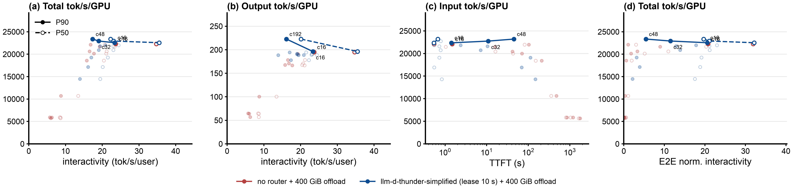
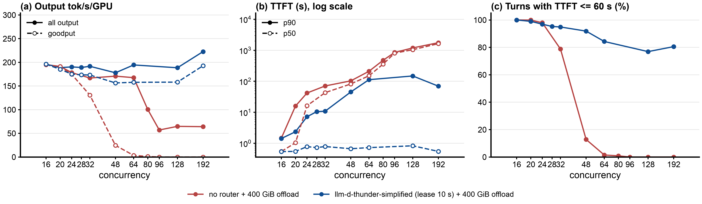
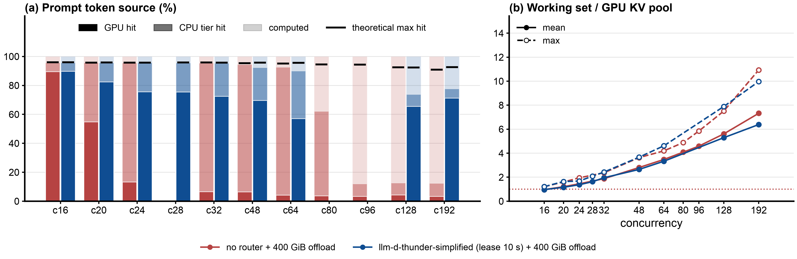
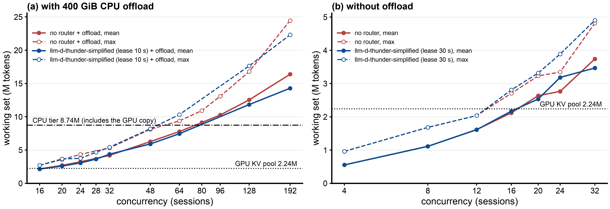
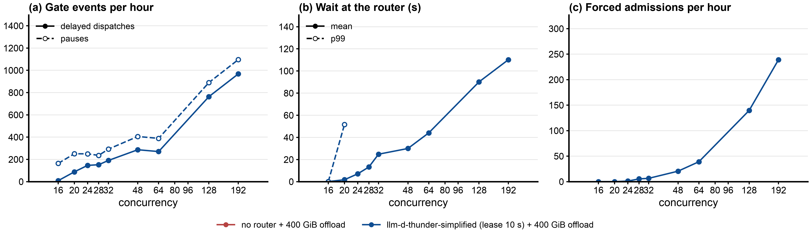
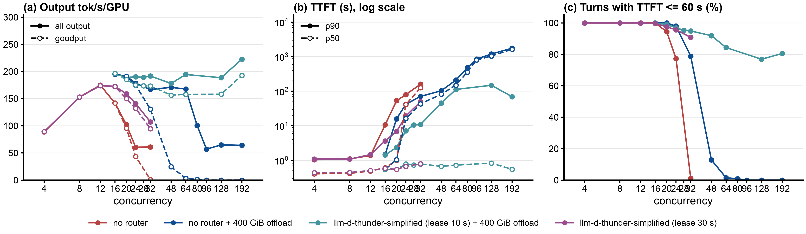
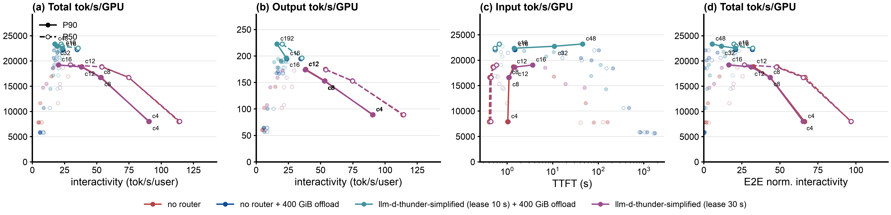

# Benchmark report: llm-d-thunder-simplified (lease 10 s) vs no-router, both with 400 GiB CPU KV offload, on one vLLM replica, Qwen3-Coder-30B-A3B-FP8, AgentX replay of real Claude Code traffic (Weka trace)

Step 24, 2026-10-09 to 12. This report compares two arms only; the full step 24 report with all arms is [REPORT.md](REPORT.md), raw data and scripts are in this folder ([README.md](README.md); per-point links, including aiperf's swim-lane HTML, in section 9), and the interactive charts are at https://zetxqx.github.io/thunderagent-original-verification/.

## 1. Executive summary

**Objective:** with a 400 GiB CPU KV offload tier on the vLLM pod, compare llm-d-thunder-simplified, the `thunder-agent` admission control plugin of llm-d-router PR3 (idle lease 10 s), against sending every request directly to the pod, across concurrency; and measure what the offload tier itself changes.

**Key findings:**

- **Up to c = 24 the two arms are close** (178 to 196 output tok/s/GPU, 97% to 100% of turns within a 60 s TTFT SLO), but the no-router arm's median TTFT already rises to 16 s at c = 24 against 0.8 s.
- **From c = 32 thunder-agent keeps latency, no-router keeps only throughput.** At c = 32 to 64 both reach 167 to 194 output tok/s/GPU (thunder-agent 4% to 15% higher), but no-router's median TTFT is 43 to 150 s (79% down to 1% of turns within the SLO) against 0.7 to 0.8 s for thunder-agent (95% to 84%).
- **Past the CPU tier, no-router collapses and thunder-agent does not.** At c = 128 and 192 thunder-agent gives **2.9x to 3.5x the output throughput** (189 to 223 vs 64 to 65 tok/s/GPU), **3.5x to 5.5x the requests/s**, a prefix hit rate of 0.74 to 0.78 against 0.12 to 0.13, and 77% to 81% of turns within the SLO against 0%.
- **The cost is the tail of the requests that do get served.** p99 TTFT is 1.5x to 10x worse with thunder-agent (c = 64: 2028 vs 258 s), because held sessions wait up to thunder-agent's 1800 s forced admission. Counting turns that never got a first token, thunder-agent is better at high load: turns waiting over 25 minutes or never served are 13% for thunder-agent against 22% to 56% for no-router at c = 128 to 192.
- **CPU offload helps both arms on a per-GPU basis**: no-router's cliff moves from c = 20 to 24 out to c = 64 to 80, and thunder-agent's throughput at c = 32 rises from 107 to 192 tok/s/GPU. **But on this node type the 450 GiB per pod allows only one pod per node**, so per node (4 GPUs) thunder-agent without offload on two pods still gives more throughput than thunder-agent with offload on one pod at 32 to 64 sessions per node (section 8).

## 2. Setup and environment

- **Hardware:** one vLLM pod on 2x NVIDIA H100 80GB (tensor parallel 2), GKE spot nodes a3-highgpu-4g (4 H100s, 895 GiB allocatable memory per node). With the 400 GiB tier each pod needs 450 GiB, so one pod per node.
- **Host:** the vLLM pod requests 8 CPU and is limited to 16 CPU; memory 450 GiB, `/dev/shm` 410 GiB (without offload: 96 GiB requested, 128 GiB limit).
- **Serving engine and version:** `vllm/vllm-openai:v0.28.0`.
- **Model configuration:** `Qwen/Qwen3-Coder-30B-A3B-Instruct-FP8` (mixture of experts, 30B total, 3B active), TP=2, `--max-model-len 262144`, FP8 weights, `--kv-cache-dtype fp8_e4m3`, `--gpu-memory-utilization 0.88`, chunked prefill and prefix caching on. GPU KV pool: 139,815 blocks x 16 tokens = **2,237,040 tokens** (48 KiB per token, about 102 GiB).
- **CPU offload:** vLLM's native offloading connector, `--kv-offloading-size=400` (GiB over both TP ranks) = **8,738,133 tokens, 3.9x the GPU pool**. The connector copies every computed block to CPU, so the tier holds a copy of the GPU contents: a pod keeps about the tier size, not GPU plus CPU.
- **Router under test:** llm-d-router endpoint picker, PR3 ([llm-d/llm-d-router#3076](https://github.com/llm-d/llm-d-router/pull/3076)) at `a025437b` plus a `Produces()` declaration ([thunder-produces.patch](thunder-produces.patch)), image `llm-d-router-endpoint-picker:thunder-agent-pr3-a025437b-produces`, one EPP and envoy per pod.
- **Benchmark tool:** aiperf, AgentX harness fork image `agentx-harness:agentx-v1.0.6`, `aiperf profile --scenario agentx`, one Kubernetes Job per point.

## 3. Workload and traffic

- **Dataset:** `semianalysis_cc_traces_weka_062126_256k`, real Claude Code sessions with subagents, replayed as session trees with their recorded tool-call gaps (median gap between turns about 1.7 s, p90 9 to 19 s, capped at 300 s).
- **Input / output token lengths** (steady state, varies by point): prompt median 41k to 98k tokens, p90 87k to 200k, max about 256k. Output median 260 to 460 tokens, mean 620 to 960.
- **Concurrency levels tested** (concurrent session trees): both arms at c = 16, 20, 24, 32, 48, 64, 128, 192; no-router also at c = 80 and 96; thunder-agent also at c = 28.
- **Test duration / warm-up:** 60 minutes of profiling per point after an AgentX warmup (10 requests per lane with no idle delay). The first 5 minutes of profiling run below the target concurrency, so **steady-state numbers use requests started after minute 5**. A fresh vLLM pod (and a fresh EPP) for every point, first-turn cache busting, seed 42.
- **Runs:** one run per arm and concurrency. Earlier steps measured 2% to 6% run-to-run variance; differences within about 5% are ties.

## 4. Test arms

- **Arm 0 (baseline), "no-router":** no router; the client calls the vLLM pod's Service and every request goes to the pod at once. 400 GiB CPU offload.
- **Arm 1, "llm-d-thunder-simplified (lease 10 s)":** the `thunder-agent` plugin, a simplified llm-d port of ThunderAgent; the client calls the pod's EPP with an `X-Session-ID` header. Thunder-agent keeps a ledger of admitted sessions (each session's size is its last turn's total tokens, or the estimate of its turns in flight) against the pod's GPU KV capacity, read from vLLM (2,237,040 tokens; the CPU tier is not counted). Turns of admitted sessions always pass; a new session passes when it fits, a paused one when its own pod has room; a session idle for more than **10 s** (`idleLeaseSeconds: 10`, the same in every point's EPP ConfigMap) after its last response gives up its room when another session needs it (it is paused, and its prefix is usually still in the CPU tier); smaller sessions go first; a request held for 1800 s is admitted regardless (`headWaitStarvationMs`, PR3 setting used throughout step 24). `utilThreshold` 1.0, flow control TTL 0, envoy ext_proc timeout 2400 s. 400 GiB CPU offload.

## 5. Results

Steady state, one run per point. TTFT in seconds; ITL in ms, per request ((latency - TTFT) / (output tokens - 1)), percentiles over requests. "In flight": mean requests in flight at the client (including any wait at the router) / mean requests running in vLLM. Errors and requests with no first token at the end of the run count as misses of the 60 s TTFT SLO.

| c | arm | in flight: client / vLLM | p50 TTFT | p90 TTFT | p99 TTFT | p50 ITL | p99 ITL | output tok/s/GPU | requests/s | steady hit rate (GPU + CPU) | TTFT <= 60 s |
|---|---|---|---|---|---|---|---|---|---|---|---|
| 16 | no-router | 11.6 / 11.5 | 0.5 | 1.5 | 9 | 29 | 58 | 195 | 0.43 | 0.96 | 100% |
| 16 | llm-d-thunder-simplified (lease 10 s) | 11.6 / 11.6 | 0.5 | 1.4 | 10 | 28 | 62 | 196 | 0.44 | 0.96 | 100% |
| 20 | no-router | 18.7 / 16.8 | 1.0 | 15.9 | 38 | 43 | 76 | 191 | 0.47 | 0.96 | 100% |
| 20 | llm-d-thunder-simplified (lease 10 s) | 17.0 / 16.5 | 0.5 | 2.4 | 56 | 41 | 69 | 189 | 0.48 | 0.96 | 99% |
| 24 | no-router | 25.8 / 18.1 | 16.3 | 41.8 | 70 | 47 | 81 | 178 | 0.44 | 0.96 | 98% |
| 24 | llm-d-thunder-simplified (lease 10 s) | 21.8 / 17.3 | 0.8 | 7.2 | 309 | 43 | 72 | 190 | 0.42 | 0.96 | 97% |
| 28 | llm-d-thunder-simplified (lease 10 s) | 25.6 / 17.2 | 0.7 | 10.5 | 472 | 44 | 72 | 189 | 0.43 | 0.96 | 95% |
| 32 | no-router | 34.4 / 17.2 | 43.0 | 70.7 | 97 | 47 | 81 | 167 | 0.41 | 0.96 | 79% |
| 32 | llm-d-thunder-simplified (lease 10 s) | 31.0 / 17.3 | 0.8 | 10.9 | 976 | 43 | 76 | 192 | 0.48 | 0.95 | 95% |
| **32** | **ratio, llm-d-thunder-simplified vs no-router** | | **54x lower** | **6.5x lower** | **10x higher** | same | same | **1.15x** | **1.17x** | same | |
| 48 | no-router | 56.5 / 18.7 | 81.8 | 103.0 | 146 | 48 | 107 | 171 | 0.48 | 0.95 | 13% |
| 48 | llm-d-thunder-simplified (lease 10 s) | 42.4 / 18.6 | 0.7 | 45.2 | 1802 | 45 | 119 | 178 | 0.54 | 0.92 | 92% |
| 64 | no-router | 80.7 / 20.7 | 150.3 | 209.8 | 258 | 49 | 134 | 168 | 0.41 | 0.93 | 1% |
| 64 | llm-d-thunder-simplified (lease 10 s) | 56.9 / 20.7 | 0.7 | 112.6 | 2028 | 47 | 110 | 194 | 0.45 | 0.90 | 84% |
| **64** | **ratio, llm-d-thunder-simplified vs no-router** | | **215x lower** | **1.9x lower** | **7.9x higher** | same | **1.2x lower** | **1.15x** | **1.10x** | same | |
| 80 | no-router | 104.4 / | 356.3 | 474.8 | 514 | 74 | 188 | 100 | 0.25 | 0.62 | 1% |
| 96 | no-router | 110.7 / 20.7 | 805.1 | 848.9 | 893 | 116 | 223 | 57 | 0.13 | 0.12 | 0% |
| 128 | no-router | 158.9 / 23.8 | 1042.5 | 1190.9 | 1217 | 119 | 316 | 65 | 0.15 | 0.13 | 0% |
| 128 | llm-d-thunder-simplified (lease 10 s) | 95.8 / 29.1 | 0.8 | 148.4 | 2662 | 51 | 183 | 189 | 0.53 | 0.74 | 77% |
| **128** | **ratio, llm-d-thunder-simplified vs no-router** | | **1300x lower** | **8.0x lower** | **2.2x higher** | **2.3x lower** | **1.7x lower** | **2.9x** | **3.5x** | **5.7x** | |
| 192 | no-router | 207.1 / 22.0 | 1636.3 | 1754.3 | 1784 | 116 | 319 | 64 | 0.13 | 0.12 | 0% |
| 192 | llm-d-thunder-simplified (lease 10 s) | 102.9 / 31.8 | 0.5 | 69.5 | 2727 | 50 | 143 | 223 | 0.71 | 0.78 | 81% |
| **192** | **ratio, llm-d-thunder-simplified vs no-router** | | **3300x lower** | **25x lower** | **1.5x higher** | **2.3x lower** | **2.2x lower** | **3.5x** | **5.5x** | **6.5x** | |

**Pareto (throughput against interactivity and TTFT):**

Lines connect only each arm's Pareto frontier (P90 solid, P50 dashed): the points that no other point of the same arm beats on both axes. Dominated points stay as faint markers without labels. No-router's frontier is a single point, c = 16 (195 output tok/s/GPU at 23.7 tok/s/user P90): every higher concurrency gives both less throughput and slower users. Thunder-agent's frontier in (b) runs from c = 16 (196 tok/s/GPU, 23.4 tok/s/user) to c = 192 (223 tok/s/GPU, 16.1 tok/s/user); in (a) and (d) from c = 16 to c = 48 (23,370 total tok/s/GPU). At c = 16 the two arms are the same point; thunder-agent adds frontier points with more throughput at lower interactivity, which no-router never reaches. c = 192 is on the frontier only on the steady-state averages; its tail (p99 TTFT 2,727 s) is not in these panels.

**Throughput, TTFT and SLO share against concurrency:**

**Where the prompt tokens come from, and the working set:**

**Working set against the GPU KV pool and the CPU tier:**

Working set: the latest prompt length of every live session (between its first and last request, including sessions waiting on a tool call), summed, sampled every 5 s over the steady state; solid is the mean, dashed the peak. It is the prefix set a cache needs to keep every session's next turn a hit. The CPU tier line is the tier size (8.74M tokens): it holds a copy of the GPU blocks, so the server keeps about 8.74M distinct tokens, not GPU plus CPU.

- **With offload (a):** the mean working set passes the GPU pool at c = 16 to 20 and the CPU tier between c = 64 and 80 (no-router: 7.78M mean and 9.38M peak at c = 64, 9.13M mean at c = 80). This is where no-router collapses: hit rate 0.93 at c = 64, 0.62 at c = 80, 0.12 at c = 96. llm-d-thunder-simplified's working set grows the same way (14.3M mean at c = 192, 1.6x the tier), but it keeps the admitted sessions near the GPU pool, so its hit rate stays at 0.74 to 0.78 at c = 128 and 192.
- **Without offload (b):** the mean working set reaches the GPU pool at c = 16 (2.12M, peak 2.71M), and no-router's hit rate falls from 0.84 at c = 16 to 0.56 at c = 20 and 0.13 at c = 24.

**Thunder-agent events:**

### 5.1 Other measured facts

| | no-router c32 | llm-d-thunder-simplified c32 | no-router c64 | llm-d-thunder-simplified c64 | no-router c128 | llm-d-thunder-simplified c128 | no-router c192 | llm-d-thunder-simplified c192 |
|---|---|---|---|---|---|---|---|---|
| prompt tokens from GPU cache / CPU tier / computed | 7 / 89 / 4% | 72 / 23 / 5% | 4 / 88 / 7% | 57 / 33 / 10% | 4 / 8 / 87% | 66 / 8 / 26% | 3 / 9 / 88% | 71 / 7 / 22% |
| requests with zero cache hit (client usage) | 1% | 2% | 3% | 4% | 62% | 8% | 70% | 4% |
| vLLM waiting queue, mean | 18.1 | 0.4 | 65.8 | 8.9 | 189.1 | 39.7 | 288.3 | 76.7 |
| working set of live sessions / GPU KV pool, mean | 1.88 | 1.96 | 3.48 | 3.33 | 5.60 | 5.29 | 7.32 | 6.39 |
| thunder-agent ledger / GPU capacity, mean | | 1.01 | | 1.55 | | 3.03 | | 4.79 |
| requests held at the router, peak | 0 | 24 | 0 | 62 | 0 | 158 | 0 | 247 |
| forced admissions (after 1800 s) | 0 | 6 | 0 | 36 | 0 | 128 | 0 | 220 |
| requests with no first token at the end (SLO misses) | 4 | 0 | 61 | 37 | 216 | 207 | 284 | 259 |
| turns waiting over 25 min or never served | 0.2% | 0.4% | 3.7% | 4.3% | 21.6% | 13.0% | 55.6% | 12.8% |
| completed requests (whole run) | 1,594 | 1,810 | 1,601 | 1,733 | 785 | 2,104 | 752 | 2,814 |
| turns per session tree, median | 23 | 25 | 14 | 11 | 3 | 3 | 2 | 1 |
| worst TTFT per session tree, p90 (s) | 105 | 1,807 | 262 | 2,107 | 1,210 | 2,673 | 1,770 | 2,825 |
| vLLM preemptions | 171 | 18 | 287 | 75 | 87 | 20 | 105 | 29 |
| output tok/s/GPU, minutes 5 to 30 / 36 to 60 | 195 / 164 | 206 / 190 | 206 / 193 | 279 / 122 | 110 / 90 | 392 / 69 | 81 / 86 | 467 / 73 |
| router CPU | not measured | | | | | | | |

### 5.2 Errors

- **Request errors:** 0 in every point of both arms.
- **Requests unfinished at the end** (cancelled by aiperf after the grace period): no-router 2 to 315, thunder-agent 2 to 274 (more at higher c); those without a first token count as SLO misses in both arms.
- **Failed runs:** four first attempts in these two arms failed and were rerun: thunder-agent c32 and c64 and no-router c20 hit "CUDA error: an illegal memory access" in vLLM, all on one bad spot node; no-router c80 hit a "Connection reset by peer" on a warmup request (aiperf reused a connection vLLM had just closed). Details: [README.md](README.md), "Failed runs and lessons".

## 6. Analysis

- **Primary bottleneck: GPU KV capacity for running requests.** vLLM runs only 17 to 32 requests at a time in both arms, because a running request's whole context must sit in GPU KV (2.24M tokens). The CPU tier only stores prefixes; a hit there still has to be copied back to the GPU before the request can run.
- **No-router: high hit rate, long queue.** With offload, the no-router arm keeps a 0.93 to 0.96 hit rate up to c = 64, almost all from the CPU tier (82% to 89% of prompt tokens at c = 24 to 64). But every request is sent at once, so from c = 24 requests pile up in vLLM's queue (18 to 66 waiting on average at c = 32 to 64) and the median TTFT grows to 43 to 150 s. Past c = 64 the working set outgrows the CPU tier (3.5x the GPU pool at c = 64, 4.1x at c = 80, against a 3.9x tier), blocks are evicted from the tier before reuse, and the arm collapses: 88% of prompt tokens recomputed, 57 to 65 tok/s/GPU, median TTFT 800 to 1,640 s.
- **Thunder-agent: short queue, GPU-resident working set.** Thunder-agent keeps its admitted ledger at about 1.0x the GPU pool until the forced admissions start, so vLLM's queue stays near 0 (0.4 at c = 32) and the median TTFT below 1 s at every concurrency. Most reuse comes from the GPU cache (57% to 72%); the CPU tier adds 23% to 33% at c = 32 to 64, mostly prefixes of sessions it paused, which now come back by copy instead of recompute. At c = 128 and 192 it still serves 2,100 to 2,800 requests in the hour against about 770 for no-router.
- **Trade-off: median latency and throughput against a long tail.** Smallest-first ordering lets large sessions wait up to the 1800 s forced admission: the worst turn per session reaches 1,800 to 2,800 s and p99 TTFT of served requests is 1.5x to 10x no-router's. After minute 30 the forced admissions arrive in bursts and the cache collapses for the rest of the run (c = 192: 467 tok/s/GPU in minutes 5 to 30, 73 in minutes 36 to 60), so the hour-long averages above sit between thunder-agent working and thunder-agent collapsed. No-router has its own tail at high load: 22% to 56% of turns wait over 25 minutes or are never served at c = 128 and 192, against 13% for thunder-agent.

## 7. Caveats

One run per point; one workload (AgentX replay of one trace); one pod per arm (no multi-pod routing); a 60-minute window, which decides when the 1800 s forced admission fires; AgentX is closed loop, so a faster arm completes more requests and sees a slightly different request mix (compare completed requests, not only rates).

## 8. What the CPU offload tier changes

Same pod, same workload, without and with the 400 GiB tier. Thunder-agent without offload ran with a 30 s lease (with offload, 10 s and 30 s give the same results within about 5%, [REPORT.md](REPORT.md) section 6).

**Per GPU:**

| c | no-router, no offload | no-router + offload | llm-d-thunder-simplified (lease 30 s), no offload | llm-d-thunder-simplified (lease 10 s) + offload |
|---|---|---|---|---|
| 16 | 142 tok/s/GPU, hit 0.84, p50 TTFT 0.6 s, 100% | 195, 0.96, 0.5 s, 100% | 173, 0.90, 0.6 s, 100% | 196, 0.96, 0.5 s, 100% |
| 20 | 102, 0.56, 1.0 s, 94% | 191, 0.96, 1.0 s, 100% | 159, 0.87, 0.5 s, 98% | 189, 0.96, 0.5 s, 99% |
| 24 | 61, 0.13, 40.9 s, 77% | 178, 0.96, 16.3 s, 98% | 141, 0.80, 0.7 s, 96% | 190, 0.96, 0.8 s, 97% |
| 32 | 61, 0.11, 126 s, 1% | 167, 0.96, 43 s, 79% | 107, 0.70, 0.8 s, 91% | 192, 0.95, 0.8 s, 95% |

(Each cell: output tok/s/GPU, steady hit rate, p50 TTFT, turns with TTFT <= 60 s.)

Same drawing: lines are each arm's Pareto frontier, dominated points are faint markers.

- **No-router:** the tier keeps the hit rate at 0.96 where the GPU alone falls to 0.11 to 0.13, and moves the throughput cliff from c = 20 to 24 out to c = 64 to 80, which matches the working set reaching the tier size (3.9x the GPU pool). It does not fix latency: with every request sent at once, the vLLM queue still grows (median TTFT 16 to 43 s at c = 24 to 32 instead of 41 to 126 s).
- **Thunder-agent:** without offload, pausing a session costs a full recompute when it returns, and the hit rate falls to 0.70 at c = 32; with offload the paused prefix comes back from the CPU tier, the hit rate stays at 0.95, throughput at c = 32 rises from 107 to 192 tok/s/GPU, and p90 TTFT drops from 50 s to 11 s. The tier also delays the forced admissions (c = 32: 6 instead of 13).
- **Thunder-agent barely uses the tier at high load:** sized to the GPU pool, it keeps the admitted set GPU-resident; at c = 128 and 192 only 7% to 8% of prompt tokens come from the CPU tier. Sizing thunder-agent's capacity to the tier (8.74M tokens, possible by config) was not run in this step.

**Per node (4 GPUs):** a pod with the 400 GiB tier needs 450 GiB, and two do not fit the 895 GiB of an a3-highgpu-4g node, so with offload a node runs one pod and two GPUs stay idle; without offload it runs two pods. For the same number of sessions per node:

| sessions per node | no-router, no offload (2 pods) | no-router + offload (1 pod) | llm-d-thunder-simplified (lease 30 s), no offload (2 pods) | llm-d-thunder-simplified (lease 10 s) + offload (1 pod) |
|---|---|---|---|---|
| 32 (2 x c16 or 1 x c32) | **568** tok/s, 100% | 334, 79% | **692**, 100% | 384, 95% |
| 48 (2 x c24 or 1 x c48) | 244, 77% | 342, 13% | **564**, 96% | 356, 92% |
| 64 (2 x c32 or 1 x c64) | 244, 1% | 336, 1% | **428**, 91% | 388, 84% |

(Each cell: output tok/s per node, turns with TTFT <= 60 s.)

- At 32 to 64 sessions per node, **two pods without offload give more throughput per node than one pod with offload**, for thunder-agent in every row and for no-router at 32 sessions; the offload tier wins per GPU but loses the second pod.
- Offload pays per node only where one pod has to carry far more sessions than two pods without offload can hold (c = 128 to 192 per pod in this sweep; two-pod points above c = 32 per pod were not run). A smaller tier that lets two pods share a node (for example about 200 GiB each) was not tested.

## 9. Raw data

Every point's raw data is in this folder, `results/<arm label>/c<N>/`:

- `aiperf_artifacts/swim_lane.html`: aiperf's interactive swim-lane chart of every request over time (one lane per session tree). Open it in a browser from a local clone; GitHub shows HTML files as source.
- `aiperf_artifacts/profile_export.jsonl`: one record per request (timestamps, TTFT, latency, input, output and cached tokens, session ids).
- `aiperf_artifacts/server_metrics_export.parquet`: the vLLM pod's Prometheus metrics, scraped every second.
- `aiperf_artifacts/profile_export_aiperf.json` and `.csv`: aiperf's own summary; `meta/`: the point's configuration (vLLM deployment, EPP ConfigMap and deployment, aiperf Job, pods and nodes); `epp/`: the EPP metrics scrape (not in git, too large).

The numbers in this report come from these files through the agentic-benchmark skill's `analyze.py` (`results/compare-all/report/summary.csv`).

**The two arms (400 GiB offload):**

| c | no-router + 400 GiB offload (`offload-baseline-60m`) | llm-d-thunder-simplified (lease 10 s) + 400 GiB offload (`offload-thunder-lease10-60m`) |
|---|---|---|
| 16 | [swim lane HTML](results/offload-baseline-60m/c16/aiperf_artifacts/swim_lane.html) · [per-request records](results/offload-baseline-60m/c16/aiperf_artifacts/profile_export.jsonl) · [vLLM metrics](results/offload-baseline-60m/c16/aiperf_artifacts/server_metrics_export.parquet) · [folder](results/offload-baseline-60m/c16/) | [swim lane HTML](results/offload-thunder-lease10-60m/c16/aiperf_artifacts/swim_lane.html) · [per-request records](results/offload-thunder-lease10-60m/c16/aiperf_artifacts/profile_export.jsonl) · [vLLM metrics](results/offload-thunder-lease10-60m/c16/aiperf_artifacts/server_metrics_export.parquet) · [folder](results/offload-thunder-lease10-60m/c16/) |
| 20 | [swim lane HTML](results/offload-baseline-60m/c20/aiperf_artifacts/swim_lane.html) · [per-request records](results/offload-baseline-60m/c20/aiperf_artifacts/profile_export.jsonl) · [vLLM metrics](results/offload-baseline-60m/c20/aiperf_artifacts/server_metrics_export.parquet) · [folder](results/offload-baseline-60m/c20/) | [swim lane HTML](results/offload-thunder-lease10-60m/c20/aiperf_artifacts/swim_lane.html) · [per-request records](results/offload-thunder-lease10-60m/c20/aiperf_artifacts/profile_export.jsonl) · [vLLM metrics](results/offload-thunder-lease10-60m/c20/aiperf_artifacts/server_metrics_export.parquet) · [folder](results/offload-thunder-lease10-60m/c20/) |
| 24 | [swim lane HTML](results/offload-baseline-60m/c24/aiperf_artifacts/swim_lane.html) · [per-request records](results/offload-baseline-60m/c24/aiperf_artifacts/profile_export.jsonl) · [vLLM metrics](results/offload-baseline-60m/c24/aiperf_artifacts/server_metrics_export.parquet) · [folder](results/offload-baseline-60m/c24/) | [swim lane HTML](results/offload-thunder-lease10-60m/c24/aiperf_artifacts/swim_lane.html) · [per-request records](results/offload-thunder-lease10-60m/c24/aiperf_artifacts/profile_export.jsonl) · [vLLM metrics](results/offload-thunder-lease10-60m/c24/aiperf_artifacts/server_metrics_export.parquet) · [folder](results/offload-thunder-lease10-60m/c24/) |
| 28 |  | [swim lane HTML](results/offload-thunder-lease10-60m/c28/aiperf_artifacts/swim_lane.html) · [per-request records](results/offload-thunder-lease10-60m/c28/aiperf_artifacts/profile_export.jsonl) · [vLLM metrics](results/offload-thunder-lease10-60m/c28/aiperf_artifacts/server_metrics_export.parquet) · [folder](results/offload-thunder-lease10-60m/c28/) |
| 32 | [swim lane HTML](results/offload-baseline-60m/c32/aiperf_artifacts/swim_lane.html) · [per-request records](results/offload-baseline-60m/c32/aiperf_artifacts/profile_export.jsonl) · [vLLM metrics](results/offload-baseline-60m/c32/aiperf_artifacts/server_metrics_export.parquet) · [folder](results/offload-baseline-60m/c32/) | [swim lane HTML](results/offload-thunder-lease10-60m/c32/aiperf_artifacts/swim_lane.html) · [per-request records](results/offload-thunder-lease10-60m/c32/aiperf_artifacts/profile_export.jsonl) · [vLLM metrics](results/offload-thunder-lease10-60m/c32/aiperf_artifacts/server_metrics_export.parquet) · [folder](results/offload-thunder-lease10-60m/c32/) |
| 48 | [swim lane HTML](results/offload-baseline-60m/c48/aiperf_artifacts/swim_lane.html) · [per-request records](results/offload-baseline-60m/c48/aiperf_artifacts/profile_export.jsonl) · [vLLM metrics](results/offload-baseline-60m/c48/aiperf_artifacts/server_metrics_export.parquet) · [folder](results/offload-baseline-60m/c48/) | [swim lane HTML](results/offload-thunder-lease10-60m/c48/aiperf_artifacts/swim_lane.html) · [per-request records](results/offload-thunder-lease10-60m/c48/aiperf_artifacts/profile_export.jsonl) · [vLLM metrics](results/offload-thunder-lease10-60m/c48/aiperf_artifacts/server_metrics_export.parquet) · [folder](results/offload-thunder-lease10-60m/c48/) |
| 64 | [swim lane HTML](results/offload-baseline-60m/c64/aiperf_artifacts/swim_lane.html) · [per-request records](results/offload-baseline-60m/c64/aiperf_artifacts/profile_export.jsonl) · [vLLM metrics](results/offload-baseline-60m/c64/aiperf_artifacts/server_metrics_export.parquet) · [folder](results/offload-baseline-60m/c64/) | [swim lane HTML](results/offload-thunder-lease10-60m/c64/aiperf_artifacts/swim_lane.html) · [per-request records](results/offload-thunder-lease10-60m/c64/aiperf_artifacts/profile_export.jsonl) · [vLLM metrics](results/offload-thunder-lease10-60m/c64/aiperf_artifacts/server_metrics_export.parquet) · [folder](results/offload-thunder-lease10-60m/c64/) |
| 80 | [swim lane HTML](results/offload-baseline-60m/c80/aiperf_artifacts/swim_lane.html) · [per-request records](results/offload-baseline-60m/c80/aiperf_artifacts/profile_export.jsonl) · [vLLM metrics](results/offload-baseline-60m/c80/aiperf_artifacts/server_metrics_export.parquet) · [folder](results/offload-baseline-60m/c80/) |  |
| 96 | [swim lane HTML](results/offload-baseline-60m/c96/aiperf_artifacts/swim_lane.html) · [per-request records](results/offload-baseline-60m/c96/aiperf_artifacts/profile_export.jsonl) · [vLLM metrics](results/offload-baseline-60m/c96/aiperf_artifacts/server_metrics_export.parquet) · [folder](results/offload-baseline-60m/c96/) |  |
| 128 | [swim lane HTML](results/offload-baseline-60m/c128/aiperf_artifacts/swim_lane.html) · [per-request records](results/offload-baseline-60m/c128/aiperf_artifacts/profile_export.jsonl) · [vLLM metrics](results/offload-baseline-60m/c128/aiperf_artifacts/server_metrics_export.parquet) · [folder](results/offload-baseline-60m/c128/) | [swim lane HTML](results/offload-thunder-lease10-60m/c128/aiperf_artifacts/swim_lane.html) · [per-request records](results/offload-thunder-lease10-60m/c128/aiperf_artifacts/profile_export.jsonl) · [vLLM metrics](results/offload-thunder-lease10-60m/c128/aiperf_artifacts/server_metrics_export.parquet) · [folder](results/offload-thunder-lease10-60m/c128/) |
| 192 | [swim lane HTML](results/offload-baseline-60m/c192/aiperf_artifacts/swim_lane.html) · [per-request records](results/offload-baseline-60m/c192/aiperf_artifacts/profile_export.jsonl) · [vLLM metrics](results/offload-baseline-60m/c192/aiperf_artifacts/server_metrics_export.parquet) · [folder](results/offload-baseline-60m/c192/) | [swim lane HTML](results/offload-thunder-lease10-60m/c192/aiperf_artifacts/swim_lane.html) · [per-request records](results/offload-thunder-lease10-60m/c192/aiperf_artifacts/profile_export.jsonl) · [vLLM metrics](results/offload-thunder-lease10-60m/c192/aiperf_artifacts/server_metrics_export.parquet) · [folder](results/offload-thunder-lease10-60m/c192/) |

**Without offload (section 8):**

| c | no-router (`baseline-60m`) | llm-d-thunder-simplified (lease 30 s) (`thunder-60m`) |
|---|---|---|
| 16 | [swim lane HTML](results/baseline-60m/c16/aiperf_artifacts/swim_lane.html) · [per-request records](results/baseline-60m/c16/aiperf_artifacts/profile_export.jsonl) · [vLLM metrics](results/baseline-60m/c16/aiperf_artifacts/server_metrics_export.parquet) · [folder](results/baseline-60m/c16/) | [swim lane HTML](results/thunder-60m/c16/aiperf_artifacts/swim_lane.html) · [per-request records](results/thunder-60m/c16/aiperf_artifacts/profile_export.jsonl) · [vLLM metrics](results/thunder-60m/c16/aiperf_artifacts/server_metrics_export.parquet) · [folder](results/thunder-60m/c16/) |
| 20 | [swim lane HTML](results/baseline-60m/c20/aiperf_artifacts/swim_lane.html) · [per-request records](results/baseline-60m/c20/aiperf_artifacts/profile_export.jsonl) · [vLLM metrics](results/baseline-60m/c20/aiperf_artifacts/server_metrics_export.parquet) · [folder](results/baseline-60m/c20/) | [swim lane HTML](results/thunder-60m/c20/aiperf_artifacts/swim_lane.html) · [per-request records](results/thunder-60m/c20/aiperf_artifacts/profile_export.jsonl) · [vLLM metrics](results/thunder-60m/c20/aiperf_artifacts/server_metrics_export.parquet) · [folder](results/thunder-60m/c20/) |
| 24 | [swim lane HTML](results/baseline-60m/c24/aiperf_artifacts/swim_lane.html) · [per-request records](results/baseline-60m/c24/aiperf_artifacts/profile_export.jsonl) · [vLLM metrics](results/baseline-60m/c24/aiperf_artifacts/server_metrics_export.parquet) · [folder](results/baseline-60m/c24/) | [swim lane HTML](results/thunder-60m/c24/aiperf_artifacts/swim_lane.html) · [per-request records](results/thunder-60m/c24/aiperf_artifacts/profile_export.jsonl) · [vLLM metrics](results/thunder-60m/c24/aiperf_artifacts/server_metrics_export.parquet) · [folder](results/thunder-60m/c24/) |
| 32 | [swim lane HTML](results/baseline-60m/c32/aiperf_artifacts/swim_lane.html) · [per-request records](results/baseline-60m/c32/aiperf_artifacts/profile_export.jsonl) · [vLLM metrics](results/baseline-60m/c32/aiperf_artifacts/server_metrics_export.parquet) · [folder](results/baseline-60m/c32/) | [swim lane HTML](results/thunder-60m/c32/aiperf_artifacts/swim_lane.html) · [per-request records](results/thunder-60m/c32/aiperf_artifacts/profile_export.jsonl) · [vLLM metrics](results/thunder-60m/c32/aiperf_artifacts/server_metrics_export.parquet) · [folder](results/thunder-60m/c32/) |
