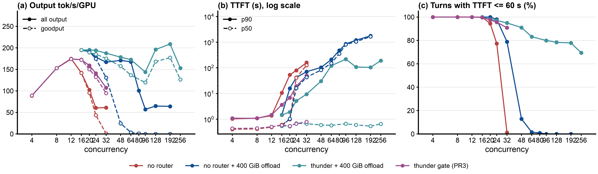
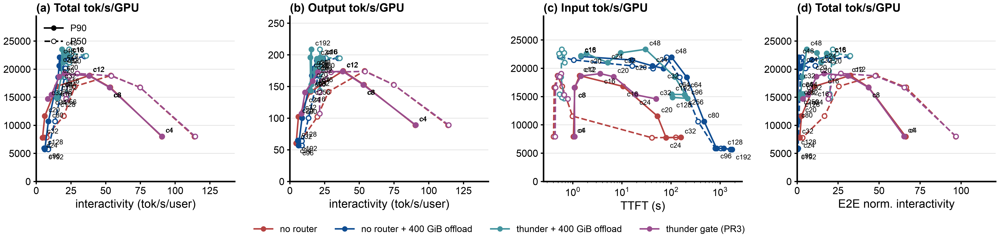
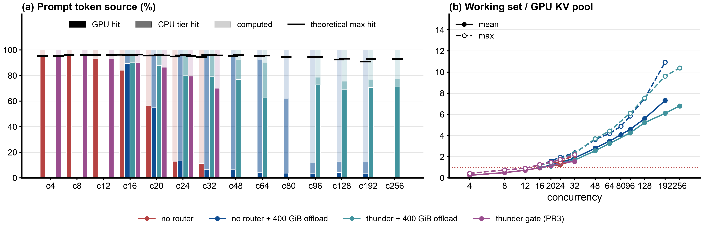
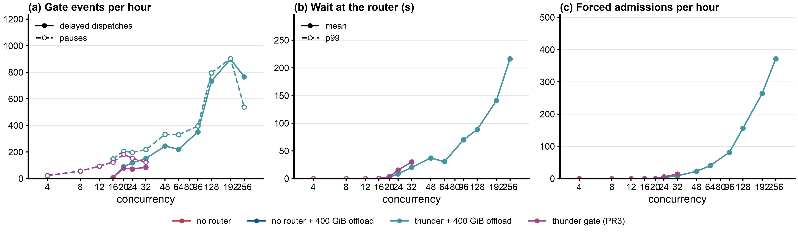
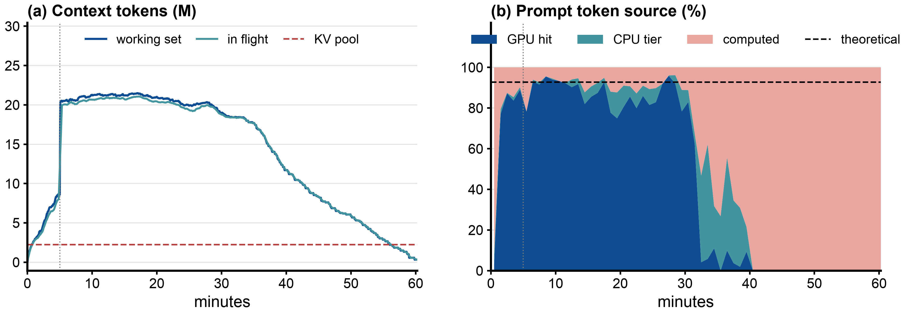

# Benchmark report: thunder-agent PR3 gate vs no router on one vLLM replica, Qwen3-Coder-30B-A3B-FP8, AgentX replay of real Claude Code traffic (Weka trace)

Step 24, 2026-10-09 to 11. Raw data, scripts and the full write-up: this folder ([README.md](README.md)). Interactive charts: https://zetxqx.github.io/thunderagent-original-verification/ (bundle `step24-thunder-pr3-lanes.json`).

## 1. Executive summary

**Objective:** measure what the thunder-agent admission gate (llm-d-router PR3) does for one vLLM pod serving agentic coding sessions, against sending every request straight to the pod, with and without a 400 GiB CPU KV offload tier, across concurrency.

**Key findings:**

- **Below saturation there is no cost.** At c = 4 to 12 the gate and no router are identical (89 to 175 output tok/s/GPU, p50 TTFT 0.4 to 0.5 s).
- **Past saturation the gate keeps the cache alive.** Without offload, at c = 24 the gate gives **2.3x the output throughput** (141 vs 61 tok/s/GPU), cuts the **median TTFT from 40.9 s to 0.7 s**, and keeps the steady-state prefix hit rate at **0.80 instead of 0.13**. At c = 32: 1.75x throughput, median TTFT 0.8 s vs 126 s, 91% vs 1% of turns within a 60 s TTFT SLO.
- **With 400 GiB offload the gap grows at high load.** No router holds its throughput to c = 64 (about 168 tok/s/GPU), but its TTFT is gone from c = 48 (13% of turns within the SLO) and its throughput collapses from c = 80 on. The gate keeps the median TTFT at 0.5 to 0.7 s at every concurrency and gives **2.5x the throughput at c = 96 and 3.3x at c = 192** (209 vs 64 tok/s/GPU), with 78% to 80% of turns within the SLO against 0%.
- **The cost is the tail.** Sessions the gate holds wait up to its 1800 s forced admission: p99 TTFT is 1.6x to 7.8x worse than no router (c = 24: 436 vs 168 s; c = 32: 1477 vs 196 s; with offload, c = 64: 2025 vs 258 s), and at c >= 96 with offload, 10% to 22% of turns wait more than 25 minutes or never get a first token.
- **The 1800 s forced admission makes every high-load point a mix of two regimes.** Before minute 30 the gate runs at up to 420 to 467 output tok/s/GPU (offload, c = 128 to 192); after it, the forced admissions arrive in a burst and the GPU prefix hit rate falls to about 0 for the rest of the hour (about 70 to 80 tok/s/GPU). A shorter forced admission (300 s) or the reclaim fix (b9a70488) does not help (section 6). Code changes for the PR author are in [README.md](README.md), "Code changes suggested to the PR author".

## 2. Setup and environment

- **Hardware:** one vLLM pod per lane on 2x NVIDIA H100 80GB (tensor parallel 2), GKE spot node type a3-highgpu-4g (4 H100s per node). Without offload two pods share a node; with offload, one pod per node.
- **Host:** the vLLM pod requests 8 CPU and 96 GiB and is limited to 16 CPU and 128 GiB; with offload, 450 GiB of memory and a 410 GiB `/dev/shm`.
- **Serving engine and version:** `vllm/vllm-openai:v0.28.0`.
- **Model configuration:** `Qwen/Qwen3-Coder-30B-A3B-Instruct-FP8` (mixture of experts, 30B total, 3B active), TP=2, `--max-model-len 262144`, FP8 weights, `--kv-cache-dtype fp8_e4m3`, `--gpu-memory-utilization 0.88`, chunked prefill and prefix caching on (vLLM defaults), `--enable-prompt-tokens-details`. GPU KV pool: 139,815 blocks x 16 tokens = **2,237,040 tokens per pod** (48 KiB per token, about 102 GiB).
- **CPU offload (offload arms):** vLLM's native offloading connector, `--kv-offloading-size=400` (GiB over both TP ranks) = **8,738,133 tokens, 3.9x the GPU pool**. The connector copies every computed block to CPU, so the tier holds a copy of the GPU contents and a pod keeps about the tier size, not GPU plus CPU.
- **Router under test:** llm-d-router endpoint picker, PR3 ([llm-d/llm-d-router#3076](https://github.com/llm-d/llm-d-router/pull/3076)) at `a025437b` plus a 6-line `Produces()` declaration ([thunder-produces.patch](thunder-produces.patch); without it every request fails), image `llm-d-router-endpoint-picker:thunder-agent-pr3-a025437b-produces`. One EPP and envoy per lane, watching only that lane's pod.
- **Benchmark tool:** aiperf, AgentX harness fork image `agentx-harness:agentx-v1.0.6`, `aiperf profile --scenario agentx`, one Kubernetes Job per point.

## 3. Workload and traffic

- **Dataset:** `semianalysis_cc_traces_weka_062126_256k`, real Claude Code sessions with subagents, replayed as session trees with their recorded tool-call gaps (median gap between turns about 1.7 s, p90 9 to 19 s, 7% to 9% over 30 s, capped at 300 s).
- **Input / output token lengths** (steady state, varies a little by point): prompt median 60k to 98k tokens, p90 93k to 200k, max about 256k. Output median 250 to 460 tokens, mean 620 to 1,060.
- **Concurrency levels tested:** concurrent session trees c = 4, 8, 12, 16, 20, 24, 32 without offload; c = 16, 20, 24, 32, 48, 64, 80, 96, 128, 192, 256 with offload (c = 80 no router only, c = 256 gate only).
- **Test duration / warm-up:** 60 minutes of profiling per point, after an AgentX warmup (10 requests per lane replayed with no idle delay to fill the caches). The first 5 minutes of profiling run below the target concurrency (lanes wait out recorded first-request gaps up to the 300 s idle cap), so **steady-state numbers use requests started after minute 5**. A fresh vLLM pod (and a fresh lane EPP) for every point, first-turn cache busting, seed 42.
- **Runs:** one run per arm and concurrency (no replicates). Earlier steps measured 2% to 6% run-to-run variance on this setup; differences within about 5% are ties.

## 4. Test arms

- **Arm 0 (baseline), "no router":** the client calls the vLLM pod's Service directly; every request goes to the pod at once.
- **Arm 1, "thunder gate (PR3)":** the client calls the lane EPP with an `X-Session-ID` header. The gate keeps a per-pod ledger of admitted sessions (each session's size is its last turn's total tokens or the estimate of its turns in flight) against the pod's capacity, read from vLLM (2,237,040 tokens). Turns of admitted sessions always pass; a new session passes when it fits, a paused one when its own pod has room; sessions idle for more than 30 s (`idleLeaseSeconds`) give up their room on demand, longest idle first; smaller sessions go first; a request held for 1800 s (`headWaitStarvationMs`) is admitted regardless. Flow control TTL 0, envoy ext_proc timeout 2400 s.
- **Arm 2, "no router + 400 GiB offload":** Arm 0 with the CPU tier.
- **Arm 3, "thunder + 400 GiB offload":** Arm 1 with the CPU tier; the gate is still sized to the GPU pool.

Gate-setting variants (lease 10 s, forced admission 300 s, reclaim fix) are in section 6.

## 5. Results

Steady state, one run per point. TTFT in seconds; ITL in ms, per request ((latency - TTFT) / (output tokens - 1)), percentiles over requests. "In flight": mean requests in flight at the client (including any wait at the router) / mean requests running in vLLM. Errors and requests with no first token at the end of the run count as misses of the 60 s TTFT SLO.

### 5.1 Without offload

| c | arm | in flight: client / vLLM | p50 TTFT | p90 TTFT | p99 TTFT | p50 ITL | p99 ITL | output tok/s/GPU | requests/s | steady hit rate | TTFT <= 60 s |
|---|---|---|---|---|---|---|---|---|---|---|---|
| 4 | no router | 1.6 / 1.6 | 0.4 | 1.0 | 4 | 9 | 20 | 89 | 0.17 | 0.96 | 100% |
| 4 | thunder | 1.6 / 1.6 | 0.4 | 1.1 | 3 | 9 | 15 | 89 | 0.17 | 0.96 | 100% |
| 8 | no router | 4.2 / 4.2 | 0.4 | 1.1 | 4 | 13 | 30 | 153 | 0.35 | 0.96 | 100% |
| 8 | thunder | 4.2 / 4.2 | 0.4 | 1.1 | 4 | 13 | 32 | 153 | 0.35 | 0.96 | 100% |
| 12 | no router | 7.1 / 7.2 | 0.5 | 1.4 | 13 | 19 | 51 | 175 | 0.38 | 0.93 | 100% |
| 12 | thunder | 7.2 / 7.2 | 0.5 | 1.5 | 16 | 19 | 47 | 174 | 0.37 | 0.93 | 100% |
| 16 | no router | 12.7 / 12.8 | 0.6 | 10.6 | 47 | 36 | 160 | 142 | 0.32 | 0.84 | 100% |
| 16 | thunder | 12.6 / 12.3 | 0.6 | 3.6 | 20 | 34 | 102 | 173 | 0.36 | 0.90 | 100% |
| 20 | no router | 20.1 / 17.6 | 1.0 | 53.0 | 79 | 51 | 341 | 102 | 0.25 | 0.56 | 94% |
| 20 | thunder | 17.8 / 16.1 | 0.5 | 6.8 | 141 | 42 | 167 | 159 | 0.41 | 0.87 | 98% |
| 24 | no router | 25.5 / 20.7 | 40.9 | 79.6 | 168 | 152 | 326 | 61 | 0.18 | 0.13 | 77% |
| 24 | thunder | 22.6 / 17.3 | 0.7 | 19.1 | 436 | 47 | 189 | 141 | 0.33 | 0.80 | 96% |
| **24** | **ratio, thunder vs no router** | | **61x lower** | **4.2x lower** | **2.6x higher** | **3.2x lower** | **1.7x lower** | **2.33x** | **1.83x** | **6.1x** | |
| 32 | no router | 40.6 / 20.1 | 126.1 | 159.5 | 196 | 133 | 277 | 61 | 0.20 | 0.11 | 1% |
| 32 | thunder | 28.6 / 17.1 | 0.8 | 49.8 | 1477 | 47 | 252 | 107 | 0.31 | 0.70 | 91% |
| **32** | **ratio, thunder vs no router** | | **160x lower** | **3.2x lower** | **7.5x higher** | **2.8x lower** | **1.1x lower** | **1.75x** | **1.55x** | **6.1x** | |

### 5.2 With 400 GiB CPU offload

| c | arm | in flight: client / vLLM | p50 TTFT | p90 TTFT | p99 TTFT | p50 ITL | p99 ITL | output tok/s/GPU | requests/s | steady hit rate (GPU + CPU) | TTFT <= 60 s |
|---|---|---|---|---|---|---|---|---|---|---|---|
| 16 | no router | 11.6 / 11.5 | 0.5 | 1.5 | 9 | 29 | 58 | 195 | 0.43 | 0.96 | 100% |
| 16 | thunder | 11.6 / 11.5 | 0.6 | 1.5 | 10 | 28 | 63 | 195 | 0.43 | 0.96 | 100% |
| 20 | no router | 18.7 / 16.8 | 1.0 | 15.9 | 38 | 43 | 76 | 191 | 0.47 | 0.96 | 100% |
| 20 | thunder | 17.0 / 15.9 | 0.5 | 1.9 | 96 | 39 | 62 | 195 | 0.49 | 0.96 | 98% |
| 24 | no router | 25.8 / 18.1 | 16.3 | 41.8 | 70 | 47 | 81 | 178 | 0.44 | 0.96 | 98% |
| 24 | thunder | 21.2 / 16.7 | 0.7 | 5.2 | 212 | 42 | 68 | 194 | 0.43 | 0.96 | 97% |
| 32 | no router | 34.4 / 17.2 | 43.0 | 70.7 | 97 | 47 | 81 | 167 | 0.41 | 0.96 | 79% |
| 32 | thunder | 28.0 / 16.8 | 0.7 | 9.4 | 819 | 42 | 71 | 188 | 0.48 | 0.96 | 95% |
| 48 | no router | 56.5 / 18.7 | 81.8 | 103.0 | 146 | 48 | 107 | 171 | 0.48 | 0.95 | 13% |
| 48 | thunder | 41.5 / 17.6 | 0.6 | 30.3 | 1815 | 42 | 133 | 178 | 0.53 | 0.93 | 91% |
| 64 | no router | 80.7 / 20.7 | 150.3 | 209.8 | 258 | 49 | 134 | 168 | 0.41 | 0.93 | 1% |
| 64 | thunder | 50.7 / 19.9 | 0.6 | 120.5 | 2025 | 45 | 97 | 173 | 0.43 | 0.90 | 83% |
| 80 | no router | 104.4 / | 356.3 | 474.8 | 514 | 74 | 188 | 100 | 0.25 | 0.62 | 1% |
| 96 | no router | 110.7 / 20.7 | 805.1 | 848.9 | 893 | 116 | 223 | 57 | 0.13 | 0.12 | 0% |
| 96 | thunder | 70.9 / 21.6 | 0.7 | 218.0 | 2529 | 46 | 143 | 144 | 0.40 | 0.79 | 80% |
| **96** | **ratio, thunder vs no router** | | **1150x lower** | **3.9x lower** | **2.8x higher** | **2.5x lower** | **1.6x lower** | **2.52x** | **3.1x** | **6.6x** | |
| 128 | no router | 158.9 / 23.8 | 1042.5 | 1190.9 | 1217 | 119 | 316 | 65 | 0.15 | 0.13 | 0% |
| 128 | thunder | 96.7 / 28.2 | 0.6 | 107.5 | 2722 | 46 | 163 | 196 | 0.56 | 0.76 | 78% |
| 192 | no router | 207.1 / 22.0 | 1636.3 | 1754.3 | 1784 | 116 | 319 | 64 | 0.13 | 0.12 | 0% |
| 192 | thunder | 100.8 / 29.1 | 0.5 | 103.9 | 2868 | 46 | 152 | 209 | 0.63 | 0.77 | 78% |
| **192** | **ratio, thunder vs no router** | | **3000x lower** | **16.9x lower** | **1.6x higher** | **2.5x lower** | **2.1x lower** | **3.27x** | **4.8x** | **6.2x** | |
| 256 | thunder | 100.6 / 23.8 | 0.7 | 189.9 | 3088 | 47 | 134 | 153 | 0.47 | 0.77 | 69% |

### 5.3 Other measured facts

| | no router c24 | thunder c24 | no router c32 | thunder c32 | no router + offload c96 | thunder + offload c96 | no router + offload c192 | thunder + offload c192 |
|---|---|---|---|---|---|---|---|---|
| requests with zero cache hit (client usage) | 59% | 9% | 62% | 17% | 63% | 8% | 70% | 5% |
| vLLM waiting queue, mean | 8.1 | 0.9 | 25.1 | 1.9 | 112.8 | 27.3 | 288.3 | 85.7 |
| working set of live sessions / GPU KV pool, mean | 1.24 | 1.42 | 1.67 | 1.55 | 4.59 | 4.25 | 7.32 | 6.10 |
| gate ledger / capacity, mean | | 1.02 | | 1.08 | | 2.54 | | 4.90 |
| requests held at the router, peak | 0 | 10 | 0 | 27 | 0 | 106 | 0 | 274 |
| forced admissions (after 1800 s) | 0 | 5 | 0 | 13 | 0 | 75 | 0 | 243 |
| requests with no first token at the end (SLO misses) | 6 | 5 | 26 | 16 | 110 | 106 | 284 | 292 |
| completed requests (whole run) | 822 | 1,343 | 899 | 1,269 | 690 | 1,627 | 752 | 2,536 |
| turns per session tree, median | 19 | 20 | 12.5 | 15 | 4 | 3 | 2 | 1 |
| worst TTFT per session tree, p90 (s) | 170 | 1,815 | 197 | 1,849 | 885 | 2,560 | 1,770 | 2,892 |
| vLLM preemptions | 4 | 2 | 3 | 3 | 113 | 23 | 105 | 22 |
| router CPU | not measured | | | | | | | |

The gate ledger above 1 at high load comes from forced admissions: once forced in, sessions stay in the ledger past the capacity.

**Throughput and TTFT over time** (thunder + offload, c = 192): the gate works until about minute 30, then the forced admissions arrive and the GPU prefix hit rate falls to about 0.

| point | output tok/s/GPU, minutes 5 to 30 | minutes 36 to 60 | GPU hit, before / after | forced admissions before / after minute 30 |
|---|---|---|---|---|
| thunder c32 (no offload) | 160 | 60 | 73% / 11% | 0 / 13 |
| thunder + offload c128 | 420 | 70 | 87% / 0% | 0 / 146 |
| thunder + offload c192 | 425 | 78 | 87% / 1% | 0 / 247 (101 in minute 36) |
| no router + offload c192 | 81 | 86 | | |

### 5.4 Errors

- **Request errors:** 0 in every valid point (all arms).
- **Requests unfinished at the end** (cancelled by aiperf after the grace period): up to 42 at c <= 32 in both arms; at high load with offload 230 to 387 for the gate (mostly waiting in vLLM after forced admissions, the rest held at the router) and 255 to 315 for no router. Those without a first token count as SLO misses in both arms.
- **Failed runs:** seven first attempts failed and were rerun (a lane-claim bug in our script, envoy and aiperf connection reuse against vLLM's 5 s keep-alive, and three vLLM crashes, "CUDA error: an illegal memory access", all on one bad spot node); two more points lost their copy-back to a GKE credential outage and were fetched from the PVC. The failed attempts' data was deleted; the list is in [README.md](README.md), "Failed runs and lessons".

## 6. Gate-setting variants (400 GiB offload)

Same setup as Arm 3, one setting changed. Steady state, one run per point.

| c | arm | output tok/s/GPU | TTFT <= 60 s | p50 / p90 TTFT | prefix hit | forced admissions | pauses | worst turn per session, p90 |
|---|---|---|---|---|---|---|---|---|
| 24 | lease 30 s, forced admission 1800 s (Arm 3) | 194 | 97% | 0.7 / 5 s | 0.96 | 3 | 182 | 993 s |
| 24 | lease 10 s | 190 | 97% | 0.8 / 7 s | 0.96 | 1 | 231 | 685 s |
| 24 | forced admission 300 s | 190 | 94% | 0.8 / 15 s | 0.96 | 56 | 183 | 325 s |
| 28 | lease 10 s | 189 | 95% | 0.7 / 11 s | 0.96 | 5 | 217 | 1748 s |
| 32 | lease 30 s, 1800 s (Arm 3) | 188 | 95% | 0.7 / 9 s | 0.96 | 8 | 201 | 1813 s |
| 32 | lease 10 s | 192 | 95% | 0.8 / 11 s | 0.95 | 6 | 270 | 1807 s |
| 32 | forced admission 300 s | 171 | 91% | 16 / 47 s | 0.96 | 114 | 168 | 338 s |
| 32 | forced admission 300 s + reclaim fix | 167 | 90% | 18 / 54 s | 0.96 | 117 | 160 | 357 s |
| 48 | lease 30 s, 1800 s (Arm 3) | 178 | 91% | 0.6 / 30 s | 0.93 | 21 | 308 | 1875 s |
| 48 | lease 10 s | 178 | 92% | 0.7 / 45 s | 0.92 | 19 | 375 | 1892 s |
| 64 | lease 30 s, 1800 s (Arm 3) | 173 | 83% | 0.6 / 121 s | 0.90 | 37 | 305 | 2128 s |
| 64 | lease 10 s | 194 | 84% | 0.7 / 113 s | 0.90 | 36 | 358 | 2107 s |
| 64 | forced admission 300 s | 152 | 24% | 135 / 458 s | 0.87 | 221 | 277 | 683 s |
| 64 | forced admission 300 s + reclaim fix | 158 | 23% | 112 / 419 s | 0.88 | 223 | 278 | 676 s |
| 96 | lease 30 s, 1800 s (Arm 3) | 144 | 80% | 0.7 / 218 s | 0.79 | 75 | 365 | 2560 s |
| 96 | forced admission 300 s | 70 | 33% | 814 / 1137 s | 0.34 | 183 | 153 | 1167 s |
| 96 | forced admission 300 s + reclaim fix | 67 | 30% | 769 / 1095 s | 0.32 | 177 | 162 | 1166 s |

- **Idle lease 10 s vs 30 s:** within about 5% at almost every point tested (c = 16 to 192, including the extra c = 28 and 48), with 15% to 35% more pauses; lease 10 s is 7% to 12% higher at c = 64 and 192, within what one run per point can resolve. Not a useful knob for this workload.
- **Forced admission 300 s:** ties 1800 s at c = 24 and gets worse with load; at c = 96 it is close to no router. The forced admissions still come in bursts, only earlier (c = 96: 60 in minute 10).
- **Reclaim fix** (`thunder-agent-pr3-a025437b-forced-7ae26276`: a forced-in session first pauses idle sessions on its pod): within about 5% of plain 300 s, with the same number of pauses, because under load almost no session is idle past the lease to be paused.

## 7. Analysis

- **Primary bottleneck: GPU KV cache capacity, not compute.** vLLM ran only 16 to 29 requests at a time, but its KV pool was full (peak 100%) from c = 16 on. Without a gate, from c = 20 the live sessions need more than the pool (1.2x at c = 20, 1.7x at c = 32); every new prefill evicts blocks another live session is about to reuse, the steady hit rate falls to 0.11 to 0.13, 59% to 62% of requests get no cache hit at all, and most turns are full prefills of 60k to 100k tokens. The gate keeps the admitted ledger at about 1.0x the pool, so admitted sessions keep their cache between turns and the same pod does 1.6x to 2.3x the work.
- **CPU offload moves the cliff, it does not remove it.** The 400 GiB tier holds 3.9x the GPU pool. No router stays at a 0.93 to 0.96 hit rate until the working set reaches about the tier size (3.5x the GPU pool at c = 64) and collapses past it (4.1x at c = 80, hit rate 0.62; 4.6x at c = 96, 0.12). But even before the collapse its TTFT is poor from c = 32 on: every admitted request waits in vLLM's queue (18 to 66 waiting on average) because GPU KV still holds only about 20 running requests. The gate, sized to the GPU pool, keeps that queue short and the median TTFT below 1 s; it barely uses the CPU tier (about 6% of prompt tokens).
- **Trade-off: the gate buys median latency and throughput with a long tail.** Smallest-first ordering lets large sessions wait until the 1800 s forced admission; at c >= 24 the worst turn per session reaches 1800 to 2900 s. At high load the forced admissions arrive in bursts around minute 30, push the pod far over capacity, and the cache collapses for the rest of the run, so the 60-minute averages understate the gate's working phase and overstate its long-run behaviour. A shorter forced admission makes it worse, and reclaiming idle sessions on forced admission does not help. The next things to test are the two code changes in [README.md](README.md): age-aware ordering, and at most one forced admission per pod at a time.
- **Caveats:** one run per point; one workload (AgentX replay of one trace); one pod per lane (no multi-pod routing); a 60-minute window, which decides when the 1800 s forced admission fires; AgentX is closed loop, so a faster arm completes more requests and sees a slightly different request mix (compare completed requests, not only rates).
