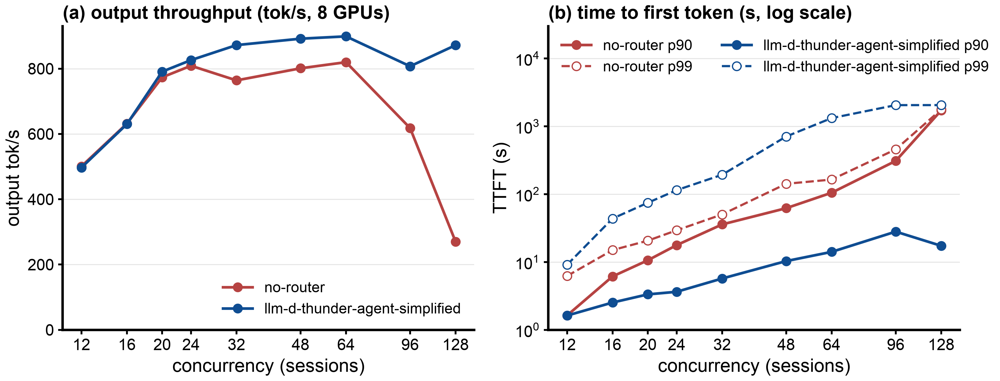
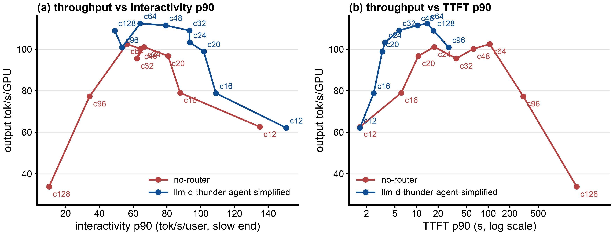
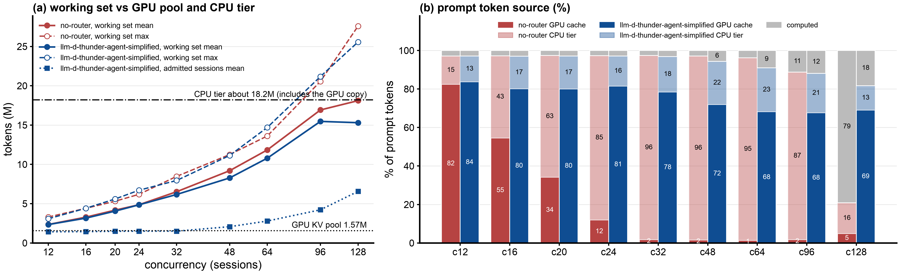
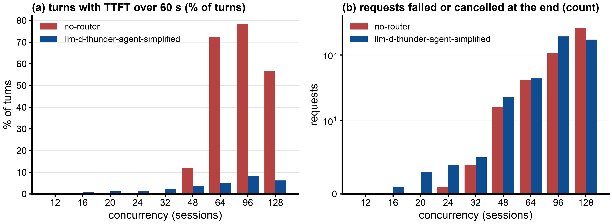

# Benchmark report: llm-d-thunder-agent-simplified vs no-router on one vLLM replica, GLM-5.2 NVFP4 on 8x B200 with CPU KV offload, real Claude Code traffic (AgentX WekaTrace)

## 1. Executive Summary

Objective: Compare performance when using llm-d-thunder-agent-simplified admission control versus no-router (every request sent straight to a single vLLM pod), at 12 to 128 concurrent agent sessions, one hour per point.

Key Finding:

- llm-d-thunder-agent-simplified gives 1.14x the output-token throughput at 32 sessions (872 vs 764 tokens/s), 1.10x to 1.11x at 48 and 64, 1.31x at 96 and 3.2x at 128 (872 vs 270); 1.02x at 20 and 24 sessions, a tie at 12 and 16. no-router stays at 760 to 820 tokens/s from 24 to 64 sessions, then collapses (618 at 96, 270 at 128); llm-d-thunder-agent-simplified stays at 807 to 899 from 32 to 128.
- llm-d-thunder-agent-simplified keeps the median time to first token at 0.56 to 0.73 s at every concurrency; no-router's median is 6.2 s at 24 sessions, 19 s at 32, 43 to 74 s at 48 to 64 and 110 to 180 s at 96 to 128. p90 TTFT is 4.9x to 11x lower from 24 to 96 sessions and 99x lower at 128.
- Up to 64 sessions the working set fits the CPU KV tier (about 18.2M tokens) and nothing beyond the new tokens of each turn is recomputed in either arm; llm-d-thunder-agent-simplified's gain comes from keeping the running sessions on the GPU (steady GPU hit 0.68 to 0.82 against 0.01 to 0.12 for no-router from 24 sessions up) instead of reloading them from CPU memory. From 96 sessions the working set reaches the CPU tier and no-router starts to recompute (11% of prompt tokens at 96, 79% at 128 in the steady state: KV thrashing); llm-d-thunder-agent-simplified computes 12% to 18%.
- The cost is the tail: p99 TTFT is 3.6x to 8.1x worse from 20 to 96 sessions (193 s vs 50 s at 32, 2054 s vs 458 s at 96), and requests that waited the full 1800 s before being forced in grow from 2 and 4 (24 and 32 sessions) to 14, 34, 66 and 131 (48 to 128 sessions). no-router has the worse middle: from 64 sessions 57% to 78% of its turns wait over 60 s, against 5% to 8% for llm-d-thunder-agent-simplified.
- On sessions both arms worked on, llm-d-thunder-agent-simplified completes 1.14x the turns per session at 24 sessions, 1.23x at 32, 1.3x to 1.9x at 48 to 96 and 3.4x at 128.
- Agent metrics (section 5, first table): E2E normalized interactivity p90 (output tokens / request latency, wait included) is 1.2x to 2.0x higher at 12 to 20 sessions and 4.3x to 76x higher from 24 sessions up. Request latency p99 is 1.2x to 7.4x higher from 16 to 96 sessions (213 s vs 94 s at 32, 1331 s vs 180 s at 64).

## 2. Setup & Environment

- Hardware: one vLLM pod using 8x NVIDIA B200 (tensor parallel 8). Node type: GKE a4-highgpu-8g (8 B200 per node; the pod uses all 8), cluster `a4-pr`, europe-west4-b. Each arm runs on its own node; paired points ran at the same time.
- Host: the vLLM pod requests 100 CPU cores and 1300 GiB memory (limit 1600 GiB), with a 900 GiB `/dev/shm` that holds the CPU KV tier.
- Serving Engine & Version: `vllm/vllm-openai:v0.31.0`
- Model Configuration:
  - `nvidia/GLM-5.2-NVFP4` at revision `aec724e8` (mixture of experts, about 743B total, 39B active, DeepSeek-style sparse attention, MTP head), TP=8, `--max-model-len 1048576`.
  - NVFP4 expert weights, FP8 KV cache (`fp8_e4m3`), `--gpu-memory-utilization 0.8`, MTP speculative decoding with 3 tokens, chunked prefill (`--max-num-batched-tokens 8192`) and prefix caching on, `--max-num-seqs 64`.
  - KV cache pool on the GPU: 24,576 blocks x 64 tokens = 1,572,864 tokens per pod.
  - CPU KV offload: vLLM native `OffloadingConnector`, `--kv-offloading-size 820` GiB. The CPU tier holds a copy of every GPU block, so the server keeps about 18.2M distinct tokens, not GPU plus CPU. GLM-5.2 uses MLA, so the KV cache is identical on all 8 GPUs, and vLLM v0.31 stores a single CPU copy for all of them (`replicated_layout` in `v1/kv_offload/cpu/spec.py`); 820 GiB / 48.4 KB per token per GPU = about 18.2M tokens. Measured: each block stored costs 48.2 KB per token (one copy) and each load 387 KB per token (8 GPUs x 48.4 KB).
- llm-d-thunder-agent-simplified: llm-d-router EPP with the `thunder-agent` plugin, a simplified llm-d port of ThunderAgent (arXiv 2602.13692) (PR llm-d/llm-d-router#3076 at commit `a025437b` plus the `Produces()` fix), image `llm-d-router-endpoint-picker:thunder-agent-pr3-a025437b-produces` (`sha256:e038ea5a...`), with envoy `distroless-v1.33.2`. One EPP per vLLM pod, file-discovery mode (one endpoint).
- Benchmark tool: `agentx-harness:agentx-v1.0.6` (SemiAnalysis aiperf fork, commit `89b21867`, `sha256:918909fe...`), `aiperf profile --scenario agentx`, the same client InferenceX uses.

## 3. Workload & Traffic

Dataset `semianalysisai/cc-traces-weka-062126` (AgentX loader `semianalysis_cc_traces_weka_062126`, uncapped for 1M context): Claude Code sessions with subagents, replayed as session trees with their recorded tool-call gaps (AgentX caps idle gaps at 10 s system-wide and 300 s per tree).

- Input / Output Token Lengths (profiling window, per request):
  - 12 to 32 sessions: prompt median 101k to 110k tokens, p90 236k to 279k, max about 790k; output median 336 to 380 tokens, mean 947 to 1094.
  - 48 to 128 sessions: prompt median falls to 48k to 96k (no-router) and 51k to 88k (llm-d-thunder-agent-simplified), p90 193k to 281k and 116k to 196k; output median 373 to 450, mean 873 to 1151. Lanes progress less far into their sessions, and llm-d-thunder-agent-simplified serves smaller sessions first, so its request mix is smaller (see Caveats).
- Concurrency Levels Tested: 12, 16, 20, 24, 32, 48, 64, 96 and 128 sessions (AgentX lanes; each lane replays one session tree at a time, closed loop).
- Test Duration / Warm-up:
  - 3600 s of profiling per point, after the AgentX warmup (10 requests per lane plus each lane's primer context, not counted): 6 to 11 minutes up to 32 sessions, 20 to 27 minutes at 48 and 64, 53 to 65 minutes at 96, 70 minutes (llm-d-thunder-agent-simplified) and 4.4 hours (no-router) at 128.
  - The first 5 minutes of profiling run at low load while lanes wait out recorded gaps; steady-state numbers use requests started after minute 5.
  - One run per point. Before every point both KV tiers were emptied (`POST /reset_prefix_cache?reset_external=true`) and the llm-d-thunder-agent-simplified EPP restarted; the vLLM server was not restarted (`--max-num-seqs 64`). Exception: no-router at 12 and 16 sessions are earlier one-hour points with a fresh server and `--max-num-seqs` 24 and 32 (GPU pool 1,694,080 tokens).

## 4. Test Arms

- no-router (baseline): the client sends every request straight to the vLLM Service.
- llm-d-thunder-agent-simplified: the client sends requests to envoy, whose external processor is the EPP running `thunder-agent`.
  - Sessions are identified by the `X-Session-ID` header (one per main agent and per subagent).
  - A pod's room is its GPU KV capacity, read from vLLM (1,572,864 tokens), minus the summed context tokens of the sessions llm-d-thunder-agent-simplified has admitted.
  - Turns of admitted sessions always dispatch. A paused or new session dispatches only when it fits; to make it fit, sessions idle for more than 10 s (`idleLeaseSeconds`) give up their room, longest idle first, and become paused.
  - A request held for 1800 s (`headWaitStarvationMs`) is let in regardless. `utilThreshold` 1.0, `evictionTtlSeconds` 3600.
  - Differences from the original upstream ThunderAgent (the paper's Python router): the fit is checked at every dispatch instead of a 5 s sweep, an idle lease replaces the acting-token decay, and a paused session waits for its own pod.

## 5. Results (raw data: `b200/results/explore1h-*/`, `b200/results/r1/c12`, `r1/c16`; collected in `b200/results/report1h/metrics.json`)

One run per point, whole profiling window (3600 s).

Agent metrics. For an agent, a turn takes the wait, the prefill and the decode together; interactivity measures only the decode. E2E normalized interactivity = output tokens / request latency per turn (p90 = the slowest 10%). Request latency in seconds; p99 shows the sessions llm-d-thunder-agent-simplified holds, p90 does not. Session progress = turns llm-d-thunder-agent-simplified completes on the traces both arms ran / no-router's turns on the same traces (the per-session mean of this ratio is in "Other measured facts").

| conc | arm | E2E norm. interactivity p50 | E2E norm. interactivity p90 | request latency p90 (s) | request latency p99 (s) | session progress |
|---|---|---|---|---|---|---|
| 12 | no-router | 145.5 | 67.6 | 14.7 | 52.5 | - |
| 12 | llm-d-thunder-agent-simplified | 156.9 | 79.7 | 13.1 | 48.0 | 0.99 |
| 16 | no-router | 101.8 | 33.7 | 18.4 | 58.9 | - |
| 16 | llm-d-thunder-agent-simplified | 123.0 | 50.5 | 16.8 | 73.0 | 1.01 |
| 20 | no-router | 84.0 | 22.0 | 25.3 | 71.6 | - |
| 20 | llm-d-thunder-agent-simplified | 112.6 | 43.8 | 21.4 | 97.6 | 1.03 |
| 24 | no-router | 47.8 | 9.7 | 32.4 | 79.2 | - |
| 24 | llm-d-thunder-agent-simplified | 108.4 | 41.4 | 22.9 | 130.2 | 1.05 |
| 32 | no-router | 22.5 | 4.2 | 49.4 | 94.2 | - |
| 32 | llm-d-thunder-agent-simplified | 109.0 | 33.5 | 24.6 | 213.3 | 1.19 |
| 48 | no-router | 10.9 | 2.2 | 76.1 | 163.0 | - |
| 48 | llm-d-thunder-agent-simplified | 95.0 | 21.2 | 31.1 | 710.8 | 1.18 |
| 64 | no-router | 6.9 | 1.4 | 122.8 | 179.9 | - |
| 64 | llm-d-thunder-agent-simplified | 82.0 | 18.2 | 39.6 | 1331 | 1.21 |
| 96 | no-router | 3.7 | 0.6 | 323.8 | 470.5 | - |
| 96 | llm-d-thunder-agent-simplified | 73.7 | 11.4 | 59.5 | 2092 | 1.56 |
| 128 | no-router | 2.9 | 0.2 | 1755 | 1926 | - |
| 128 | llm-d-thunder-agent-simplified | 66.3 | 14.5 | 48.4 | 2149 | 3.61 |

All metrics. TTFT in seconds, ITL in ms. Concurrency: configured sessions / mean requests running in vLLM. Hit rate: steady-state GPU prefix-cache hit rate.

| Arm | Concurrency (configured / running in vLLM) | p50 TTFT (s) | p90 TTFT (s) | p99 TTFT (s) | p50 ITL (ms) | p99 ITL (ms) | Output Tokens/s | Requests/s | Steady GPU hit rate | Peak KV |
|---|---|---|---|---|---|---|---|---|---|---|
| no-router | 12 / 2.5 | 0.62 | 1.63 | 6.2 | 4.8 | 32.7 | 501 | 0.46 | 0.824 | 100% |
| llm-d-thunder-agent-simplified | 12 / 2.4 | 0.56 | 1.62 | 9.1 | 4.6 | 12.5 | 497 | 0.46 | 0.838 | 97% |
| ratio, llm-d-thunder-agent-simplified vs no-router | | 1.1x lower | same | 1.5x higher | 1.05x lower | 2.6x lower | 0.99x | 1.00x | 1.02x | |
| no-router | 16 / 4.1 | 0.77 | 6.13 | 15.0 | 6.1 | 26.4 | 632 | 0.65 | 0.546 | 100% |
| llm-d-thunder-agent-simplified | 16 / 3.6 | 0.64 | 2.53 | 43.7 | 5.5 | 27.7 | 630 | 0.65 | 0.801 | 100% |
| ratio, llm-d-thunder-agent-simplified vs no-router | | 1.2x lower | 2.4x lower | 2.9x higher | 1.1x lower | 1.05x higher | 1.00x | 1.00x | 1.5x | |
| no-router | 20 / 5.7 | 1.32 | 10.60 | 20.6 | 6.9 | 31.2 | 774 | 0.75 | 0.341 | 100% |
| llm-d-thunder-agent-simplified | 20 / 5.0 | 0.69 | 3.33 | 74.7 | 6.1 | 26.0 | 791 | 0.77 | 0.800 | 100% |
| ratio, llm-d-thunder-agent-simplified vs no-router | | 1.9x lower | 3.2x lower | 3.6x higher | 1.14x lower | 1.2x lower | 1.02x | 1.03x | 2.3x | |
| no-router | 24 / 6.8 | 6.21 | 17.72 | 29.3 | 8.0 | 35.6 | 809 | 0.81 | 0.120 | 100% |
| llm-d-thunder-agent-simplified | 24 / 5.4 | 0.71 | 3.64 | 114.5 | 6.2 | 25.8 | 826 | 0.85 | 0.815 | 99% |
| ratio, llm-d-thunder-agent-simplified vs no-router | | 8.7x lower | 4.9x lower | 3.9x higher | 1.29x lower | 1.38x lower | 1.02x | 1.05x | 6.8x | |
| no-router | 32 / 6.7 | 19.22 | 35.81 | 50.2 | 8.3 | 46.3 | 764 | 0.77 | 0.017 | 100% |
| llm-d-thunder-agent-simplified | 32 / 5.9 | 0.72 | 5.71 | 193.1 | 6.4 | 27.8 | 872 | 0.92 | 0.785 | 100% |
| ratio, llm-d-thunder-agent-simplified vs no-router | | 27x lower | 6.3x lower | 3.8x higher | 1.29x lower | 1.67x lower | 1.14x | 1.20x | 45x | |
| no-router | 48 / 7.1 | 42.78 | 62.12 | 142.2 | 8.4 | 33.4 | 801 | 0.77 | 0.016 | 100% |
| llm-d-thunder-agent-simplified | 48 / 7.3 | 0.67 | 10.32 | 707.8 | 7.5 | 37.0 | 892 | 0.92 | 0.720 | 100% |
| ratio, llm-d-thunder-agent-simplified vs no-router | | 64x lower | 6.0x lower | 5.0x higher | 1.1x lower | 1.1x higher | 1.11x | 1.19x | 46x | |
| no-router | 64 / 7.8 | 74.18 | 105.02 | 164.1 | 9.0 | 44.4 | 820 | 0.79 | 0.013 | 100% |
| llm-d-thunder-agent-simplified | 64 / 9.1 | 0.68 | 14.10 | 1322.1 | 8.7 | 51.5 | 899 | 0.95 | 0.682 | 100% |
| ratio, llm-d-thunder-agent-simplified vs no-router | | 109x lower | 7.4x lower | 8.1x higher | 1.03x lower | 1.2x higher | 1.10x | 1.21x | 51x | |
| no-router | 96 / 9.0 | 179.41 | 309.17 | 457.7 | 12.1 | 86.6 | 618 | 0.58 | 0.017 | 100% |
| llm-d-thunder-agent-simplified | 96 / 9.7 | 0.69 | 28.04 | 2053.6 | 9.5 | 79.7 | 807 | 0.92 | 0.676 | 100% |
| ratio, llm-d-thunder-agent-simplified vs no-router | | 260x lower | 11x lower | 4.5x higher | 1.3x lower | 1.1x lower | 1.31x | 1.59x | 39x | |
| no-router | 128 / 11.5 | 109.82 | 1717.01 | 1769.3 | 33.1 | 189.0 | 270 | 0.23 | 0.049 | 100% |
| llm-d-thunder-agent-simplified | 128 / 12.1 | 0.73 | 17.33 | 2055.8 | 11.2 | 85.5 | 872 | 0.96 | 0.690 | 100% |
| ratio, llm-d-thunder-agent-simplified vs no-router | | 150x lower | 99x lower | 1.2x higher | 2.9x lower | 2.2x lower | 3.23x | 4.08x | 14x | |

Per point:

| conc | arm | requests ok | client errors | cancelled at the end | out tok/s | p50 TTFT (s) | p99 TTFT (s) | max TTFT (s) | p50 ITL (ms) | turns over 60 s | sessions with a turn over 60 s | overall hit (GPU + CPU tier, whole window) |
|---|---|---|---|---|---|---|---|---|---|---|---|---|
| 12 | no-router | 1653 | 0 | 0 | 501 | 0.62 | 6.2 | 14 | 4.8 | 0% | 0% | 0.970 |
| 12 | llm-d-thunder-agent-simplified | 1643 | 0 | 0 | 497 | 0.56 | 9.1 | 27 | 4.6 | 0% | 0% | 0.970 |
| 16 | no-router | 2328 | 0 | 0 | 632 | 0.77 | 15.0 | 25 | 6.1 | 0% | 0% | 0.971 |
| 16 | llm-d-thunder-agent-simplified | 2340 | 0 | 1 | 630 | 0.64 | 43.7 | 297 | 5.5 | 0.68% | 16.7% | 0.970 |
| 20 | no-router | 2710 | 0 | 0 | 774 | 1.32 | 20.6 | 32 | 6.9 | 0% | 0% | 0.971 |
| 20 | llm-d-thunder-agent-simplified | 2783 | 0 | 3 | 791 | 0.69 | 74.7 | 448 | 6.1 | 1.19% | 26.2% | 0.969 |
| 24 | no-router | 2921 | 1 | 0 | 809 | 6.21 | 29.3 | 40 | 8.0 | 0% | 0% | 0.971 |
| 24 | llm-d-thunder-agent-simplified | 3065 | 0 | 4 | 826 | 0.71 | 114.5 | 1810 | 6.2 | 1.53% | 33.3% | 0.969 |
| 32 | no-router | 2791 | 0 | 4 | 764 | 19.22 | 50.2 | 61 | 8.3 | 0.07% | 3.6% | 0.972 |
| 32 | llm-d-thunder-agent-simplified | 3331 | 0 | 5 | 872 | 0.72 | 193.1 | 1817 | 6.4 | 2.46% | 63.8% | 0.967 |
| 48 | no-router | 2805 | 0 | 16 | 801 | 42.78 | 142.2 | 168 | 8.4 | 12.12% | 83.3% | 0.969 |
| 48 | llm-d-thunder-agent-simplified | 3335 | 0 | 23 | 892 | 0.67 | 707.8 | 2250 | 7.5 | 3.81% | 73.8% | 0.943 |
| 64 | no-router | 2864 | 0 | 42 | 820 | 74.18 | 164.1 | 170 | 9.0 | 72.56% | 95.9% | 0.960 |
| 64 | llm-d-thunder-agent-simplified | 3455 | 0 | 44 | 899 | 0.68 | 1322.1 | 2486 | 8.7 | 5.21% | 78.9% | 0.912 |
| 96 | no-router | 2105 | 1 | 105 | 618 | 179.41 | 457.7 | 463 | 12.1 | 78.44% | 95.9% | 0.888 |
| 96 | llm-d-thunder-agent-simplified | 3292 | 0 | 191 | 807 | 0.69 | 2053.6 | 2757 | 9.5 | 8.20% | 85.1% | 0.886 |
| 128 | no-router | 851 | 0 | 260 | 270 | 109.82 | 1769.3 | 1790 | 33.1 | 56.64% | 99.2% | 0.362 |
| 128 | llm-d-thunder-agent-simplified | 3459 | 0 | 171 | 872 | 0.73 | 2055.8 | 3206 | 11.2 | 6.19% | 89.4% | 0.827 |

Other measured facts:

| | conc 12 | conc 16 | conc 20 | conc 24 | conc 32 |
|---|---|---|---|---|---|
| requests with zero cache hit, no-router / llm-d-thunder-agent-simplified | 2.8% / 2.9% | 3.0% / 2.8% | 3.1% / 3.0% | 3.0% / 2.9% | 3.9% / 4.0% |
| vLLM waiting queue mean, no-router / llm-d-thunder-agent-simplified | 0.08 / 0.05 | 0.81 / 0.14 | 2.06 / 0.17 | 5.67 / 0.18 | 14.20 / 0.24 |
| sessions admitted at once by llm-d-thunder-agent-simplified (mean) | 7.2 | 7.8 | 8.8 | 9.4 | 9.4 |
| tokens of admitted sessions vs GPU pool (llm-d-thunder-agent-simplified) | 0.91x | 0.92x | 0.95x | 0.96x | 0.96x |
| sessions held by llm-d-thunder-agent-simplified at peak | 76 | 124 | 151 | 163 | 223 |
| sessions forced in after 1800 s | 0 | 0 | 0 | 2 | 4 |
| per-session progress on shared sessions (mean ratio of turns, llm-d-thunder-agent-simplified vs no-router) | 0.99x | 1.00x | 1.06x | 1.14x | 1.23x |
| CPU-to-GPU KV traffic per run including warmup, no-router / llm-d-thunder-agent-simplified | 12.5 / 12.1 TB | 52.9 / 21.6 TB | 106.9 / 25.7 TB | 146.1 / 25.6 TB | 142.3 / 28.0 TB |

| | conc 48 | conc 64 | conc 96 | conc 128 |
|---|---|---|---|---|
| requests with zero cache hit, no-router / llm-d-thunder-agent-simplified | 7.3% / 8.6% | 10.5% / 13.1% | 16.4% / 14.3% | 45.9% / 21.1% |
| prompt tokens computed (not in any cache, steady state), no-router / llm-d-thunder-agent-simplified | 2.8% / 5.6% | 3.8% / 9.0% | 11.3% / 11.8% | 79.1% / 18.3% |
| working set mean / peak (no-router), against an 18.2M CPU tier | 9.2M / 11.2M | 11.8M / 13.6M | 16.9M / 20.6M | 18.1M / 27.6M |
| vLLM waiting queue mean, no-router / llm-d-thunder-agent-simplified | 31.0 / 3.2 | 53.9 / 6.7 | 104.8 / 17.4 | 226.9 / 34.9 |
| sessions admitted at once by llm-d-thunder-agent-simplified (mean) | 13.0 | 16.8 | 21.3 | 33.0 |
| tokens of admitted sessions vs GPU pool (llm-d-thunder-agent-simplified) | 1.32x | 1.78x | 2.68x | 4.17x |
| sessions held by llm-d-thunder-agent-simplified at peak | 344 | 539 | 554 | 907 |
| sessions forced in after 1800 s | 14 | 34 | 66 | 131 |
| per-session progress on shared sessions (mean ratio of turns, llm-d-thunder-agent-simplified vs no-router) | 1.58x | 1.31x | 1.90x | 3.41x |
| CPU-to-GPU KV traffic per run including warmup, no-router / llm-d-thunder-agent-simplified | 175.5 / 33.6 TB | 174.8 / 31.4 TB | 85.9 / 20.1 TB | 8.3 / 9.3 TB |

Sessions held by llm-d-thunder-agent-simplified include subagent sessions that already finished; llm-d-thunder-agent-simplified drops them after 3600 s idle. The EPP's CPU was not sampled during the runs.

## 6. Figures

Throughput and TTFT

Pareto: throughput against per-user speed and against TTFT

Each point is one concurrency (c12 to c128); up and to the right is better in (a), up and to the left in (b). Interactivity p90 is the slow end of output tok/s per user (the 10th percentile). From 16 sessions on, llm-d-thunder-agent-simplified's curve lies above no-router's in (a) and to the left in (b): at every concurrency it gives at least the same throughput with faster typical turns. no-router's curve flattens from 24 to 64 sessions (about 100 tok/s/GPU, slower turns) and then falls back (77 at 96, 34 at 128). llm-d-thunder-agent-simplified reaches 112 tok/s/GPU at 48 and 64 sessions and stays at 101 to 109 at 96 and 128, with slower users (interactivity p90 49 to 53). The tail (p99 TTFT, waits over 60 s) is not in these panels; see Errors.

Working set and the KV cache (GPU pool and CPU tier)

(a) Working set: the latest prompt length of every live session (between its first and last request, including sessions waiting on a tool call), summed, sampled every 5 s over the steady state; solid is the mean, dashed the peak. The two lines are the GPU KV pool (1.57M tokens) and the CPU tier (about 18.2M tokens, one copy shared by the 8 GPUs, see section 2). The tier holds a copy of every GPU block, so the server keeps about 18.2M distinct tokens, not GPU plus CPU. The dotted blue line is llm-d-thunder-agent-simplified's admitted set (summed context of the sessions it has admitted).

- The working set grows with concurrency: 2.3M at 12 sessions, 6.2M to 6.5M at 32, 9.2M at 48, 11.8M at 64, 16.9M at 96 and 18.1M at 128 (no-router means). It is above the GPU pool at every concurrency.
- It stays below the CPU tier up to 64 sessions (peak 13.6M); at 96 sessions the peak (20.6M) passes the tier and at 128 the mean reaches it (peak 27.6M). This is where no-router starts to recompute.
- llm-d-thunder-agent-simplified's working set is a little smaller at 96 and 128 sessions (15.3M to 15.5M mean), because it serves smaller sessions first.
- llm-d-thunder-agent-simplified keeps its admitted set just under the GPU pool up to 32 sessions (1.42M to 1.54M, 0.90x to 0.98x). From 48 sessions the forced admissions (requests let in after 1800 s whether they fit or not) push it over the pool: 1.32x at 48, 1.78x at 64, 2.68x at 96, 4.17x at 128.

(b) Share of all prompt tokens served from the GPU prefix cache (dark), loaded from the CPU tier (light) and computed (grey, labeled from 5%), measured by vLLM's `prompt_tokens_by_source` counter over the steady state (from minute 5 of profiling, no warmup). Left bar no-router, right bar llm-d-thunder-agent-simplified.

- Up to 32 sessions the computed share is 2.6% to 3.1% in both arms: the new tokens of each turn. At 48 and 64 sessions it is 2.8% to 3.8% (no-router) and 5.6% to 9.0% (llm-d-thunder-agent-simplified).
- no-router moves from the GPU to the CPU tier as concurrency grows (GPU 82% to 1%, CPU tier 15% to 95% from 12 to 64 sessions), then to recompute once the working set reaches the tier: 11% computed at 96 sessions, 79% at 128.
- llm-d-thunder-agent-simplified stays on the GPU: 68% to 84% from the GPU cache at every concurrency. Its CPU share (13% to 23%) is mostly paused sessions coming back; its computed share grows to 12% at 96 and 18% at 128, because at that size the CPU tier no longer keeps every paused session's prefix.

Errors

Client errors: one connection error in no-router at 24 sessions and one at 96. Requests cancelled at the end are those still in flight 30 s after the window closed; panel (b) uses a log scale. Up to 32 sessions, 1 to 2 per point in llm-d-thunder-agent-simplified had no first token yet (still held by llm-d-thunder-agent-simplified). From 48 sessions most cancelled requests in both arms had no first token: held by llm-d-thunder-agent-simplified (21 of 23, 37 of 44, 188 of 191, 168 of 171 at 48, 64, 96, 128) or queued in vLLM under no-router (11 of 16, 36 of 42, 97 of 105, 248 of 260).

## 7. Analysis

Primary Bottleneck: GPU KV capacity for the running requests up to 64 sessions; from 96 sessions also the CPU tier.

- Contexts are long (median prompt about 100k tokens up to 32 sessions), and a running request needs its whole context on the GPU, so vLLM runs only 2 to 12 requests at a time (5 to 7 from 20 to 32 sessions) against a max_num_seqs of 64, with the KV pool 100% full at every point.
- Up to 20 sessions the GPU pool fits the active sessions with no-router and the two arms tie on throughput; llm-d-thunder-agent-simplified still lowers p90 TTFT at 16 sessions (2.5 s against 6.1 s) at the cost of a longer tail.
- From 24 to 64 sessions the 18.2M-token CPU tier keeps every session's prefix (no-router overall hit 0.96 to 0.97, close to an infinite cache). With no-router all sessions take turns on the GPU slots, each turn evicts another session's GPU blocks, the steady GPU hit falls to 0.01 to 0.12, and 85% to 96% of every prompt is reloaded from CPU memory in the steady state (142 to 176 TB per run including the warmup, against 26 to 34 TB under llm-d-thunder-agent-simplified). The waiting queue grows (5.7 to 54 requests on average) and the median TTFT is that queue time (6 s to 74 s). With the copy path busy, every engine step is slower (p50 ITL 8.0 to 9.0 ms against 6.2 to 8.7 ms), and output stays at 760 to 820 tok/s. llm-d-thunder-agent-simplified keeps the admitted sessions on the GPU between turns (steady GPU hit 0.68 to 0.82), the vLLM queue short (0.2 to 6.7), and produces 1.02x to 1.14x the tokens.
- At 96 and 128 sessions the working set reaches the CPU tier. no-router starts to thrash: steady-state overall hit 0.89 and 0.21, 11% and 79% of prompt tokens recomputed, 105 and 227 requests waiting, p50 ITL 12 and 33 ms, output 618 and 270 tok/s. llm-d-thunder-agent-simplified keeps 0.68 to 0.69 steady GPU hit and 12% to 18% computed, and gives 807 and 872 tok/s: 1.31x and 3.2x no-router.

Trade-offs:

- Using llm-d-thunder-agent-simplified, held sessions wait. Up to 32 sessions: 0.7% to 2.5% of turns wait over 60 s (median of those waits 115 s to 164 s), 17% to 64% of sessions hit at least one such turn, and p99 TTFT is 3 to 4x worse from 20 sessions up. Most long waits hit sessions paused mid-task; first turns of a new conversation are 6% to 27% of them (16, 33, 47 and 82 long turns at 16, 20, 24 and 32 sessions).
- From 48 sessions the tail dominates: 3.8% to 8.2% of turns wait over 60 s, 74% to 89% of sessions hit one, p99 TTFT is 708 to 2056 s, and 14, 34, 66 and 131 requests wait the full 1800 s before being forced in. Admitted sessions rarely idle long enough (10 s) to give up their room, so the backstop is the only way in for many held sessions. In a deployment with client timeouts these would fail.
- no-router has no such tail but a slow middle: from 48 sessions its median TTFT is 43 s to 180 s, and from 64 sessions 57% to 78% of all turns wait over 60 s.
- From 48 sessions llm-d-thunder-agent-simplified works for about 30 minutes and then collapses: requests held since the start of the window reach the 1800 s backstop at minute 30 to 35 and are forced in together. These are the largest sessions (it serves smaller ones first), so the admitted set jumps to 6M to 23M tokens against the 1.57M GPU pool and output falls to about 100 tok/s (5-minute bins). At 48 and 64 sessions it recovers by minute 45 to 50; at 96 and 128 it stays collapsed until the end of the window. The hour averages from 48 sessions up therefore mix a working gate (minutes 0 to 30: 1100 to 1500 tok/s) with a collapsed one. At 32 sessions there is no collapse.
- This is also why 128 sessions gives more output than 96 (872 against 807 tok/s): both collapse at minute 35 (101 and 249 tok/s on average after it), but in minutes 0 to 30 the 128-session run averaged 1519 tok/s against 1235, because with more lanes llm-d-thunder-agent-simplified has more small sessions to pick from (median prompt 41k to 57k against 49k to 96k) and admits more of them at once (26 to 34 sessions against 18 to 25).
- The forced admissions also cost llm-d-thunder-agent-simplified cache: they push the admitted set over the GPU pool (1.3x to 4.2x from 48 sessions), and its steady GPU hit drops from about 0.8 to 0.68 to 0.72.

Caveats:

- One run per point. Run-to-run spread measured in the same mode with 900 s windows: about 1% (no-router) and about 4% (llm-d-thunder-agent-simplified) on throughput.
- Exploration mode: caches emptied and the llm-d-thunder-agent-simplified EPP restarted, but no server restart between points, and `--max-num-seqs 64` instead of AgentX's 2x concurrency; no-router at 12 and 16 sessions comes from fresh-server runs. Not comparable with InferenceX results.
- The two arms ran on different nodes. Up to 32 sessions paired points ran at the same time; from 48 sessions not always (llm-d-thunder-agent-simplified at 128 sessions started 1.5 h after no-router at 128).
- The warmup grows with concurrency (up to 4.4 hours for no-router at 128 sessions), so the measured hour starts after different amounts of work in the two arms.
- llm-d-thunder-agent-simplified serves smaller sessions first. From 48 sessions its request mix is smaller (prompt p90 116k to 196k against 193k to 281k), which lifts its request rate and throughput; part of its gain there comes from that mix, not only from the cache.
- 900 s windows of the same comparison showed larger throughput gains (+6% to +10% at 24, +24% to +27% at 32 sessions); over an hour the sessions' contexts and llm-d-thunder-agent-simplified's admitted working set grow and llm-d-thunder-agent-simplified admits fewer sessions.
