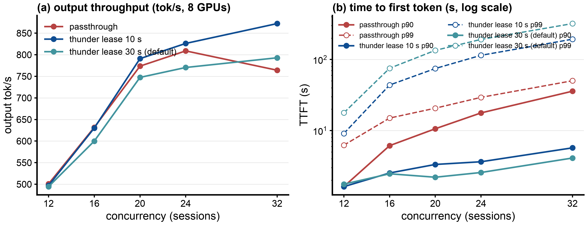
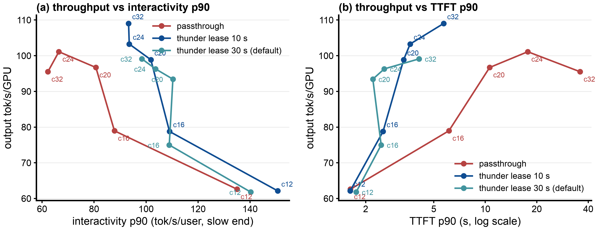
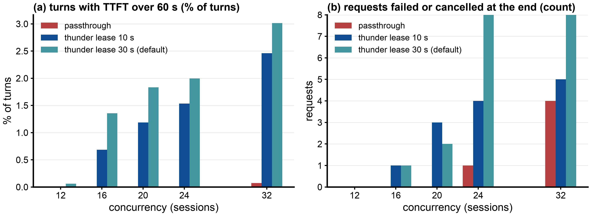
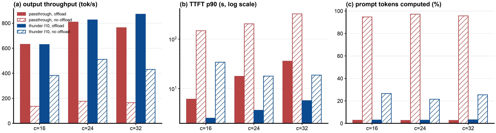

# Benchmark report: passthrough vs ThunderAgent lease 10 s vs ThunderAgent lease 30 s (default) on one vLLM replica, GLM-5.2 NVFP4 on 8x B200 with CPU KV offload, real Claude Code traffic (AgentX WekaTrace); plus the effect of CPU offload

## 1. Executive Summary

Objective: Compare three ways to serve agent sessions on one vLLM pod, at 12 to 32 concurrent sessions, one hour per point: requests sent straight to vLLM (passthrough), and the llm-d `thunder-agent` gate with a 10 s or a 30 s idle lease. All three use the CPU KV tier. A second part measures what the CPU KV tier itself does, by running passthrough and thunder lease 10 s without it.

Key Finding:

- Thunder lease 10 s gives the most throughput: 1.14x passthrough at 32 sessions (872 vs 764 tok/s), 1.02x at 20 and 24, a tie at 12 and 16. Lease 30 s gives 0.95x to 1.04x passthrough: below passthrough at 16 to 24 sessions, slightly above at 32.
- Both thunder arms cut TTFT for typical turns: p50 TTFT 0.56 to 0.72 s at every load against 6.2 s (24 sessions) and 19.2 s (32 sessions) under passthrough. Lease 30 s has the best p90 TTFT and per-user speed (p90 TTFT 2.6 s vs 3.6 s at 24 sessions; interactivity p90 104 vs 94 tok/s).
- Both thunder arms pay in the tail. p99 TTFT at 32 sessions: passthrough 50 s, lease 10 s 193 s, lease 30 s 320 s. Requests that waited the full 1800 s and were forced in: lease 10 s 0 / 2 / 4 at 20 / 24 / 32 sessions, lease 30 s 1 / 5 / 7. A longer lease makes the tail worse.
- The CPU KV tier is what keeps every arm working. Without it, passthrough recomputes 95% to 97% of all prompt tokens (steady state) already at 16 sessions and falls to 136 to 177 tok/s, 18% to 22% of its throughput with the tier (809 to 177 tok/s at 24 sessions, median TTFT 129 s); thunder lease 10 s falls by 38% to 51% (826 to 511 tok/s at 24 sessions). With the CPU tier, every arm computes only the new tokens of each turn (about 3%).
- Without the CPU tier, thunder is 2.6x to 2.9x passthrough at 16 to 32 sessions (511 vs 177 tok/s at 24): the gate prevents most of the KV thrashing, but it cannot replace the CPU tier, because a paused session's GPU blocks are evicted while it waits.

## 2. Setup & Environment

- Hardware: one vLLM pod using 8x NVIDIA B200 (tensor parallel 8). Node type: GKE a4-highgpu-8g (8 B200 per node; the pod uses all 8), cluster `a4-pr`, europe-west4-b. Four such nodes ran points in parallel, one point per node at a time.
- Host: the vLLM pod requests 100 CPU cores and 1300 GiB memory (limit 1600 GiB), with a 900 GiB `/dev/shm` that holds the CPU KV tier.
- Serving Engine & Version: `vllm/vllm-openai:v0.31.0`
- Model Configuration:
  - `nvidia/GLM-5.2-NVFP4` at revision `aec724e8` (mixture of experts, about 743B total, 39B active, DeepSeek-style sparse attention, MTP head), TP=8, `--max-model-len 1048576`.
  - NVFP4 expert weights, FP8 KV cache (`fp8_e4m3`), `--gpu-memory-utilization 0.8`, MTP speculative decoding with 3 tokens, chunked prefill (`--max-num-batched-tokens 8192`) and prefix caching on, `--max-num-seqs 64`.
  - KV cache pool on the GPU: 24,576 blocks x 64 tokens = 1,572,864 tokens per pod, the same with and without the CPU tier.
  - CPU KV offload (Parts A and B "offload on"): vLLM native `OffloadingConnector`, `--kv-offloading-size 820 --kv-offloading-backend native`. The CPU tier holds a copy of every GPU block, so the server keeps about 18.2M distinct tokens, not GPU plus CPU. GLM-5.2 uses MLA, so the KV cache is identical on all 8 GPUs, and vLLM v0.31 stores a single CPU copy for all of them (`replicated_layout` in `v1/kv_offload/cpu/spec.py`); 820 GiB / 48.4 KB per token per GPU = about 18.2M tokens. Measured: each block stored costs 48.2 KB per token (one copy) and each load 387 KB per token (8 GPUs x 48.4 KB). "Offload off": the same server with these two flags removed.
- Router under test: llm-d-router EPP with the `thunder-agent` plugin (PR llm-d/llm-d-router#3076 at commit `a025437b` plus the `Produces()` fix), image `llm-d-router-endpoint-picker:thunder-agent-pr3-a025437b-produces` (`sha256:e038ea5a...`), envoy `distroless-v1.33.2`. One EPP per vLLM pod, file-discovery mode (one endpoint).
- Benchmark tool: `agentx-harness:agentx-v1.0.6` (SemiAnalysis aiperf fork, commit `89b21867`), `aiperf profile --scenario agentx`, the same client InferenceX uses.

## 3. Workload & Traffic

Dataset `semianalysisai/cc-traces-weka-062126` (AgentX loader `semianalysis_cc_traces_weka_062126`, uncapped for 1M context): Claude Code sessions with subagents, replayed as session trees with their recorded tool-call gaps (AgentX caps idle gaps at 10 s system-wide and 300 s per tree).

- Input / Output Token Lengths (profiling window, per request, offload on):
  - prompt median 99k to 110k tokens, p90 227k to 279k, max about 790k.
  - output median 330 to 380 tokens, mean 920 to 1094.
- Concurrency Levels Tested: 12, 16, 20, 24 and 32 sessions (AgentX lanes; each lane replays one session tree at a time, closed loop). Offload off: 16, 24 and 32.
- Test Duration / Warm-up:
  - 3600 s of profiling per point, after the AgentX warmup (10 requests per lane plus each lane's primer context; 6 to 11 minutes with offload, 50 to 80 minutes for passthrough without offload; not counted).
  - One run per point. Before every point both KV tiers were emptied (`POST /reset_prefix_cache?reset_external=true`) and the router restarted; the vLLM server was not restarted.
  - Exceptions: passthrough and lease 30 s at 12 and 16 sessions are earlier one-hour points with a fresh server per point and `--max-num-seqs` 24 and 32 (GPU pool 1,639,360 to 1,694,080 tokens).

## 4. Test Arms

- Arm 0 (Baseline), "passthrough": the client sends every request straight to the vLLM Service.
- Arm 1, "thunder lease 10 s": the client sends requests to envoy, whose external processor is the EPP running `thunder-agent`.
  - Sessions are identified by the `X-Session-ID` header (one per main agent and per subagent).
  - A pod's room is its GPU KV capacity, read from vLLM, minus the summed context tokens of the sessions it has admitted.
  - Turns of admitted sessions always dispatch. A paused or new session dispatches only when it fits; to make it fit, sessions idle for more than `idleLeaseSeconds` give up their room, longest idle first, and become paused.
  - `idleLeaseSeconds` 10, `headWaitStarvationMs` 1800000 (a request held for 1800 s is let in regardless), `utilThreshold` 1.0, `evictionTtlSeconds` 3600. Config: `b200/thunder-gpu-l10-plugins.yaml`.
- Arm 2, "thunder lease 30 s (default)": Arm 1 with `idleLeaseSeconds` 30, the plugin's default lease. Config: `b200/thunder-plugins.yaml`.
- Offload comparison (section 8): Arm 0 and Arm 1 again, with the CPU KV tier removed.

## 5. Results (raw data: `b200/results/explore1h-*/`, `r1/`, `thunder-r1/`; collected in `b200/results/report3arm/metrics.json`)

All with the CPU KV tier. One run per point, whole profiling window (3600 s). TTFT in seconds, ITL in ms, interactivity p90 in output tok/s per user (slow end). Concurrency: configured sessions / mean requests running in vLLM. Hit rate: steady-state GPU prefix-cache hit rate.

| Test Arm | Concurrency (configured / running in vLLM) | p50 TTFT (s) | p90 TTFT (s) | p99 TTFT (s) | p50 ITL (ms) | p99 ITL (ms) | Output Tokens/s | Requests/s | Interactivity p90 | Steady GPU hit rate |
|---|---|---|---|---|---|---|---|---|---|---|
| Arm 0 (passthrough) | 12 / 2.5 | 0.62 | 1.63 | 6.2 | 4.8 | 32.7 | 501 | 0.46 | 135 | 0.824 |
| Arm 1 (thunder lease 10 s) | 12 / 2.4 | 0.56 | 1.62 | 9.1 | 4.6 | 12.5 | 497 | 0.46 | 151 | 0.838 |
| Arm 2 (thunder lease 30 s) | 12 / 2.4 | 0.61 | 1.76 | 17.8 | 4.7 | 17.9 | 494 | 0.45 | 140 | 0.851 |
| ratio, Arm 1 vs Arm 0 | | 1.1x lower | same | 1.5x higher | 1.1x lower | 2.6x lower | same | same | 1.12x | same |
| ratio, Arm 2 vs Arm 0 | | same | 1.1x higher | 2.9x higher | same | 1.8x lower | same | same | 1.04x | same |
| Arm 0 (passthrough) | 16 / 4.1 | 0.77 | 6.13 | 15.0 | 6.1 | 26.4 | 632 | 0.65 | 88 | 0.546 |
| Arm 1 (thunder lease 10 s) | 16 / 3.6 | 0.64 | 2.53 | 43.7 | 5.5 | 27.7 | 630 | 0.65 | 109 | 0.801 |
| Arm 2 (thunder lease 30 s) | 16 / 3.3 | 0.62 | 2.46 | 75.3 | 5.3 | 21.8 | 600 | 0.63 | 109 | 0.838 |
| ratio, Arm 1 vs Arm 0 | | 1.2x lower | 2.4x lower | 2.9x higher | 1.1x lower | same | same | same | 1.24x | 1.47x |
| ratio, Arm 2 vs Arm 0 | | 1.2x lower | 2.5x lower | 5.0x higher | 1.1x lower | 1.2x lower | 0.95x | same | 1.24x | 1.53x |
| Arm 0 (passthrough) | 20 / 5.7 | 1.32 | 10.60 | 20.6 | 6.9 | 31.2 | 774 | 0.75 | 81 | 0.341 |
| Arm 1 (thunder lease 10 s) | 20 / 5.0 | 0.69 | 3.33 | 74.7 | 6.1 | 26.0 | 791 | 0.77 | 102 | 0.800 |
| Arm 2 (thunder lease 30 s) | 20 / 4.3 | 0.66 | 2.20 | 134.5 | 5.6 | 22.2 | 747 | 0.74 | 110 | 0.857 |
| ratio, Arm 1 vs Arm 0 | | 1.9x lower | 3.2x lower | 3.6x higher | 1.1x lower | 1.2x lower | 1.02x | 1.03x | 1.26x | 2.34x |
| ratio, Arm 2 vs Arm 0 | | 2.0x lower | 4.8x lower | 6.5x higher | 1.2x lower | 1.4x lower | 0.97x | same | 1.37x | 2.51x |
| Arm 0 (passthrough) | 24 / 6.8 | 6.21 | 17.72 | 29.3 | 8.0 | 35.6 | 809 | 0.81 | 66 | 0.120 |
| Arm 1 (thunder lease 10 s) | 24 / 5.4 | 0.71 | 3.64 | 114.5 | 6.2 | 25.8 | 826 | 0.85 | 94 | 0.815 |
| Arm 2 (thunder lease 30 s) | 24 / 4.7 | 0.66 | 2.57 | 191.7 | 5.7 | 20.8 | 770 | 0.80 | 104 | 0.872 |
| ratio, Arm 1 vs Arm 0 | | 8.7x lower | 4.9x lower | 3.9x higher | 1.3x lower | 1.4x lower | 1.02x | 1.05x | 1.41x | 6.8x |
| ratio, Arm 2 vs Arm 0 | | 9.4x lower | 6.9x lower | 6.5x higher | 1.4x lower | 1.7x lower | 0.95x | same | 1.56x | 7.3x |
| Arm 0 (passthrough) | 32 / 6.7 | 19.21 | 35.81 | 50.2 | 8.3 | 46.3 | 764 | 0.77 | 62 | 0.017 |
| Arm 1 (thunder lease 10 s) | 32 / 5.9 | 0.72 | 5.71 | 193.1 | 6.4 | 27.8 | 872 | 0.92 | 93 | 0.785 |
| Arm 2 (thunder lease 30 s) | 32 / 5.0 | 0.68 | 4.11 | 320.3 | 6.1 | 26.7 | 793 | 0.86 | 98 | 0.849 |
| ratio, Arm 1 vs Arm 0 | | 27x lower | 6.3x lower | 3.8x higher | 1.3x lower | 1.7x lower | 1.14x | 1.20x | 1.50x | 45x |
| ratio, Arm 2 vs Arm 0 | | 28x lower | 8.7x lower | 6.4x higher | 1.4x lower | 1.7x lower | 1.04x | 1.12x | 1.58x | 49x |

Per point:

| conc | arm | requests ok | client errors | cancelled at the end | out tok/s | p50 TTFT (s) | p99 TTFT (s) | max TTFT (s) | turns over 60 s | sessions with a turn over 60 s | forced in after 1800 s | pauses | sessions admitted (mean) | prompt tokens from CPU tier | CPU-to-GPU KV traffic (TB) | turns on shared sessions vs passthrough |
|---|---|---|---|---|---|---|---|---|---|---|---|---|---|---|---|---|
| 12 | passthrough | 1653 | 0 | 0 | 501 | 0.62 | 6.2 | 14 | 0% | 0% | - | - | - | 15% | 12.5 | 1.00x |
| 12 | lease 10 s | 1643 | 0 | 0 | 497 | 0.56 | 9.1 | 27 | 0% | 0% | 0 | 252 | 7.2 | 13% | 12.1 | 0.99x |
| 12 | lease 30 s | 1639 | 0 | 0 | 494 | 0.61 | 17.8 | 218 | 0.06% | 4.2% | 0 | 238 | 7.8 | 12% | 9.9 | 0.99x |
| 16 | passthrough | 2328 | 0 | 0 | 632 | 0.77 | 15.0 | 25 | 0% | 0% | - | - | - | 43% | 52.9 | 1.00x |
| 16 | lease 10 s | 2340 | 0 | 1 | 630 | 0.64 | 43.7 | 297 | 0.68% | 16.7% | 0 | 431 | 7.8 | 17% | 21.6 | 1.01x |
| 16 | lease 30 s | 2288 | 0 | 1 | 600 | 0.62 | 75.3 | 471 | 1.35% | 36.1% | 0 | 345 | 8.6 | 13% | 15.0 | 0.98x |
| 20 | passthrough | 2710 | 0 | 0 | 774 | 1.32 | 20.6 | 32 | 0% | 0% | - | - | - | 63% | 106.9 | 1.00x |
| 20 | lease 10 s | 2783 | 0 | 3 | 791 | 0.69 | 74.7 | 448 | 1.19% | 26.2% | 0 | 534 | 8.8 | 17% | 25.7 | 1.03x |
| 20 | lease 30 s | 2675 | 0 | 2 | 747 | 0.66 | 134.5 | 1805 | 1.83% | 41.5% | 1 | 394 | 9.8 | 11% | 15.7 | 0.99x |
| 24 | passthrough | 2921 | 1 | 0 | 809 | 6.21 | 29.3 | 40 | 0% | 0% | - | - | - | 85% | 146.1 | 1.00x |
| 24 | lease 10 s | 3065 | 0 | 4 | 826 | 0.71 | 114.5 | 1810 | 1.53% | 33.3% | 2 | 562 | 9.4 | 16% | 25.6 | 1.05x |
| 24 | lease 30 s | 2906 | 0 | 8 | 770 | 0.66 | 191.7 | 1818 | 2.00% | 50.0% | 5 | 401 | 10.1 | 10% | 15.4 | 1.00x |
| 32 | passthrough | 2791 | 0 | 4 | 764 | 19.21 | 50.2 | 61 | 0.07% | 3.6% | - | - | - | 96% | 142.3 | 1.00x |
| 32 | lease 10 s | 3331 | 0 | 5 | 872 | 0.72 | 193.1 | 1817 | 2.46% | 63.8% | 4 | 727 | 9.4 | 18% | 28.0 | 1.19x |
| 32 | lease 30 s | 3117 | 0 | 12 | 793 | 0.68 | 320.3 | 1834 | 3.02% | 69.6% | 7 | 538 | 11.0 | 12% | 19.1 | 1.12x |

Notes: "prompt tokens from CPU tier" is the share of all prompt tokens vLLM loaded from the CPU tier in the steady state (from minute 5 of profiling; the rest came from the GPU prefix cache, plus about 3% computed). CPU-to-GPU traffic includes the warmup. "Turns on shared sessions" is the total turns done on sessions both arms worked on, divided by passthrough's.

## 6. Figures

Throughput and TTFT

Pareto: throughput against per-user speed and against TTFT

Each point is one concurrency (c12 to c32); up and to the right is better in (a), up and to the left in (b). Interactivity p90 is the slow end of output tok/s per user (the 10th percentile). Both thunder curves lie right of passthrough in (a) and left of it in (b) from 16 sessions on: faster typical turns at the same or higher throughput. Lease 10 s reaches higher (109 tok/s/GPU at c32); lease 30 s sits further right in (a) and left in (b) but lower: it trades throughput for per-user speed. Passthrough bends back after 24 sessions. The tail (p99 TTFT, waits over 60 s) is not in these panels; see Errors.

Errors

Client errors: one connection error in passthrough at 24 sessions. Requests cancelled at the end are those still in flight 30 s after the window closed; in the thunder arms most of them had no first token yet (still held by the router): 1 to 2 per point with lease 10 s, up to 11 with lease 30 s.

## 7. Analysis

Primary Bottleneck: GPU KV capacity for the running requests, not compute and not cache capacity.

- With the CPU tier, nothing is recomputed in any arm: the overall hit rate is 0.97 and the computed share of prompt tokens is 2.6% to 3.3% in the steady state, about the new tokens of each turn.
- Contexts are long (median prompt about 105k tokens), so the 1.57M-token GPU pool runs only 5 to 7 requests at a time against `max-num-seqs` 64.
- Passthrough: all sessions take turns on those slots, each turn evicts another session's GPU blocks, and 85% to 96% of every prompt is reloaded from CPU memory at 24 and 32 sessions (steady state; 142 to 146 TB per run including the warmup). The waiting queue becomes the TTFT (median 6.2 s and 19.2 s), and every engine step is slower while the copy path is busy (p50 ITL 8.0 to 8.3 ms against 5.7 to 6.4 ms in the thunder arms).
- Thunder: the admitted set is kept at 0.91x to 0.99x of the GPU pool, the admitted sessions stay on the GPU between turns (steady GPU hit 0.78 to 0.87), and the vLLM queue stays near empty.

Lease 10 s vs lease 30 s:

- With a 30 s lease, an idle session keeps its room through most tool calls. The router admits more sessions (9.8 to 11.0 against 8.8 to 9.4 at 20 to 32 sessions), but fewer of them are running at any moment (4.3 to 5.0 requests in vLLM against 5.0 to 5.9), because the extra room is held by sessions waiting on a tool.
- Result: the running sessions find their blocks on the GPU more often (steady hit 0.85 to 0.87 against 0.79 to 0.82) and run faster per user (p90 interactivity +5% to +11%), but the pod does less work in total (throughput -6% to -9% against lease 10 s).
- Held sessions wait longer, because room is given up less often: fewer pauses, but p99 TTFT 1.7x to 1.8x worse than lease 10 s, 36% to 70% of sessions with a turn over 60 s from 16 sessions up, and 5 and 7 requests forced in after 1800 s at 24 and 32 sessions.
- For this workload lease 10 s is the better setting: it is the only arm that beats passthrough on throughput, and its tail is shorter than lease 30 s.

Trade-offs:

- Both thunder arms shift waiting from every turn (passthrough) to a few long waits for paused sessions. With client timeouts below a few minutes, those waits would become failures.
- Below about 16 sessions the GPU pool fits the active sessions without a router and all three arms tie on throughput.

Caveats:

- One run per point. Run-to-run spread measured with 900 s windows: about 1% (passthrough) and about 4% (thunder) on throughput.
- Exploration mode: caches emptied and the router restarted, but no server restart between points, and `--max-num-seqs 64` instead of AgentX's 2x concurrency; passthrough and lease 30 s at 12 and 16 sessions come from fresh-server runs. Not comparable with InferenceX results.
- Arms at the same concurrency ran on different nodes, often at different times.

## 8. Effect of CPU KV offload

Same method, with `--kv-offloading-size` and `--kv-offloading-backend` removed: the GPU pool is unchanged (1,572,864 tokens), only the CPU tier is gone. Raw data: `b200/results/explore1h-direct-nooff/`, `explore1h-thunder-gpu-l10-nooff/`.

| conc | arm | CPU tier | requests ok | out tok/s | p50 TTFT (s) | p90 TTFT (s) | p99 TTFT (s) | p50 ITL (ms) | interactivity p90 | GPU hit | prompt tokens computed | prompt tokens computed per s | requests with zero hit | sessions with a turn over 60 s | cancelled at the end | turns on shared sessions vs passthrough with offload |
|---|---|---|---|---|---|---|---|---|---|---|---|---|---|---|---|---|
| 16 | passthrough | on | 2328 | 632 | 0.77 | 6.13 | 15.0 | 6.1 | 88 | 0.55 | 2.8% | 2.7k | 3.0% | 0% | 0 | 1.00x |
| 16 | passthrough | off | 493 | 136 | 94.10 | 147.31 | 166.4 | 38.7 | 9 | 0.17 | 94.8% | 14.6k | 60.2% | 94.4% | 15 | 0.49x |
| 16 | lease 10 s | on | 2340 | 630 | 0.64 | 2.53 | 43.7 | 5.5 | 109 | 0.80 | 3.0% | 2.7k | 2.8% | 16.7% | 1 | 1.01x |
| 16 | lease 10 s | off | 1366 | 383 | 0.66 | 34.01 | 153.9 | 7.6 | 26 | 0.74 | 26.5% | 11.7k | 17.1% | 56.7% | 5 | 0.68x |
| 24 | passthrough | on | 2921 | 809 | 6.21 | 17.72 | 29.3 | 8.0 | 66 | 0.17 | 2.6% | 3.1k | 3.0% | 0% | 0 | 1.00x |
| 24 | passthrough | off | 718 | 177 | 129.04 | 203.30 | 222.9 | 17.0 | 10 | 0.29 | 97.2% | 14.8k | 52.5% | 96.7% | 27 | 0.35x |
| 24 | lease 10 s | on | 3065 | 826 | 0.71 | 3.64 | 114.5 | 6.2 | 94 | 0.82 | 2.8% | 3.3k | 2.9% | 33.3% | 4 | 1.05x |
| 24 | lease 10 s | off | 1956 | 511 | 0.65 | 17.82 | 399.4 | 8.0 | 38 | 0.80 | 21.4% | 12.3k | 15.0% | 71.8% | 8 | 0.72x |
| 32 | passthrough | on | 2791 | 764 | 19.21 | 35.81 | 50.2 | 8.3 | 62 | 0.08 | 2.6% | 2.9k | 3.9% | 3.6% | 4 | 1.00x |
| 32 | passthrough | off | 788 | 165 | 5.30 | 321.64 | 358.1 | 13.3 | 11 | 0.36 | 95.7% | 13.6k | 42.8% | 94.7% | 40 | 0.36x |
| 32 | lease 10 s | on | 3331 | 872 | 0.72 | 5.71 | 193.1 | 6.4 | 93 | 0.79 | 3.1% | 3.6k | 4.0% | 63.8% | 5 | 1.19x |
| 32 | lease 10 s | off | 1722 | 431 | 0.67 | 18.67 | 267.3 | 9.2 | 33 | 0.77 | 25.4% | 12.0k | 17.0% | 68.8% | 37 | 0.65x |

GPU hit here is over the whole window. "Prompt tokens computed" is the share vLLM had to compute (not found in any cache) in the steady state, and "per s" that share of the steady-state prompt token rate; about 3% is the new text of each turn, the rest is recomputed history.

What the CPU tier does:

- It turns a GPU eviction into a copy instead of a recompute. With the tier, every arm computes only the new tokens (2.6% to 3.3%), whatever the GPU hit rate is. Without it, every block that left the GPU must be computed again.
- Passthrough depends on it most. At 24 sessions the GPU supplies only 12% of prompt tokens; the CPU tier supplies 85% (steady state). Without the tier nearly all of it is recomputed (97%): vLLM is busy computing prompts (14.8k tokens/s, 7 running requests), half of the requests get no cache hit at all, the waiting queue grows to 19 requests, and output falls to 22% (177 vs 809 tok/s). This is KV thrashing, and it starts already at 16 sessions (95% of prompt tokens computed, 136 vs 632 tok/s, p50 ITL 38.7 ms because long prefills share every step with decode); at 32 sessions it is 165 vs 764 tok/s. The CPU tier hides it completely.
- Thunder depends on it too, less. The gate keeps the admitted sessions within the GPU pool, so the GPU hit rate stays at 0.74 to 0.80 without the tier. But a paused session's blocks are evicted while it waits; when it comes back, the CPU tier reloads them (this is the 16% to 18% of prompt tokens thunder loads from CPU). Without the tier, those turns are full recomputes: 15% to 17% of requests get no cache hit, the computed share rises to 21% to 27%, and throughput falls to 49% to 62% of the offload value.
- Without the tier, thunder still prevents most of the thrashing: 2.8x passthrough's throughput at 16 sessions (383 vs 136 tok/s), 2.9x at 24 (511 vs 177) and 2.6x at 32 (431 vs 165), with a p50 TTFT of 0.65 to 0.67 s against 94 and 129 s at 16 and 24 sessions (5.3 s at 32, where p90 is 322 s).
- The cost of the tier is the copy traffic: under passthrough 106 to 146 TB per hour from CPU to GPU at 20 to 32 sessions, which slows every engine step (p50 ITL 8.0 to 8.3 ms against 6.2 to 6.4 ms with thunder). Thunder cuts this traffic by 76% to 83% (25.6 to 28.0 TB), which is where its throughput gain over passthrough comes from at 24 and 32 sessions.

Conclusion on offload: on this workload the CPU tier is necessary for both passthrough and thunder, and the two are complementary. The CPU tier removes recomputation; thunder removes most of the copy traffic and the queueing that the tier alone cannot.
