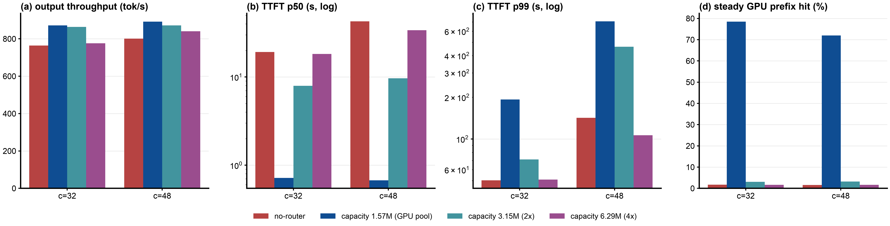
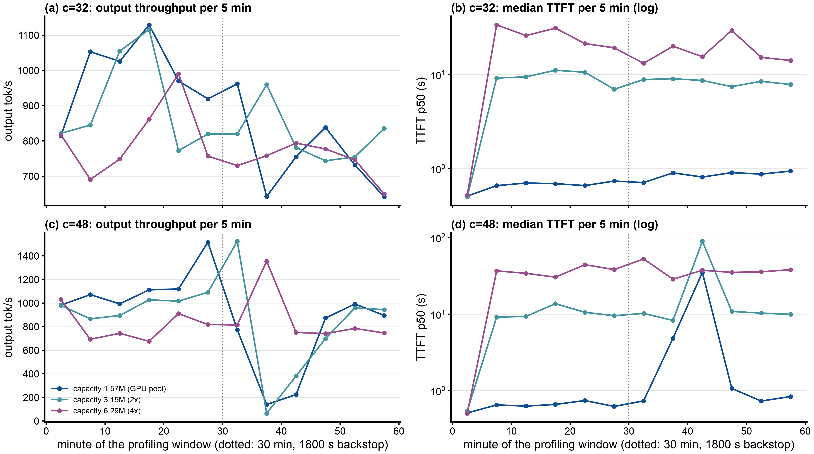
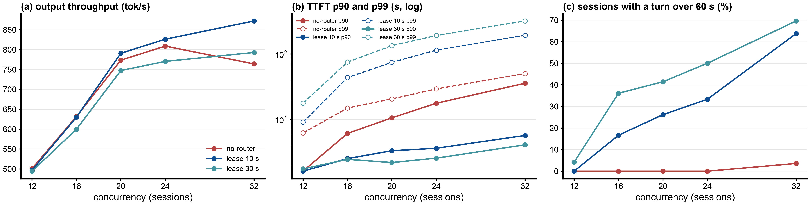
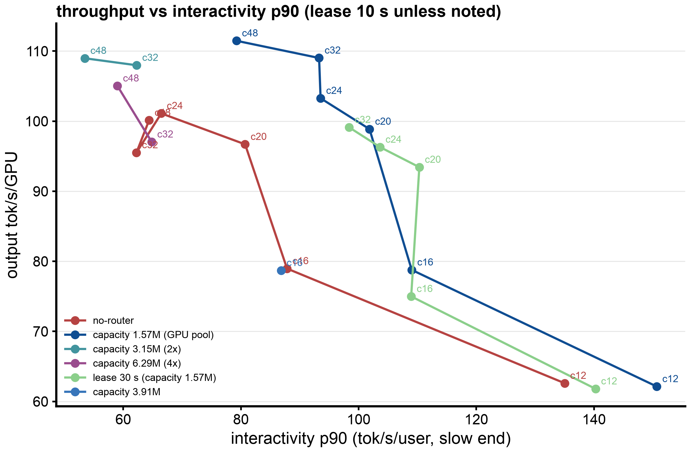

# Benchmark report: llm-d-thunder-agent-simplified gate settings (capacity and idle lease) on one vLLM replica, GLM-5.2 NVFP4 on 8x B200 with CPU KV offload, real Claude Code traffic (AgentX WekaTrace)

## 1. Executive Summary

Objective: Find out how the two main settings of llm-d-thunder-agent-simplified change the results on one GLM-5.2 server: the gate capacity (how many tokens of session context the gate admits per pod) and the idle lease (how long an idle session keeps its room). One hour per point, with the CPU KV tier on, compared against no-router.

Key Finding:

- Capacity equal to the GPU KV pool (1.57M tokens, the default read from vLLM) is the best setting for typical requests: at 32 and 48 sessions it gives the most output (872 and 892 tok/s, against 764 and 801 for no-router), a median TTFT of 0.7 s and a steady GPU prefix hit of 72% to 78%.
- Raising the capacity above the GPU pool removes that benefit. At 2x (3.15M) and 4x (6.29M) the admitted sessions no longer fit on the GPU, the steady GPU hit falls to 2% to 3% (the same as no-router), and the median TTFT rises to 8 s to 34 s. Throughput stays 1% to 11% under the 1.57M setting; at 6.29M and 32 sessions it is the same as no-router (776 against 764 tok/s).
- What a larger capacity buys is a shorter tail and no collapse: at 6.29M no request waits for the 1800 s forced admission, p99 TTFT is 51 s and 106 s (against 193 s and 708 s at 1.57M), and output stays flat over the hour. At 1.57M and 48 sessions output falls from 1133 tok/s (minutes 0 to 30) to 650 (minutes 30 to 60) after the forced admissions at minute 30 to 35.
- A 30 s idle lease is worse than 10 s on this workload: 6% to 9% less output from 20 to 32 sessions, p99 TTFT 1.7x to 1.8x higher, and more requests forced in after 1800 s (1, 5, 7 against 0, 2, 4 at 20, 24, 32 sessions). It keeps more sessions on the GPU (steady hit 0.85 to 0.87 against 0.79 to 0.82) and gives slightly faster typical turns (p90 TTFT 2.2 s to 4.1 s against 3.3 s to 5.7 s).
- No setting tested gives both a fast median and a short tail. That needs a change in how the gate picks and force-admits held sessions, not a different number.
- The upstream main image (`ghcr.io/llm-d/llm-d-router-endpoint-picker:main`, commit `907c5fe8`, with the merged #3076) behaves like the PR3 image tested here (section 8).

## 2. Setup & Environment

- Hardware: one vLLM pod using 8x NVIDIA B200 (tensor parallel 8). Node type: GKE a4-highgpu-8g, cluster `a4-pr`, europe-west4-b. Four such nodes ran points in parallel, one point per node at a time.
- Host: the vLLM pod requests 100 CPU cores and 1300 GiB memory (limit 1600 GiB), with a 900 GiB `/dev/shm` that holds the CPU KV tier.
- Serving Engine & Version: `vllm/vllm-openai:v0.31.0`
- Model Configuration:
  - `nvidia/GLM-5.2-NVFP4` at revision `aec724e8`, TP=8, `--max-model-len 1048576`, FP8 KV cache, `--gpu-memory-utilization 0.8`, MTP speculative decoding with 3 tokens, chunked prefill (`--max-num-batched-tokens 8192`), prefix caching on, `--max-num-seqs 64`.
  - GPU KV pool: 24,576 blocks x 64 tokens = 1,572,864 tokens.
  - CPU KV offload: vLLM native `OffloadingConnector`, `--kv-offloading-size 820` GiB, about 18.2M tokens. GLM-5.2 uses MLA, so the KV cache is the same on all 8 GPUs and vLLM keeps one CPU copy for all of them.
- Router under test: llm-d-router EPP with the `thunder-agent` plugin (PR llm-d/llm-d-router#3076 at commit `a025437b` plus the `Produces()` fix), image `llm-d-router-endpoint-picker:thunder-agent-pr3-a025437b-produces`, envoy `distroless-v1.33.2`. One EPP per vLLM pod, file-discovery mode.
- Benchmark tool: `agentx-harness:agentx-v1.0.6` (SemiAnalysis aiperf fork), `aiperf profile --scenario agentx`.

## 3. Workload & Traffic

Dataset `semianalysisai/cc-traces-weka-062126` (AgentX loader `semianalysis_cc_traces_weka_062126`, uncapped for 1M context): Claude Code sessions with subagents, replayed as session trees with their recorded tool-call gaps (AgentX caps idle gaps at 10 s system-wide and 300 s per tree).

- Input / Output Token Lengths (profiling window, per request): prompt median 88k to 110k tokens, p90 about 200k to 280k, max about 790k; output median 330 to 390 tokens, mean 920 to 1094.
- Concurrency Levels Tested: capacity at 32 and 48 sessions (and 3.91M at 16); idle lease at 12, 16, 20, 24 and 32 sessions.
- Test Duration / Warm-up:
  - 3600 s of profiling per point, after the AgentX warmup (10 requests per lane plus each lane's primer context, 6 to 20 minutes, not counted).
  - Steady-state numbers use requests started after minute 5.
  - One run per point. Before every point both KV tiers were emptied (`POST /reset_prefix_cache?reset_external=true`) and the EPP restarted; the vLLM server was not restarted. Exceptions (fresh vLLM pod per point, `--max-num-seqs` 2x concurrency): no-router at 12 and 16 sessions, lease 30 s at 12 and 16 sessions, and capacity 3.91M at 16 sessions.

## 4. Test Arms

All llm-d-thunder-agent-simplified arms: sessions identified by the `X-Session-ID` header; a pod's room is its capacity minus the summed context tokens of the sessions it has admitted; turns of admitted sessions always dispatch; a paused or new session dispatches only when it fits, and sessions idle for longer than the idle lease give up their room for it (longest idle first, they become paused); a request held for 1800 s (`headWaitStarvationMs`) is let in regardless; `utilThreshold` 1.0, `evictionTtlSeconds` 3600.

- no-router (baseline): every request goes straight to the vLLM Service.
- capacity 1.57M, lease 10 s: capacity read from vLLM (the GPU KV pool). Config `b200/thunder-gpu-l10-plugins.yaml`.
- capacity 3.15M (2x the GPU pool), lease 10 s: `b200/thunder-cap3m-l10-plugins.yaml`.
- capacity 6.29M (4x), lease 10 s: `b200/thunder-cap6m-l10-plugins.yaml`.
- capacity 3.91M, lease 10 s (16 sessions only): set earlier as GPU plus an estimate of the CPU tier that turned out to be wrong (2.27M). `b200/thunder-cpu-l10-plugins.yaml`.
- capacity 1.57M, lease 30 s (the plugin's default lease): `b200/thunder-plugins.yaml`.

The capacity variants drop vLLM's `cache_config_info` from the EPP's metric extraction, so the gate falls back to `capacityTokens`. The gate's capacity metric in each run confirms the value (3,145,728 and 6,291,456).

## 5. Results (raw data: `b200/results/explore1h-*`, `r1/`, `thunder-r1/`, `thunder-cpu-l10-r1/`; collected in `b200/results/report-params/metrics.json`)

TTFT in seconds, interactivity p90 in output tok/s per user (slow end), hit rate as steady-state GPU prefix-cache hit.

### 5.1 Gate capacity, lease 10 s

| conc | arm | output tok/s | TTFT p50 | TTFT p90 | TTFT p99 | interactivity p90 | GPU hit | vLLM waiting (mean) | turns over 60 s | sessions with a turn over 60 s | forced in after 1800 s |
|---|---|---|---|---|---|---|---|---|---|---|---|
| 32 | no-router | 764 | 19.21 | 35.81 | 50.2 | 62 | 1.7% | 14.2 | 0.07% | 3.6% | - |
| 32 | capacity 1.57M | **872** | **0.72** | **5.71** | 193.1 | **93** | **78.5%** | 0.2 | 2.46% | 63.8% | 4 |
| 32 | capacity 3.15M | 864 | 7.95 | 17.13 | 71.3 | 62 | 3.1% | 6.4 | 1.16% | 24.1% | 0 |
| 32 | capacity 6.29M | 776 | 18.21 | 35.43 | 50.9 | 65 | 1.7% | 13.8 | 0.18% | 7.1% | 0 |
| 48 | no-router | 801 | 42.78 | 62.12 | 142.2 | 64 | 1.6% | 31.0 | 12.12% | 83.3% | - |
| 48 | capacity 1.57M | **892** | **0.67** | **10.32** | 707.8 | **79** | **72.0%** | 3.2 | 3.81% | 73.8% | 14 |
| 48 | capacity 3.15M | 872 | 9.65 | 21.28 | 463.2 | 53 | 3.2% | 9.8 | 3.79% | 67.1% | 12 |
| 48 | capacity 6.29M | 840 | 33.96 | 56.45 | 106.4 | 59 | 1.7% | 26.1 | 7.50% | 70.0% | 0 |

Output in the two halves of the hour (5-minute bins, tok/s):

| conc | arm | minutes 0 to 30 | minutes 30 to 60 |
|---|---|---|---|
| 32 | capacity 1.57M | 985 | 762 |
| 32 | capacity 3.15M | 905 | 816 |
| 32 | capacity 6.29M | 811 | 743 |
| 48 | capacity 1.57M | 1133 | 650 |
| 48 | capacity 3.15M | 980 | 762 |
| 48 | capacity 6.29M | 812 | 866 |

Capacity 3.91M at 16 sessions (fresh vLLM pod), next to no-router and capacity 1.57M:

| arm | output tok/s | TTFT p50 | TTFT p90 | TTFT p99 | interactivity p90 | GPU hit | sessions with a turn over 60 s |
|---|---|---|---|---|---|---|---|
| no-router | 632 | 0.77 | 6.13 | 15.0 | 88 | 54.6% | 0% |
| capacity 1.57M | 630 | 0.64 | 2.53 | 43.7 | 109 | 80.1% | 16.7% |
| capacity 3.91M | 630 | 0.81 | 5.60 | 15.9 | 87 | 54.4% | 0% |

### 5.2 Idle lease, capacity 1.57M

| conc | arm | output tok/s | TTFT p50 | TTFT p90 | TTFT p99 | interactivity p90 | GPU hit | sessions with a turn over 60 s | forced in after 1800 s |
|---|---|---|---|---|---|---|---|---|---|
| 12 | no-router | 501 | 0.62 | 1.63 | 6.2 | 135 | 82.4% | 0% | - |
| 12 | lease 10 s | 497 | 0.56 | 1.62 | 9.1 | 151 | 83.8% | 0% | 0 |
| 12 | lease 30 s | 494 | 0.61 | 1.76 | 17.8 | 140 | 85.1% | 4.2% | 0 |
| 16 | no-router | 632 | 0.77 | 6.13 | 15.0 | 88 | 54.6% | 0% | - |
| 16 | lease 10 s | 630 | 0.64 | 2.53 | 43.7 | 109 | 80.1% | 16.7% | 0 |
| 16 | lease 30 s | 600 | 0.62 | 2.46 | 75.3 | 109 | 83.8% | 36.1% | 0 |
| 20 | no-router | 774 | 1.32 | 10.60 | 20.6 | 81 | 34.1% | 0% | - |
| 20 | lease 10 s | **791** | 0.69 | 3.33 | 74.7 | 102 | 80.0% | 26.2% | 0 |
| 20 | lease 30 s | 747 | 0.66 | 2.20 | 134.5 | 110 | 85.7% | 41.5% | 1 |
| 24 | no-router | 809 | 6.21 | 17.72 | 29.3 | 66 | 12.0% | 0% | - |
| 24 | lease 10 s | **826** | 0.71 | 3.64 | 114.5 | 94 | 81.5% | 33.3% | 2 |
| 24 | lease 30 s | 770 | 0.66 | 2.57 | 191.7 | 104 | 87.2% | 50.0% | 5 |
| 32 | no-router | 764 | 19.21 | 35.81 | 50.2 | 62 | 1.7% | 3.6% | - |
| 32 | lease 10 s | **872** | 0.72 | 5.71 | 193.1 | 93 | 78.5% | 63.8% | 4 |
| 32 | lease 30 s | 793 | 0.68 | 4.11 | 320.3 | 98 | 84.9% | 69.6% | 7 |

## 6. Figures

Capacity at 32 and 48 sessions

Capacity over the hour (5-minute bins)

At 48 sessions the 1.57M and 3.15M runs drop to 65 to 380 tok/s around minute 35, when requests held since the start reach the 1800 s backstop and are forced in together (the largest sessions, since the gate serves smaller ones first), and recover by minute 45 to 50. The 6.29M run never holds a request that long and stays at 700 to 900 tok/s, but its median TTFT is 30 s to 50 s all hour. At 32 sessions none of the runs collapses.

Idle lease 10 s against 30 s

Throughput against per-user speed, every setting

Up and to the right is better. Capacity 1.57M with lease 10 s gives the best curve; lease 30 s sits to the right of it at low load but lower; the 3.15M and 6.29M points sit at the far left (slow users, like no-router) with throughput close to 1.57M; 3.91M at 16 sessions sits on top of no-router.

## 7. Analysis

Primary Bottleneck: GPU KV capacity for the running requests (only 5 to 10 requests fit at once with 100k-token contexts).

Capacity:

- The gate helps only while its admitted set fits on the GPU. With capacity 1.57M the admitted sessions stay on the GPU between turns (steady GPU hit 72% to 79%), vLLM's queue stays near empty (0.2 to 3.2 waiting), and a turn starts in under a second.
- At 2x and 4x the gate admits more sessions than the GPU holds. They then evict each other's GPU blocks just as under no-router: the steady GPU hit is 2% to 3%, 85% to 89% of each prompt is loaded back from the CPU tier, and requests queue inside vLLM (6 to 26 waiting). The median TTFT becomes that queue time (8 s at 3.15M, 18 s to 34 s at 6.29M), and interactivity drops to no-router levels (53 to 65).
- Throughput barely moves, because the CPU tier still holds every prefix (recompute 2.8% to 5.0%): 3.15M gives 1% to 2% less than 1.57M, 6.29M gives 6% to 11% less. At 6.29M and 32 sessions the gate almost never holds anyone (its admitted set is 0.98x of 6.29M, about the whole working set), and the run is the same as no-router.
- The upside of a larger capacity is the tail. Fewer sessions are held, so fewer reach the 1800 s backstop: forced admissions go from 4 and 14 (1.57M) to 0 (6.29M), p99 TTFT from 193 s and 708 s to 51 s and 106 s, and the output stays flat instead of collapsing after minute 30.
- Capacity 3.91M at 16 sessions is about 1.2x the mean working set there (3.3M), so the gate still pauses sessions (178 times) but never holds one for long (no turn over 60 s), and every other number matches no-router (GPU hit 54%, TTFT p90 5.6 s against 6.1 s).

Idle lease:

- With 30 s an idle session keeps its room through most tool calls. More sessions are admitted (1 to 1.6 more on average), but more of them sit idle, so fewer requests run (4.3 to 5.0 against 5.0 to 5.9 in vLLM from 20 to 32 sessions). The running ones find their blocks on the GPU more often (hit 0.85 to 0.87) and run a little faster per user, but the pod does less work: 6% to 9% less output, below no-router at 20 and 24 sessions.
- Room is given up less often, so held sessions wait longer: p99 TTFT 1.7x to 1.8x of lease 10 s, 36% to 70% of sessions with a turn over 60 s from 16 sessions up, and more forced admissions.

Trade-offs:

- There is one dial between two ends. Capacity at the GPU pool gives fast typical turns and the most output, and pays with a long tail, forced admissions and (from about 48 sessions) a collapse after minute 30. A large capacity removes the tail and the collapse, and pays with no-router-like median latency. The lease moves along the same line: longer lease, faster running sessions, longer waits for held ones.
- Getting both a fast median and a short tail needs a change in the gate's logic, for example ordering held sessions by how long they have waited instead of smallest first, and force-admitting one session at a time after pausing idle ones. Those were suggested to the PR author in step 24.

Caveats:

- One run per point; run-to-run spread with 900 s windows was about 4% on throughput for the gate.
- The capacity variants ran on the same day on four servers at once; three of them had to be rerun after a client node overload stopped them in warmup (results under `*-retry`). The lease 30 s points at 12 and 16 sessions and the 3.91M point come from fresh-server runs with `--max-num-seqs` 2x concurrency.
- Only 32 and 48 sessions for capacity; the curve between 1.57M and 3.15M (for example 2M) was not measured.

## 8. Upstream main image check

`ghcr.io/llm-d/llm-d-router-endpoint-picker:main` (digest `sha256:c0d60804...`, built from upstream main `907c5fe8`, which includes the merged #3076). Against the tested `a025437b` it adds the `Produces()` declaration and a forced admission that first pauses idle sessions on the session's own pod; the config parameters are the same. One 900 s point at 24 sessions, capacity 1.57M, lease 10 s, against the same settings with the PR3 image (three 900 s runs) and no-router (two 900 s runs):

| arm | output tok/s | TTFT p50 / p90 | interactivity p90 | GPU hit | gate pauses / resumes / delayed | admitted vs GPU pool | request errors |
|---|---|---|---|---|---|---|---|
| main image | 916 | 0.58 / 2.80 s | 86 | 82.0% | 140 / 97 / 67 | 0.94 | 0 |
| PR3 image | 878 to 911 | 0.57 to 0.58 / 2.33 to 2.95 s | 83 to 86 | 82.5% to 83.0% | 127 to 138 / 90 to 93 / 60 to 69 | 0.93 to 0.95 | 0 |
| no-router | 830 to 835 | 4.1 to 4.3 / 15.4 to 16.1 s | 57 to 62 | 9.4% to 9.7% | - | - | 0 |

The main image behaves like the PR3 image. Its EPP log has the same benign errors as the PR3 runs (1600 "parsing response" lines from the client's `/metrics` scrape through the EPP, and one "client disconnected" per request cancelled at the end), and no "wrote undeclared request attribute" error. The 900 s window does not reach the 1800 s backstop, so the new forced-admission behavior was not exercised.
