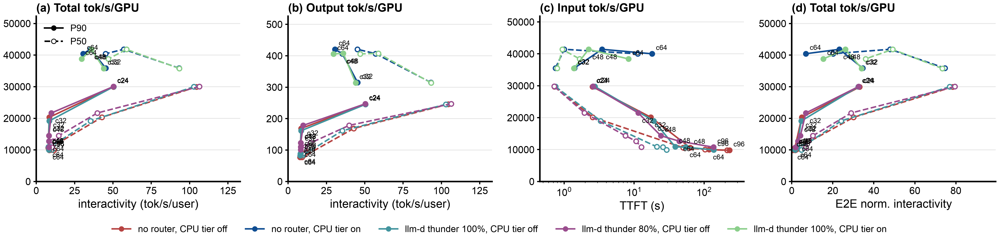
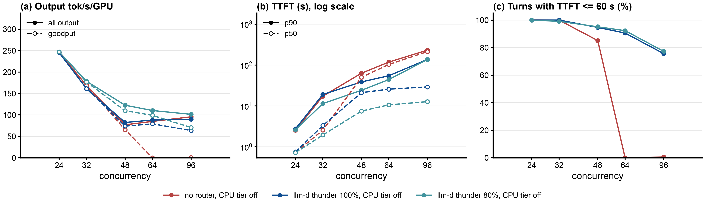

# Step 26: llm-d-thunder-agent-simplified on Qwen3.5-397B-A17B-FP8, vLLM TP=4, 4x B200

Status: part 1 (CPU tier on) done (2026-10-14); part 2 (CPU tier off) done (2026-10-28). Report comparing with GLM-5.2 (step 25): [benchmark-report-qwen35-vs-glm52.md](benchmark-report-qwen35-vs-glm52.md).

## Question

InferenceX run 442369 serves Qwen3.5-397B-A17B-FP8 on 4 B200 (SGLang, TP4, HiCache) for the AgentX workload. Does llm-d-thunder-agent-simplified help this model the way it helps GLM-5.2?

## Setup

- Cluster a4-pr, namespace bobzetian-llmd, kubeconfig `/tmp/a4-pr.kubeconfig` (regenerate with `KUBECONFIG=/tmp/a4-pr.kubeconfig gcloud container clusters get-credentials a4-pr --region europe-west4 --project supercomputer-testing` if `/tmp` was cleaned).
- Servers: `b200/vllm-qwen35.yaml.tmpl` (the SGLang to vLLM mapping is in its header), rendered to `vllm-qwen35-{a..f}.yaml`, GPUs from `gpu-claim.yaml` (4 per server), two servers per a4-highgpu-8g node.
- llm-d-thunder-agent-simplified: `b200/thunder-l10-q{b,d,f}-plugins.yaml`, one per thunder server, capacity = that server's vLLM `kv_cache_size_tokens` (vLLM uses 2128-token blocks for this hybrid model, so block size x blocks would overstate it by 13%); lease 10 s, forced admission after 1800 s. EPP lanes `lane-epp-q{b,d,f}.yaml` (rendered by `render-epp.sh`, image replaced by `ghcr.io/llm-d/llm-d-router-endpoint-picker:main@sha256:c0d60804...`, commit `907c5fe8`).
- Trace set: `semianalysis_cc_traces_weka_062126_256k`, as InferenceX uses for qwen3.5.

## Runs

| label | server | concurrency | arm | result |
|---|---|---|---|---|
| `qwen35-direct` | qwen35-tp4-a | 32 | no-router | ok (2 request errors from the 5 s keep-alive) |
| `qwen35-thunder-gpu-l10` | qwen35-tp4-b | 32 | llm-d-thunder-agent-simplified | ok |
| `qwen35-direct` | qwen35-tp4-c | 48 | no-router | ok |
| `qwen35-thunder-gpu-l10` | qwen35-tp4-d | 48 | llm-d-thunder-agent-simplified | ok |
| `qwen35-direct` | qwen35-tp4-e | 64 | no-router | ok on the third attempt (`run-c64-direct.sh`) |
| `qwen35-thunder-gpu-l10` | qwen35-tp4-f | 64 | llm-d-thunder-agent-simplified | ok |
| `qwen35-thunder-u08` | qwen35-tp4-d | 48 | llm-d-thunder-agent-simplified, `utilThreshold` 0.8 (`thunder-l10-u8-qd-plugins.yaml`) | ok |
| `qwen35-thunder-u06` | qwen35-tp4-c | 48 | llm-d-thunder-agent-simplified, `utilThreshold` 0.6 (`thunder-l10-u6-qc-plugins.yaml`) | ok |

Runner: `b200/run-1h.sh` (all six at once, 3600 s, cache reset per point); the two `utilThreshold` points: `b200/run-util.sh`, analysis `b200/results/report-util/`. Analysis: `b200/results/report/`; comparison with GLM-5.2: `b200/results/report-compare/` (`collect_qwen.py` is step 25's collector pointed at these runs).

## Incidents

- no-router c=64 failed twice in warmup with "Connection reset by peer": vLLM closes idle HTTP connections after 5 s (`VLLM_HTTP_TIMEOUT_KEEP_ALIVE`), and the client reused one it had just closed. Server e was restarted with `VLLM_HTTP_TIMEOUT_KEEP_ALIVE=1800` (the template now sets it; InferenceX sets `SGLANG_TIMEOUT_KEEP_ALIVE=1800` for the same reason). The third attempt first failed at once because the old Jobs still existed; delete them before reusing a label.
- The runner was restarted twice before any point started: once after its header was edited while running (bash reads scripts as it goes), once to set the per-server llm-d-thunder-agent-simplified capacities.

## Part 2: CPU tier off (2026-10-28)

### Question

Part 1 found no throughput gain on Qwen3.5 (0.97x to 1.00x): a GPU cache miss was a cheap copy from the 387 GiB CPU tier (63% of prompt tokens at 48 sessions). Without a CPU tier, every miss is a full prefill. How much does llm-d thunder give then, and from which concurrency?

### Setup

- Servers: [`b200/vllm-qwen35-nooff.yaml.tmpl`](b200/vllm-qwen35-nooff.yaml.tmpl), part 1's template without `--kv-offloading-size` / `--kv-offloading-backend` (memory request 256Gi, `/dev/shm` 64Gi). Everything else as part 1, `MAX_NUM_SEQS` = 2x concurrency. Six servers `qwen35-nooff-{a..f}`, two per node: a, b on `13z6`; c, d on `gw0s`; e, f on `p3mf`.
- llm-d thunder: part 1's settings (`utilThreshold` 1.0, idle lease 10 s, forced admission 1800 s, no `cacheInfoSpec`), capacity = the server's `kv_cache_size_tokens`, set again after every server restart. Lane EPPs `agentx-epp-n{b,d,f}` rendered by [`b200/render-nooff-epp.py`](b200/render-nooff-epp.py) from part 1's `lane-epp-qd.yaml` (same EPP image and envoy config).
- Client and method: as part 1 (AgentX `agentx-v1.0.6`, `semianalysis_cc_traces_weka_062126_256k`, 3600 s, `RESET=1`).
- Third arm (added after the first two, 2026-10-28 23:49 to 02:29 UTC): llm-d thunder with `utilThreshold` 0.8, so the gate admits sessions up to 80% of the GPU KV pool and leaves room for paused sessions' blocks; everything else as the 100% arm. Label `qwen35-nooff-thunder-u08`, runner [`b200/run-nooff-u08.sh`](b200/run-nooff-u08.sh), lane EPPs `agentx-epp-t{a,c,e}`. Servers a (`13z6`, c=96), c (`gw0s`, c=48 then 32), e (`p3mf`, c=64 then 24): each of these nodes had one GPU taken by another team, and two servers tried on `d213` were evicted for low ephemeral storage. The no-router baseline for this arm is the run of the first two arms: same node for every c, about 21 hours earlier.
- Grid: c = 24, 32, 48, 64, 96, both arms of one c at the same time on one node. Node queues: `13z6` c=96; `gw0s` c=48 then 32; `p3mf` c=64 then 24. Runner [`b200/run-nooff.sh`](b200/run-nooff.sh) (`SMOKE=1` for the c=4 smoke), labels `qwen35-nooff-direct` and `qwen35-nooff-thunder-l10`, analysis `b200/results/report-nooff/`.

### Expectations (written before the run)

1. c = 24 and 32: the working set fits the GPU pool (part 1: 0.87x at c=32). Thunder within 5% to 15% of no router.
2. c = 48 and 64 (part 1: 1.36x and 1.78x the pool): no router computes most of what came from the CPU tier in part 1, output falls well below part 1's 394 tok/s/GPU, TTFT p50 reaches tens of seconds. Thunder gives at least 1.2x output. Risk: in part 1 at c=48 thunder admitted 47.1 of 48 sessions with a 29% GPU hit; if that repeats, the gain at c=48 stays small.
3. c = 96: no router collapses; thunder holds output near its c=48/64 level, with a longer tail (TTFT p99, forced admissions).
4. Falsified if at c=64 thunder is within 5% of no router in output and no router computes under 20% of prompt tokens.

### Runs

| label | server (node) | c | result |
|---|---|---|---|
| `qwen35-nooff-direct-smoke-{a,c,e}`, `qwen35-nooff-thunder-l10-smoke-{b,d,f}` | all six | 4 (120 s) | ok, `verify-point.sh` passed (cached tokens present: prefix caching works on the hybrid model without the offload connector) |
| `qwen35-nooff-direct` / `qwen35-nooff-thunder-l10` | a / b (`13z6`) | 96 | ok (02:49 to 04:41 UTC) |
| `qwen35-nooff-direct` / `qwen35-nooff-thunder-l10` | c / d (`gw0s`) | 48, then 32 | ok (02:57 to 05:45 UTC) |
| `qwen35-nooff-direct` / `qwen35-nooff-thunder-l10` | e / f (`p3mf`) | 64, then 24 | ok (02:57 to 05:53 UTC) |
| `qwen35-nooff-thunder-u08-smoke-{a,c,e}` | a, c, e | 4 (120 s) | ok |
| `qwen35-nooff-thunder-u08` | a (`13z6`) / c (`gw0s`) / e (`p3mf`) | 96 / 48, then 32 / 64, then 24 | ok (23:49 to 02:22 UTC); all five pass `verify-point.sh` |

All ten points pass `verify-point.sh` (job succeeded, pods unchanged, EPP scrape present, no gate warning). Thunder capacities (vLLM `kv_cache_size_tokens`): 4,686,531 (c=96), 4,780,827 (c=48), 4,739,337 (c=64), 4,843,063 (c=32), 4,869,466 (c=24). No-router warmups took 20 to 43 min at c >= 48 (thunder: 5 to 13 min), so no-router profiling started later than thunder's on the same node. Incidents: the first smoke run gave all three nodes the same label, so two smoke Jobs clashed (fixed: one smoke label per server); the runner's final `analyze.py` call failed (`uv` not on its PATH; fixed after the runs, analyses run by hand).

### Results

Steady state (requests started after minute 5), 4 B200 per point. Report [`b200/results/report-nooff/summary.md`](b200/results/report-nooff/summary.md), ratios [`ratios.md`](b200/results/report-nooff/ratios.md). 2x2 with part 1 (CPU tier on, analyzed again with the same `analyze.py`): [`b200/results/report-2x2/`](b200/results/report-2x2/), part 1 summary [`b200/results/report-cpuon/summary.md`](b200/results/report-cpuon/summary.md).

| c | arm | output tok/s/GPU (vs no router) | goodput tok/s/GPU (TTFT under 60 s) | TTFT p50 / p90 / p99 (s) | decode interactivity p90 | E2E-norm. interactivity p90 | GPU hit / computed | vLLM waiting | forced admissions |
|---|---|---|---|---|---|---|---|---|---|
| 24 | no router | 245.8 | 245.8 | 0.73 / 2.5 / 7 | 50.4 | 33.1 | 88.2% / 11.8% | 0.3 | - |
| 24 | thunder 100% | 245.4 (1.00x) | 245.4 | 0.75 / 2.8 / 8 | 50.5 | 32.4 | 88.2% / 11.8% | 0.4 | 0 |
| 24 | thunder 80% | 247.1 (1.01x) | 247.1 | 0.72 / 2.6 / 9 | 50.3 | 32.6 | 88.2% / 11.8% | 0.4 | 0 |
| 32 | no router | 168.7 | 168.6 | 2.6 / 17.3 / 32 | 8.4 | 4.86 | 60.2% / 39.8% | 3.3 | - |
| 32 | thunder 100% | 161.5 (0.96x) | 161.5 | 3.3 / 19.1 / 33 | 8.4 | 4.63 | 56.5% / 43.5% | 3.4 | 0 |
| 32 | thunder 80% | 178.6 (1.06x) | 176.8 | 2.0 / 11.4 / 58 | 9.9 | 6.88 | 63.7% / 36.3% | 2.0 | 0 |
| 48 | no router | 77.0 | 65.4 | 50 / 63 / 84 | 7.8 | 1.56 | 2.8% / 97.2% | 23.3 | - |
| 48 | thunder 100% | 82.4 (1.07x) | 73.9 | 21 / 39 / 265 | 7.9 | 2.54 | 4.3% / 95.7% | 9.5 | 7 |
| 48 | thunder 80% | **122.6 (1.59x)** | **109.9** | 7.5 / 24 / 430 | 8.2 | 4.18 | 29.5% / 70.5% | 3.6 | 8 |
| 64 | no router | 84.9 | 0.0 | 103 / 118 / 135 | 8.2 | 0.88 | 0.9% / 99.1% | 48.6 | - |
| 64 | thunder 100% | 88.1 (1.04x) | 79.2 | 26 / 55 / 1,173 | 8.1 | 2.31 | 4.1% / 95.9% | 12.7 | 21 |
| 64 | thunder 80% | **110.3 (1.30x)** | **99.0** | 10.6 / 44 / 1,813 | 8.3 | 3.06 | 16.3% / 83.7% | 5.3 | 24 |
| 96 | no router | 95.6 | 0.4 | 213 / 231 / 246 | 8.5 | 0.50 | 0.9% / 99.1% | 99.6 | - |
| 96 | thunder 100% | 90.1 (0.94x) | 63.7 | 29 / 137 / 1,847 | 8.3 | 1.62 | 2.9% / 97.1% | 19.7 | 53 |
| 96 | thunder 80% | 101.4 (1.06x) | 70.6 | 12.7 / 136 / 1,925 | 8.3 | 1.90 | 4.4% / 95.6% | 12.4 | 59 |

2x2, output tok/s/GPU (no router / thunder 100%):

| c | CPU tier on (part 1) | CPU tier off (part 2) | CPU tier gain, no router |
|---|---|---|---|
| 32 | 314.9 / 313.7 | 168.7 / 161.5 | 1.87x |
| 48 | 406.7 / 407.5 | 77.0 / 82.4 | 5.28x |
| 64 | 420.6 / 405.9 | 84.9 / 88.1 | 4.95x |

### Findings

1. **Without a CPU tier, thunder at 100% capacity does not raise throughput on Qwen3.5** (1.00x, 0.96x, 1.07x, 1.04x, 0.94x at c = 24 to 96). From c=48 on, both arms compute 96% to 99% of prompt tokens. The gate does not keep paused sessions on the GPU: its admitted working set averages 1.00x to 1.23x the pool, so the running requests fill the KV cache (91% to 99% used) and every resumed turn is recomputed.
2. **At 80% capacity (`utilThreshold` 0.8), thunder raises throughput 1.59x at c=48 and 1.30x at c=64** (122.6 and 110.3 against 77.0 and 84.9 tok/s/GPU). The room left in the pool keeps paused sessions' blocks: GPU hit 29.5% and 16.3%, against 4.3% and 4.1% at 100%. At c=32 it gives 1.06x (100%: 0.96x), at c=24 a tie, and at c=96 1.06x, where 96 sessions overflow the pool far beyond the 20% headroom (GPU hit 4.4%).
3. **Latency and goodput:** both thunder arms move the queue from vLLM to the gate. TTFT p50 at 80% is 7.5, 10.6 and 12.7 s at c = 48, 64, 96 (no router 50, 103, 213 s; 100%: 21, 26, 29 s). With a 60 s TTFT SLO, the 80% arm keeps 95%, 92% and 77% of turns (no router 85%, 0%, 0.6%), goodput 109.9, 99.0 and 70.6 tok/s/GPU.
4. **The cost is the tail, and 80% makes it longer:** TTFT p99 430 s, 1,813 s and 1,925 s at c = 48, 64, 96 (100%: 265, 1,173, 1,847 s; no router 84, 135, 246 s), with 8, 24 and 59 forced admissions. Admitting less means held sessions wait longer.
5. **The CPU tier is still the larger lever:** without it, no-router output falls 1.87x at c=32 and about 5x at c = 48 and 64 (407 to 77, 421 to 85 tok/s/GPU). The best CPU-off arm (thunder 80%, 122.6 at c=48) stays at 0.30x of the CPU-on no-router point.
6. **Contrast with part 1:** with the CPU tier on, 80% capacity cost 4% throughput at c=48 (a CPU hit is cheap there); without it, a miss is a full prefill, so keeping paused sessions on the GPU pays.

Against the expectations (written for the first two arms): (1) holds; (2) holds for no router but not for thunder at 100% (1.07x and 1.04x, not 1.2x); the risk written in (2) is what happened, and the 80% arm, added afterwards, removes it at c = 48 and 64; (3) holds for latency and the tail; (4) not falsified as written: misses are not rare, and only a gate with headroom avoids some of them.
