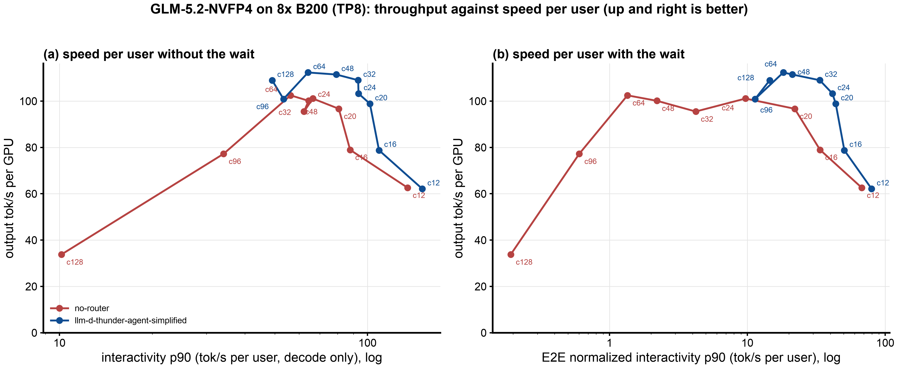
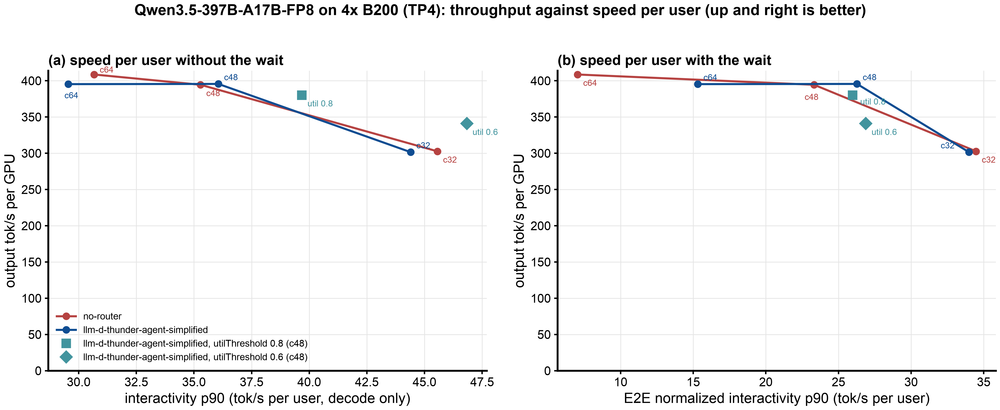

# Benchmark report: llm-d-thunder-agent-simplified on GLM-5.2 (8x B200) and Qwen3.5-397B (4x B200)

## 1. Executive Summary

Objective: Find why llm-d-thunder-agent-simplified helps GLM-5.2 and does not help Qwen3.5-397B-A17B. Both models ran against no-router at 32, 48 and 64 agent sessions, one hour for each point.

Key Finding:

- On GLM-5.2, llm-d-thunder-agent-simplified increases throughput by 10% to 14%. It decreases the median TTFT from 19 s to 74 s down to 0.7 s.
- On Qwen3.5, llm-d-thunder-agent-simplified does not increase throughput (0.97x to 1.00x). It decreases the median TTFT only at 64 sessions (1.6 s, not 11.0 s).
- The cause is no-router, not llm-d-thunder-agent-simplified. GLM-5.2 keeps 48.4 KB of KV for each token on each GPU. Qwen3.5 keeps approximately 8 KB. Thus, up to 48 sessions, Qwen3.5 has almost no queue and little CPU-to-GPU traffic for llm-d-thunder-agent-simplified to remove.
- On Qwen3.5, llm-d-thunder-agent-simplified does not keep idle sessions on the GPU. The GPU hit is 29% at 48 sessions, the same as no-router. On GLM-5.2 it is 72%.
- The cost is the same on the two models: a longer tail. At 64 sessions on Qwen3.5, p99 TTFT is 99 s (no-router: 26 s).
- Qwen3.5 does not collapse after the 1800 s forced admissions. GLM-5.2 collapses at 48 and 64 sessions.
- With free space (`utilThreshold` 0.6, section 5.3), llm-d-thunder-agent-simplified keeps idle sessions on the GPU on Qwen3.5. The GPU hit is 75%, not 29%. But throughput decreases by 14%, and the agent metrics do not improve. The cause: a CPU-tier hit is cheap on this model.
- When llm-d-thunder-agent-simplified helps (section 8): it can only recover the compute that no-router loses on cache misses. On three models, the gain is 1.75x to 3.89x when a miss is a full prefill. It is 1.03x to 1.15x when a miss is an expensive load, and 1.00x on Qwen3.5.
- Agent metrics (section 5.1): on GLM-5.2, llm-d-thunder-agent-simplified increases the E2E normalized interactivity p90 by 8x to 14x. It increases the session progress by 18% to 21%. It also increases the request latency p99 by 2.3x to 7.4x. On Qwen3.5, the three metrics do not change up to 48 sessions.

## 2. Setup & Environment

| | GLM-5.2 (step 25) | Qwen3.5 (step 26) |
|---|---|---|
| Model | `nvidia/GLM-5.2-NVFP4`, 743B total, 39B active, MLA in all layers, 1M context | `Qwen/Qwen3.5-397B-A17B-FP8`, 397B total, 17B active, 15 of 60 layers with full attention (2 KV heads), 262k context |
| Hardware | 8x B200, TP8 | 4x B200, TP4 |
| Engine | vLLM v0.31.0, FP8 KV, MTP 3 tokens, `--max-num-seqs 64` | vLLM v0.31.0, FP8 KV, MTP 3 tokens, `--max-num-seqs` 2x concurrency |
| GPU KV pool | 1.57M tokens | 4.74M to 4.84M tokens |
| KV per token per GPU | 48.4 KB | approximately 7.7 KB, plus a fixed state for each request |
| CPU KV offload | 820 GiB | 387 GiB |
| EPP image | PR3 `a025437b` plus `Produces()` | upstream main `907c5fe8` |
| llm-d-thunder-agent-simplified settings | capacity from vLLM, lease 10 s, forced admission after 1800 s | capacity = vLLM `kv_cache_size_tokens`, lease 10 s, forced admission after 1800 s |

## 3. Workload & Traffic

- Traces: the same 393 Claude Code sessions. GLM-5.2 uses the full corpus. Qwen3.5 uses the 256k-capped corpus, as InferenceX does. The capped corpus has half the turns and one third of the input tokens.
- Median prompt: GLM-5.2 73k to 108k tokens. Qwen3.5 73k to 92k tokens.
- Each point: 3600 s after the warmup. The KV cache is empty at the start of each point. One run for each point.

## 4. Test Arms

- no-router (baseline): the client sends each request directly to vLLM.
- llm-d-thunder-agent-simplified: it admits a session only if its context fits in the pod capacity. A session that is idle for more than 10 s can lose its room. It admits a request after 1800 s in all conditions.

## 5. Results

Raw data: step 25 `b200/results/explore1h-*` and step 26 `b200/results/qwen35-*`. The same code collects the two (`report1h/metrics.json`, `report-compare/metrics-qwen.json`).

### 5.1 Agent metrics

For an agent, the time of a turn is the wait, the prefill and the decode together. Interactivity measures only the decode, so this report uses these three metrics:

- E2E normalized interactivity: output tokens / request latency, for each turn. It includes the wait. p90 is the slowest 10%.
- Request latency p90 and p99: the time of a turn, in seconds. p99 shows the sessions that llm-d-thunder-agent-simplified holds. p90 does not.
- Session progress: the turns that llm-d-thunder-agent-simplified completes on the traces that the two arms ran, divided by the no-router turns on the same traces. 1.00 = the same progress.

All values are for the whole profiling window.

| model | c | arm | E2E norm. interactivity p50 | E2E norm. interactivity p90 | request latency p90 (s) | request latency p99 (s) | session progress |
|---|---|---|---|---|---|---|---|
| GLM-5.2 | 32 | no-router | 22.5 | 4.2 | 49.4 | 94.2 | - |
| GLM-5.2 | 32 | thunder | 109.0 | 33.5 | 24.6 | 213.3 | 1.19 |
| GLM-5.2 | 48 | no-router | 10.9 | 2.2 | 76.1 | 163.0 | - |
| GLM-5.2 | 48 | thunder | 95.0 | 21.2 | 31.1 | 710.8 | 1.18 |
| GLM-5.2 | 64 | no-router | 6.9 | 1.4 | 122.8 | 179.9 | - |
| GLM-5.2 | 64 | thunder | 82.0 | 18.2 | 39.6 | 1331.0 | 1.21 |
| Qwen3.5 | 32 | no-router | 76.2 | 34.5 | 25.5 | 86.1 | - |
| Qwen3.5 | 32 | thunder | 75.2 | 34.0 | 25.6 | 86.4 | 1.00 |
| Qwen3.5 | 48 | no-router | 48.7 | 23.3 | 38.2 | 114.2 | - |
| Qwen3.5 | 48 | thunder | 49.9 | 26.3 | 37.2 | 114.8 | 1.00 |
| Qwen3.5 | 64 | no-router | 21.1 | 7.0 | 56.6 | 156.8 | - |
| Qwen3.5 | 64 | thunder | 36.8 | 15.3 | 55.1 | 225.2 | 0.98 |

- GLM-5.2: the p90 metrics and the p99 metric give opposite results. Most turns are much faster. The held turns are much slower. At 64 sessions, 1% of the turns take more than 22 minutes.
- Qwen3.5: up to 48 sessions, the two arms are the same. At 64 sessions, llm-d-thunder-agent-simplified doubles the E2E normalized interactivity p90 and increases the request latency p99 by 1.4x.
- Interactivity (decode only) increases only on GLM-5.2 (p90 62 to 93 at 32 sessions), because less CPU-to-GPU traffic makes each engine step faster. On Qwen3.5 it does not change, because the number of running requests does not change.

### 5.2 All metrics

TTFT is in seconds. Interactivity p90 is output tok/s per user (slow end). Token sources are for the steady state.

| model | c | arm | output tok/s per GPU | TTFT p50 | TTFT p90 | TTFT p99 | interactivity p90 | running in vLLM | waiting in vLLM | prompt tokens from GPU / CPU / computed | CPU-to-GPU traffic (TB) | sessions with a turn over 60 s | forced in after 1800 s |
|---|---|---|---|---|---|---|---|---|---|---|---|---|---|
| GLM-5.2 | 32 | no-router | 95.5 | 19.21 | 35.81 | 50.2 | 62 | 6.7 | 14.2 | 2% / 96% / 3% | 142.3 | 3.6% | - |
| GLM-5.2 | 32 | thunder | 109.0 | 0.72 | 5.71 | 193.1 | 93 | 5.9 | 0.2 | 78% / 18% / 3% | 28.0 | 63.8% | 4 |
| GLM-5.2 | 48 | no-router | 100.1 | 42.78 | 62.12 | 142.2 | 64 | 7.1 | 31.0 | 2% / 96% / 3% | 175.5 | 83.3% | - |
| GLM-5.2 | 48 | thunder | 111.5 | 0.67 | 10.32 | 707.8 | 79 | 7.3 | 3.2 | 72% / 22% / 6% | 33.6 | 73.8% | 14 |
| GLM-5.2 | 64 | no-router | 102.5 | 74.18 | 105.02 | 164.1 | 56 | 7.8 | 53.9 | 1% / 95% / 4% | 174.8 | 95.9% | - |
| GLM-5.2 | 64 | thunder | 112.4 | 0.68 | 14.10 | 1322.1 | 64 | 9.1 | 6.7 | 68% / 23% / 9% | 31.4 | 78.9% | 34 |
| Qwen3.5 | 32 | no-router | 302.7 | 0.74 | 1.40 | 5.7 | 46 | 13.2 | 0.1 | 78% / 15% / 7% | 2.4 | 0% | - |
| Qwen3.5 | 32 | thunder | 301.5 | 0.78 | 1.38 | 5.7 | 44 | 13.3 | 0.1 | 79% / 15% / 7% | 2.4 | 0% | 0 |
| Qwen3.5 | 48 | no-router | 394.4 | 0.99 | 3.45 | 7.5 | 35 | 26.6 | 1.1 | 28% / 63% / 8% | 12.3 | 0% | - |
| Qwen3.5 | 48 | thunder | 395.6 | 0.93 | 2.24 | 10.9 | 36 | 25.9 | 0.6 | 29% / 62% / 9% | 12.0 | 6.3% | 0 |
| Qwen3.5 | 64 | no-router | 408.6 | 10.98 | 17.95 | 25.8 | 31 | 35.1 | 17.7 | 0% / 88% / 12% | 16.7 | 0% | - |
| Qwen3.5 | 64 | thunder | 395.3 | 1.57 | 8.25 | 99.1 | 30 | 33.5 | 2.1 | 1% / 87% / 12% | 15.8 | 42.9% | 2 |

"thunder" is llm-d-thunder-agent-simplified. CPU-to-GPU traffic includes the warmup.

llm-d-thunder-agent-simplified compared to no-router:

| | GLM-5.2 c=32 / 48 / 64 | Qwen3.5 c=32 / 48 / 64 |
|---|---|---|
| output throughput | 1.14x / 1.11x / 1.10x | 1.00x / 1.00x / 0.97x |
| TTFT p50 | 27x / 64x / 109x lower | 1.05x / 1.06x lower / 7.0x lower |
| TTFT p99 | 3.8x / 5.0x / 8.1x higher | same / 1.4x / 3.8x higher |
| E2E normalized interactivity p90 | 7.9x / 9.6x / 13.5x higher | same / 1.13x / 2.2x higher |
| request latency p99 | 2.3x / 4.4x / 7.4x higher | same / same / 1.4x higher |
| session progress | 1.19 / 1.18 / 1.21 | 1.00 / 1.00 / 0.98 |

llm-d-thunder-agent-simplified state (EPP metrics, steady state):

| | GLM-5.2 c=32 / 48 / 64 | Qwen3.5 c=32 / 48 / 64 |
|---|---|---|
| sessions admitted at once | 9.4 / 13.0 / 16.8 | 45.8 / 47.1 / 46.6 |
| of which running / idle | about 6 / 3 to about 9 / 8 | 13.8 / 31.8, 26.3 / 21.3, 34.6 / 12.5 |
| admitted context vs capacity | 0.96x / 1.32x / 1.78x | 0.98x / 0.99x / 1.00x |
| KV cache used by the running requests alone (median) | 59% / 65% / 68% | 36% / 74% / 93% |

### 5.3 Qwen3.5 with free space: `utilThreshold` 0.8 and 0.6 (48 sessions)

Question: if llm-d-thunder-agent-simplified admits less, does it keep the idle sessions on the GPU, and does this help? `utilThreshold` scales the capacity (4.78M tokens) to 0.8x and 0.6x. The servers have the same size as at the 48-session points above (`max-num-seqs` 96). Each point ran for one hour on 2026-10-14. Runner: `b200/run-util.sh`. Analysis: `b200/results/report-util/`. Collected numbers: `b200/results/report-compare/metrics-util.json`.

| arm | sessions admitted (running / idle) | prompt tokens from GPU / CPU / computed | running in vLLM | output tok/s per GPU | interactivity p90 | E2E norm. interactivity p50 / p90 | request latency p90 / p99 (s) | TTFT p99 (s) | sessions with a turn over 60 s | session progress |
|---|---|---|---|---|---|---|---|---|---|---|
| no-router | - | 28% / 63% / 8% | 26.6 | 394.4 | 35.3 | 48.7 / 23.3 | 38.2 / 114.2 | 7.5 | 0% | - |
| thunder, utilThreshold 1.0 | 47.1 (25.4 / 21.7) | 29% / 62% / 9% | 25.9 | 395.6 | 36.1 | 49.9 / 26.3 | 37.2 / 114.8 | 10.9 | 6.2% | 1.00 |
| thunder, utilThreshold 0.8 | 35.8 (23.1 / 12.6) | 49% / 43% / 9% | 23.3 | 380.2 | 39.7 | 53.7 / 26.0 | 37.7 / 126.4 | 34.3 | 20.7% | 0.96 |
| thunder, utilThreshold 0.6 | 26.0 (17.5 / 8.5) | 75% / 16% / 9% | 17.5 | 340.8 | 46.8 | 62.7 / 26.9 | 35.0 / 194.9 | 128.1 | 38.5% | 0.86 |

Token sources are for the steady state. Forced admissions: 0 / 0 / 3.

- Free space keeps the idle sessions on the GPU. The GPU hit increases from 29% to 49% (0.8) and 75% (0.6). This confirms the cause in section 7: at utilThreshold 1.0, no space remains for idle sessions.
- The GPU hit does not increase throughput. On Qwen3.5, a CPU-tier hit is cheap (31 to 35 KB for each token). Thus the CPU-tier hits cost almost nothing. Fewer admitted sessions give fewer running requests. Thus throughput decreases by 4% (0.8) and 14% (0.6).
- Interactivity (decode only) increases: p90 36 / 40 / 47 (utilThreshold 1.0 / 0.8 / 0.6). The cause: fewer requests run in each step. Each output token takes 45 / 43 / 37 ms.
- The agent metrics do not improve. E2E normalized interactivity p90 stays at 26 to 27, because the held sessions wait longer. Request latency p99 increases from 115 s to 126 s and 195 s. Session progress decreases to 0.96 and 0.86.
- Thus on Qwen3.5, utilThreshold 1.0 is the best setting of the three. This result also shows why interactivity alone is not a good metric for agents. Interactivity improves, but the agents get slower.

## 6. Figures

### GLM-5.2-NVFP4 on 8x B200 (TP8)

Throughput, E2E normalized interactivity, request latency and TTFT

Requests in vLLM, GPU cache share and CPU-to-GPU traffic

Pareto: throughput against speed per user, all step 25 concurrencies (12 to 128 sessions)

- (a) Without the wait: from 16 sessions, the llm-d-thunder-agent-simplified curve is above and to the right of the no-router curve.
- (b) With the wait: the gap is larger. From 24 sessions, no-router moves far to the left (E2E normalized interactivity p90 9.7 down to 0.2), because requests wait in the vLLM queue. llm-d-thunder-agent-simplified stays between 11 and 80.

### Qwen3.5-397B-A17B-FP8 on 4x B200 (TP4)

Throughput, E2E normalized interactivity, request latency and TTFT

Requests in vLLM, GPU cache share and CPU-to-GPU traffic

Pareto: throughput against speed per user, with the utilThreshold points at 48 sessions

- The two arms are on the same curve.
- (a) Without the wait: utilThreshold 0.6 is to the right of the curve. On this metric, it looks better.
- (b) With the wait: utilThreshold 0.8 and 0.6 are below the 48-session point of utilThreshold 1.0. They give less throughput at approximately the same speed per user (26 to 27). Thus the metric that includes the wait gives the opposite result.

The two "Requests in vLLM" figures use the same y axes. Thus the bar heights compare directly between the models.

Qwen3.5 with free space: `utilThreshold` 1.0, 0.8 and 0.6 at 48 sessions (section 5.3)

- (a) and (b): fewer admitted sessions leave space for the idle sessions. The GPU hit increases from 29% to 75%.
- (c): throughput decreases, because fewer requests run at the same time.
- (d): interactivity (grey) increases, but E2E normalized interactivity (violet) does not change, because the held sessions wait longer.
- (e) and (f): the request latency p99 and the share of sessions with a turn over 60 s increase. Session progress decreases.

### The two models together

llm-d-thunder-agent-simplified compared to no-router, agent metrics (one line for each model)

## 7. Analysis

What llm-d-thunder-agent-simplified can fix:

- llm-d-thunder-agent-simplified helps when too many sessions share the GPU KV cache. Then requests wait in the vLLM queue, and each turn loads its history from the CPU tier.
- llm-d-thunder-agent-simplified admits only the sessions that fit. Their history stays on the GPU between turns.

GLM-5.2:

- Only 5 to 10 requests of approximately 100k tokens fit on the GPU.
- no-router keeps 14 to 54 requests in the vLLM queue. The median TTFT is this queue time (19 s to 74 s).
- 95% of each prompt comes from the CPU tier: 142 to 176 TB for each hour. This traffic makes each engine step slower.
- llm-d-thunder-agent-simplified removes the queue and most of the traffic. Throughput increases by 10% to 14%.

Qwen3.5:

- 13 to 35 requests fit on the GPU. Up to 48 sessions, the vLLM queue has 0.1 to 1.1 requests.
- A CPU-tier hit costs 31 to 35 KB for each token (GLM-5.2: 387 KB). The traffic is only 2 to 17 TB for each hour.
- Thus no-router has almost no loss. The two arms have the same throughput.
- At 64 sessions, no-router has a queue (17.7 requests). llm-d-thunder-agent-simplified removes it, but the server is at its limit. Throughput does not increase.

Why llm-d-thunder-agent-simplified does not keep sessions on the GPU on Qwen3.5:

- The running requests use most of the KV cache: 74% at 48 sessions and 93% at 64 (GLM-5.2: 59% to 68%). vLLM removes the idle sessions first.
- llm-d-thunder-agent-simplified fills 98% to 100% of its capacity. The effective capacity is 5% to 15% lower. Thus no free space remains. GLM-5.2 has a similar gap, so this is not the full cause.
- vLLM's KV usage counts only the blocks of running requests. Cached blocks of idle sessions are not in it. At 32 sessions the working set is 0.86x the pool on average and 1.16x at peak, so some evictions occur. This explains the 15% CPU-tier share at 32 sessions.
- At 32 sessions, vLLM computes 7% of prompt tokens (GLM-5.2: 3%). Prefix hits come in whole 2128-token blocks. Thus vLLM computes the partial last block of each prompt again.
- The utilThreshold test confirms the cause (section 5.3). With 0.6x the capacity, the GPU hit is 75%, not 29%. But this does not help on Qwen3.5. A CPU-tier hit is cheap, and fewer running requests decrease throughput by 14%.

The tail:

- On the two models, the sessions that llm-d-thunder-agent-simplified holds must wait.
- GLM-5.2: p99 TTFT is 193 s to 1322 s. At 48 and 64 sessions, the forced admissions cause a collapse for 10 to 20 minutes.
- Qwen3.5: llm-d-thunder-agent-simplified admits 46 of 64 sessions at the same time. Thus fewer sessions wait for a long time. p99 TTFT is 6 s to 99 s, and there is no collapse.

Conclusion:

- The value of llm-d-thunder-agent-simplified increases with the cost of a cache miss compared with compute (section 8).
- If only a small number of long sessions fit on the GPU, llm-d-thunder-agent-simplified increases throughput and decreases the median TTFT very much.
- If the KV size is small, no-router is satisfactory. llm-d-thunder-agent-simplified only decreases the median and increases the tail. A lower `utilThreshold` does not change this.

Caveats:

- The workloads are different (full corpus and 256k-capped corpus). The engine settings and the EPP images are also different.
- One run for each point. Qwen3.5 no-router at 64 sessions ran later on a restarted server with `VLLM_HTTP_TIMEOUT_KEEP_ALIVE=1800`.
- The effective capacity is an estimate.
- The results are not comparable with InferenceX (SGLang). At 32 sessions, InferenceX gives 336 tok/s per GPU and interactivity p90 74. vLLM gives 303 and 46.
- The utilThreshold test (section 5.3) is at 48 sessions only.

## 8. When llm-d-thunder-agent-simplified helps

### 8.1 The rule

llm-d-thunder-agent-simplified does not add compute. It can only recover the compute that no-router loses on cache misses. Thus it increases throughput only when two conditions are true:

1. The sessions do not fit: the working set is clearly larger than the GPU KV pool.
2. A miss is expensive, compared with the compute that the GPU must do for each token in all conditions.

If condition 2 is false, llm-d-thunder-agent-simplified only changes which sessions wait. The median TTFT decreases and the tail increases (Qwen3.5 at 64 sessions, section 5).

Evidence from three models, with and without CPU KV offload. All values are for the steady state. Sources: dashboard bundles (steps 24 and 25) and step 26.

| model, hardware | active parameters | CPU offload | what no-router does on a miss | working set / GPU pool | output tok/s per GPU, no-router to thunder | thunder / no-router |
|---|---|---|---|---|---|---|
| GLM-5.2, 8x B200 | 39B | off | computes the prompt again (95% to 97% of prompt tokens) | 2.5 / 3.4 (c24 / c32) | 16 to 61 / 13 to 49 | **3.80x / 3.89x** |
| Qwen3-Coder-30B-A3B, 2x H100 | 3B | off | computes the prompt again (87% to 89%) | 1.2 / 1.7 (c24 / c32) | 60 to 141 / 61 to 107 | **2.33x / 1.75x** |
| GLM-5.2, 8x B200 | 39B | on | loads 387 KB for each token from the CPU tier | 3.1 / 4.1 (c24 / c32) | 102 to 105 / 94 to 108 | 1.03x / 1.15x |
| Qwen3-Coder-30B-A3B, 2x H100 | 3B | on | loads 49 KB for each token | 1.4 / 1.9 (c24 / c32) | 178 to 190 / 167 to 192 | 1.07x / 1.15x |
| Qwen3.5-397B-A17B, 4x B200 | 17B | on | loads 31 to 35 KB for each token | 1.4 / 1.8 (c48 / c64) | 407 to 407 / 421 to 406 | **1.00x / 0.97x** |

The idle lease is 10 s, except Qwen3-Coder without offload: 30 s (no 10 s run exists).

- Without offload, each miss is a full prefill. The gain is 1.75x to 3.89x.
- With offload, a miss is a load. The gain decreases when the load cost decreases.
- Qwen3-Coder at 24 sessions and Qwen3.5 at 48 sessions have the same working set / pool (1.4). Qwen3-Coder gains 7%. Qwen3.5 gains 0%.
- The probable cause: compute for each token. Qwen3-Coder has 3B active parameters, so a load is large compared with its compute. Qwen3.5 has 17B active parameters. The GPU types are also different (H100 and B200).
- The setups also differ in engine version and settings. Compare the trend, not single values.

### 8.2 Why GLM-5.2 satisfies the two conditions

- Fit: GLM-5.2 uses MLA. Each of the 8 GPUs keeps a full copy of the compressed KV, so tensor parallelism does not divide it. Thus 8 B200 give a pool of only 1.57M tokens. Approximately 8 sessions fit, at approximately 0.2M tokens of working set for each session.
- Qwen3.5 keeps KV in only 15 of 60 layers, with 2 KV heads. Its pool is 4.8M tokens on 4 GPUs. Approximately 35 sessions fit.
- Miss cost: a GLM-5.2 load copies 387 KB for each token (8 copies). no-router copies 142 to 176 TB each hour. This traffic makes each engine step slower: 8.3 ms for each output token at 32 sessions, against 6.4 ms with llm-d-thunder-agent-simplified.
- Lesson: the model size does not decide the result. Two values decide it: the KV bytes for each token on each GPU, and the miss cost compared with compute.

### 8.3 Qwen3.5 at high concurrency: what limits the server

no-router:

| | c32 | c48 | c64 |
|---|---|---|---|
| output tok/s per GPU | 303 | 394 (+30%) | 409 (+4%) |
| requests running in vLLM | 13.2 | 26.6 (+100%) | 35.1 (+32%) |
| engine step time (ms) | 28.5 | 46.3 | 59.0 |
| GPU KV used by running requests, mean | 37% | 70% | 90% |
| requests waiting in vLLM / mean wait | 0.1 / 0.1 s | 1.1 / 0.7 s | 17.7 / 10 s |
| preemptions (share of requests) | 0 | 18 (0.29%) | 94 (1.47%) |
| CPU-to-GPU traffic | 0.7 GB/s | 3.4 GB/s | 4.6 GB/s |

- Compute is almost at its limit at 64 sessions. From 48 to 64 sessions, the running requests increase by 32%, but throughput increases by only 4%.
- The running requests fill the GPU KV (90% mean at 64 sessions). vLLM cannot run more requests. The other requests wait in the vLLM queue.
- Preemption: vLLM admits a request when its prompt fits now. It does not keep space for the tokens that the request will generate. When no free block remains, vLLM stops the newest running request and puts it back in the queue. When the request starts again, it gets its prefix from the GPU cache or the CPU tier, or computes it again.
- A preemption makes that request slower. The effect on throughput is probably a few percent: at most 94 x approximately 100k tokens, against 67M prompt tokens computed in the hour. This is an estimate, not a measurement.
- The CPU-to-GPU link is not a limit (4.6 GB/s at most).
- No capacity setting of llm-d-thunder-agent-simplified removes the compute limit or the KV limit of the running requests.

### 8.4 Experiments to confirm the rule

Done: the miss cost changed alone (offload on and off) on GLM-5.2 and Qwen3-Coder (section 8.1).

To do on Qwen3.5, with one change for each experiment:

| experiment | the one change | prediction | if the result is different |
|---|---|---|---|
| E1: 96 and 128 sessions. Arms: no-router, thunder with capacity = CPU tier, thunder with capacity = GPU pool. All servers `--max-num-seqs 128`. | The working set becomes larger than the CPU tier (12.68M tokens) at approximately 96 sessions. Misses change from loads to recompute. | At 128 sessions, no-router throughput decreases. Thunder with capacity = CPU tier keeps approximately 400 tok/s per GPU. | Recompute costs less than expected on this model. |
| E2: GPU pool decreased to approximately 1M tokens (`--kv-cache-memory`), so approximately 8 sessions fit. Offload on, 32 sessions. | Only condition 1 becomes like GLM-5.2. A miss stays cheap. | A vLLM queue starts. Thunder decreases the median TTFT. Throughput does not increase. | Condition 1 alone is sufficient. Change the rule. |

A test without GPUs: for each no-router run in section 8.1, calculate the time lost to misses. This time is the bytes loaded / link bandwidth, plus the time for the extra computed tokens. Compare it with the measured thunder gain. If the two agree, one no-router run is sufficient to decide if thunder is useful for a new model.

### 8.5 Settings for each model

| setting | how to select it | GLM-5.2 | Qwen3.5 |
|---|---|---|---|
| use thunder | if the no-router run loses much compute on misses | yes | no, while compute is at its limit and misses are cheap |
| capacity | the tier where a miss becomes expensive | GPU pool, 1.57M tokens (a load is already expensive) | CPU tier, 12,680,752 tokens (only prevents recompute) |
| capacity unit | tokens that really fit | vLLM `kv_cache_size_tokens` | vLLM `kv_cache_size_tokens`. Block size x blocks is 13% too high. Running requests use approximately 14% more than their token count. |
| idle lease | the tool-call time and the miss cost | 10 s (30 s is worse, see step 25) | can be short, because a lost room costs little |

- CPU tier of Qwen3.5: 5,959 chunks. The smallest step of `vllm:kv_offload_cpu_cache_usage_perc` is 1/5959. 387 GiB / 69.8 MB for each chunk gives 5,957. Each chunk holds one 2128-token attention block (measured: 2175 to 2201 stored tokens for each chunk). Thus 5,959 x 2,128 = 12,680,752 tokens, 2.68x the GPU pool.
- The capacity is not GPU plus CPU. The offload connector copies each GPU block to the CPU tier. Thus the CPU tier is the largest set of distinct tokens that the server keeps.
- Tool-call time (idle time between two turns of a session, Qwen3.5 at 48 sessions): median 1.9 s, p75 4.1 s, p90 26 s. 78% of gaps are 5 s or less. 83% are 10 s or less.
- Suggestion for llm-d-thunder-agent-simplified: it can calculate these values itself. It can read the GPU pool and the CPU tier from vLLM, and measure the load bytes for each token and the step time. Then it can select the capacity.
