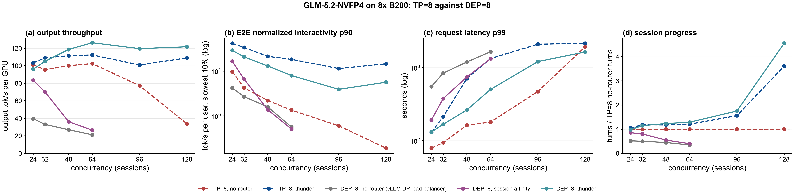
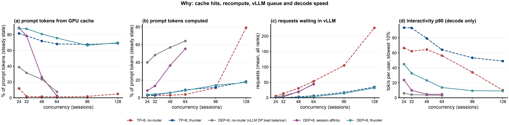

# Benchmark report: GLM-5.2 on 8x B200, TP=8 against DEP=8, with and without llm-d-thunder-agent-simplified

## 1. Executive Summary

Objective: Find if DEP=8 (attention data parallel 8, MoE expert parallel 8) is better than TP=8 for GLM-5.2 on the AgentX workload. Also find if llm-d-thunder-agent-simplified still helps on DEP=8. 24 to 64 agent sessions, one hour for each point.

Key Finding:

- DEP=8 needs llm-d-thunder-agent-simplified. Without it, DEP=8 is much worse than TP=8 at every tested concurrency.
- DEP=8 with vLLM's own DP load balancer gives 21% to 39% of the TP=8 throughput. vLLM sends each turn to the least-loaded rank, so 40% to 64% of prompt tokens go through prefill again.
- DEP=8 with session affinity keeps each session on one rank. It gives 83% of the TP=8 throughput at 24 sessions and 26% at 64 sessions. From 48 sessions, the ranks overflow and 36% to 55% of prompt tokens go through prefill again.
- DEP=8 with llm-d-thunder-agent-simplified is the best configuration from 48 sessions: 1.07x and 1.12x the throughput of TP=8 with llm-d-thunder-agent-simplified at 48 and 64 sessions. The request latency p99 is 264 s and 503 s (TP=8 with thunder: 711 s and 1331 s). Session progress is 1.23 and 1.29 (TP=8 with thunder: 1.18 and 1.21).
- The cost of DEP=8 is the speed for each user. The decode interactivity p90 of DEP=8 with thunder is 14 to 45 tok/s, against 64 to 94 for TP=8 with thunder. At 24 and 32 sessions, TP=8 with thunder has a higher throughput and higher E2E normalized interactivity.
- At 96 and 128 sessions (section 5.3), DEP=8 with thunder still gives 1.19x and 1.12x the TP=8 thunder throughput. But it does not give more than at 64 sessions. From 96 sessions, the forced admissions after 1800 s cause a decrease after minute 30, smaller than on TP=8.
- The prediction of this step was wrong. DEP=8 gives 4.2x more GPU KV in total, but as 8 separate pools of 818k tokens. One long session can fill a rank. Thus llm-d-thunder-agent-simplified is more necessary on DEP=8, not less.

## 2. Setup & Environment

| | TP=8 (step 25) | DEP=8 (this step) |
|---|---|---|
| Model | `nvidia/GLM-5.2-NVFP4` revision `aec724e8` | same |
| Hardware | one a4-highgpu-8g node, 8x B200 | same, one node for each server |
| Engine | vLLM v0.31.0, FP8 KV, MTP 3, `--gpu-memory-utilization 0.8` | same |
| Parallelism | `--tensor-parallel-size 8` | `--data-parallel-size 8 --enable-expert-parallel`, TP=1 in each rank |
| GPU KV pool | 1.57M tokens, one pool. Each GPU keeps a full copy of the MLA KV. | 818,175 tokens on each rank, 6.55M in total (4.2x) |
| Weights on each GPU | (not recorded) | 85.8 GiB. Each rank keeps a full copy of the non-expert weights. |
| `--max-model-len` | 1,048,576 | 783,872, the most that one rank holds. The longest prompt is 782,546 tokens. |
| `--max-num-seqs` | 64 | 32 on each rank |
| CPU KV offload | 820 GiB, one copy | 102.5 GiB on each rank (2.27M tokens), 820 GiB in total |
| Load balancing to the ranks | not applicable | no-router: vLLM's internal DP load balancer (one API server). Router arms: one API server for each rank (`--data-parallel-multi-port-external-lb`, ports 8000 to 8007) |
| EPP image | thunder: PR3 `a025437b` plus `Produces()` | upstream main `907c5fe8` |

## 3. Workload & Traffic

- Traces: the full corpus `semianalysis_cc_traces_weka_062126` (393 Claude Code sessions), the same as step 25.
- Median prompt approximately 100k tokens, p90 approximately 278k, maximum 782,546.
- Each point: 3600 s after the warmup. The runner empties both KV tiers of each rank before each point. One run for each point.

## 4. Test Arms

| arm | requests to the ranks | data |
|---|---|---|
| TP=8, no-router | client to vLLM | step 25 `explore1h-direct` |
| TP=8, thunder | EPP with llm-d-thunder-agent-simplified (capacity = GPU pool, lease 10 s, forced admission after 1800 s) | step 25 `explore1h-thunder-gpu-l10` |
| DEP=8, no-router | client to one vLLM API server, which selects a rank by load | `dep8-direct` |
| DEP=8, session affinity | EPP: `session-affinity-scorer` (`x-session-id`) keeps a session on one rank. `token-load-scorer` (weight 0.1) places new sessions. | `dep8-affinity` |
| DEP=8, thunder | EPP: llm-d-thunder-agent-simplified on each rank (capacity 818,175 tokens, lease 10 s, forced admission after 1800 s). The same `token-load-scorer` places new sessions. | `dep8-thunder-l10` |

"thunder" in the tables is llm-d-thunder-agent-simplified. The same `analyze.py` processed the step 25 points again, so all points have the same columns.

## 5. Results

Raw data: `b200/results/dep8-*` and step 25 `b200/results/explore1h-*`. Collected in `b200/results/report-compare/metrics.json` (`collect.py`). Whole profiling window, except token sources and vLLM queues (steady state). Session progress: turns completed on the traces that the arm and TP=8 no-router both ran, divided by the TP=8 no-router turns.

### 5.1 Throughput and agent metrics

| c | arm | completed | output tok/s per GPU | E2E norm. interactivity p50 / p90 | request latency p90 / p99 (s) | TTFT p50 (s) | session progress |
|---|---|---|---|---|---|---|---|
| 24 | TP=8, no-router | 2,921 | 101.1 | 47.8 / 9.7 | 32 / 79 | 6.21 | 1.00 |
| 24 | TP=8, thunder | 3,065 | 103.3 | 108.4 / 41 | 23 / 130 | 0.71 | 1.05 |
| 24 | DEP=8, no-router | 1,306 | 39.6 | 13.8 / 4.2 | 149 / 551 | 3.78 | 0.52 |
| 24 | DEP=8, affinity | 2,464 | 83.5 | 51.8 / 17 | 58 / 192 | 0.88 | 0.86 |
| 24 | DEP=8, thunder | 2,858 | 96.2 | 62.0 / 29 | 37 / 132 | 0.86 | 0.98 |
| 32 | TP=8, no-router | 2,791 | 95.5 | 22.5 / 4.2 | 49 / 94 | 19.21 | 1.00 |
| 32 | TP=8, thunder | 3,331 | 109.0 | 109.0 / 34 | 25 / 213 | 0.72 | 1.19 |
| 32 | DEP=8, no-router | 1,199 | 33.1 | 8.9 / 2.7 | 222 / 842 | 4.68 | 0.50 |
| 32 | DEP=8, affinity | 2,203 | 70.1 | 32.5 / 6.6 | 112 / 378 | 1.20 | 0.80 |
| 32 | DEP=8, thunder | 3,232 | 105.1 | 53.9 / 21 | 43 / 168 | 0.88 | 1.15 |
| 48 | TP=8, no-router | 2,805 | 100.1 | 10.9 / 2.2 | 76 / 163 | 42.78 | 1.00 |
| 48 | TP=8, thunder | 3,335 | 111.5 | 95.0 / 21 | 31 / 711 | 0.67 | 1.18 |
| 48 | DEP=8, no-router | 1,111 | 27.0 | 5.7 / 1.6 | 360 / 1194 | 7.03 | 0.45 |
| 48 | DEP=8, affinity | 1,434 | 36.1 | 7.0 / 1.4 | 283 / 744 | 7.94 | 0.55 |
| 48 | DEP=8, thunder | 3,648 | 118.7 | 43.2 / 13 | 67 / 264 | 0.97 | 1.23 |
| 64 | TP=8, no-router | 2,864 | 102.5 | 6.9 / 1.4 | 123 / 180 | 74.18 | 1.00 |
| 64 | TP=8, thunder | 3,455 | 112.4 | 82.0 / 18 | 40 / 1331 | 0.68 | 1.21 |
| 64 | DEP=8, no-router | 834 | 21.2 | 3.4 / 0.57 | 653 / 1649 | 51.90 | 0.35 |
| 64 | DEP=8, affinity | 967 | 26.5 | 4.3 / 0.51 | 608 / 1324 | 47.95 | 0.40 |
| 64 | DEP=8, thunder | 3,833 | 126.3 | 31.5 / 8 | 97 / 503 | 1.12 | 1.29 |

### 5.2 What happens in the server

| c | arm | prompt tokens from GPU / CPU / computed | running / waiting in vLLM (all ranks) | interactivity p90 (decode only) |
|---|---|---|---|---|
| 24 | TP=8, no-router | 12% / 85% / 3% | 6.8 / 5.7 | 66 |
| 24 | TP=8, thunder | 81% / 16% / 3% | 5.4 / 0.2 | 94 |
| 24 | DEP=8, no-router | 39% / 21% / 40% | 20.8 / 2.5 | 6 |
| 24 | DEP=8, affinity | 89% / 3% / 8% | 13.7 / 0.9 | 24 |
| 24 | DEP=8, thunder | 88% / 9% / 4% | 10.2 / 0.3 | 45 |
| 32 | TP=8, no-router | 2% / 96% / 3% | 6.7 / 14.2 | 62 |
| 32 | TP=8, thunder | 78% / 18% / 3% | 5.9 / 0.2 | 93 |
| 32 | DEP=8, no-router | 32% / 20% / 48% | 25.4 / 7.0 | 4 |
| 32 | DEP=8, affinity | 78% / 8% / 13% | 21.3 / 2.9 | 10 |
| 32 | DEP=8, thunder | 87% / 9% / 4% | 14.0 / 0.5 | 33 |
| 48 | TP=8, no-router | 2% / 96% / 3% | 7.1 / 31.0 | 64 |
| 48 | TP=8, thunder | 72% / 22% / 6% | 7.3 / 3.2 | 79 |
| 48 | DEP=8, no-router | 23% / 20% / 57% | 31.9 / 18.9 | 4 |
| 48 | DEP=8, affinity | 26% / 37% / 36% | 28.7 / 20.0 | 5 |
| 48 | DEP=8, thunder | 81% / 13% / 6% | 22.4 / 1.1 | 23 |
| 64 | TP=8, no-router | 1% / 95% / 4% | 7.8 / 53.9 | 56 |
| 64 | TP=8, thunder | 68% / 23% / 9% | 9.1 / 6.7 | 64 |
| 64 | DEP=8, no-router | 8% / 28% / 64% | 31.7 / 45.4 | 3 |
| 64 | DEP=8, affinity | 3% / 42% / 55% | 28.2 / 44.0 | 5 |
| 64 | DEP=8, thunder | 76% / 16% / 8% | 33.7 / 3.3 | 14 |

Forced admissions after 1800 s at 24 / 32 / 48 / 64 sessions: TP=8 with thunder 2 / 4 / 14 / 34. DEP=8 with thunder 0 / 0 / 2 / 5. Sessions with a turn over 60 s TTFT, TP=8 with thunder: 33% / 64% / 74% / 79%. DEP=8 with thunder: 19% / 29% / 45% / 68%.

### 5.3 Experiment C: DEP=8 with thunder at 96 and 128 sessions

`b200/run-dep8-highc.sh`, 2026-10-15: c=96 on `glm52-dep8-c` and c=128 on `glm52-dep8-b` at the same time. Same thunder config as in section 4. Client memory limit 64 GiB. TP=8 references: step 25 at c=96 and 128. Only the thunder arm ran on DEP=8.

| c | arm | completed | output tok/s per GPU | E2E norm. interactivity p50 / p90 | request latency p90 / p99 (s) | TTFT p50 (s) | session progress | prompt tokens from GPU / CPU / computed | running / waiting in vLLM | interactivity p90 (decode only) |
|---|---|---|---|---|---|---|---|---|---|---|
| 96 | TP=8, no-router | 2,105 | 77.3 | 3.7 / 0.6 | 324 / 470 | 179.41 | 1.00 | 2% / 87% / 11% | 9.0 / 104.8 | 34 |
| 96 | TP=8, thunder | 3,292 | 100.9 | 73.7 / 11 | 60 / 2092 | 0.69 | 1.56 | 68% / 21% / 12% | 9.7 / 17.4 | 53 |
| 96 | DEP=8, thunder | 3,985 | 119.6 | 19.3 / 3.9 | 180 / 1209 | 1.68 | 1.75 | 66% / 19% / 14% | 48.6 / 14.5 | 9 |
| 128 | TP=8, no-router | 851 | 33.8 | 2.9 / 0.19 | 1755 / 1926 | 109.82 | 1.00 | 5% / 16% / 79% | 11.5 / 226.9 | 10 |
| 128 | TP=8, thunder | 3,459 | 109.0 | 66.3 / 15 | 48 / 2149 | 0.73 | 3.61 | 69% / 13% / 18% | 12.1 / 34.9 | 49 |
| 128 | DEP=8, thunder | 4,212 | 121.7 | 16.8 / 5.6 | 126 / 1638 | 1.50 | 4.56 | 70% / 13% / 17% | 56.9 / 32.0 | 9 |

Forced admissions after 1800 s at 96 / 128 sessions: TP=8 with thunder 66 / 131. DEP=8 with thunder 30 / 62.

Output tokens of completed requests in each 10 minutes of the profiling window (thousands):

| | 0 to 10 | 10 to 20 | 20 to 30 | 30 to 40 | 40 to 50 | 50 to 60 |
|---|---|---|---|---|---|---|
| DEP=8, thunder, c=64 | 483 | 546 | 996 | 577 | 515 | 502 |
| DEP=8, thunder, c=96 | 425 | 843 | 783 | 509 | 381 | 490 |
| DEP=8, thunder, c=128 | 493 | 1,001 | 1,169 | 509 | 142 | 202 |
| TP=8, thunder, c=96 | 640 | 931 | 652 | 320 | 49 | 282 |
| TP=8, thunder, c=128 | 718 | 1,093 | 922 | 297 | 80 | 28 |

- DEP=8 with thunder stays at 120 to 126 tok/s per GPU from 48 sessions. The peak is at 64 sessions. At 96 and 128 sessions, it gives 1.19x and 1.12x the TP=8 thunder throughput.
- The tail and session progress stay better than TP=8 with thunder. Each user stays slower: the decode interactivity p90 is 9, against 49 to 53.
- From 96 sessions, the forced admissions after 1800 s also hurt DEP=8. At 128 sessions, the output decreases from approximately 1,000k to 142k to 202k tokens for each 10 minutes after minute 30. Each rank runs 7 requests on average, 32 requests wait in vLLM, and vLLM computes 17% of prompt tokens. The decrease is smaller than on TP=8 (28k to 80k), because thunder holds fewer sessions and forces in half as many.

## 6. Figures

Throughput and agent metrics (TP=8 dashed, DEP=8 solid). At 96 and 128 sessions, only the thunder arm ran on DEP=8.

Cache hits, recompute, vLLM queue and decode speed

## 7. Analysis

Why DEP=8 without llm-d-thunder-agent-simplified is slow:

- DEP=8 divides the GPU KV into 8 pools of 818k tokens. A rank holds approximately 8 median sessions. One long session can fill a rank.
- The 8 ranks work in lockstep: each MoE all-to-all waits for the slowest rank. Thus a large prefill on one rank delays the decode on all 8 ranks.
- vLLM's internal DP load balancer selects a rank by load, not by session. The turns of a session go to different ranks, so 40% to 64% of prompt tokens go through prefill again.
- Session affinity keeps a session on its rank, so the GPU hit is 78% to 89% at 24 and 32 sessions. But nothing limits the sessions on a rank. From 48 sessions, the requests wait in the vLLM queue of each rank (20 and 44 in total). While they wait, their blocks leave the CPU tier of the rank (2.27M tokens). On one rank at 64 sessions, vLLM wrote 3.5x the size of its CPU tier in the hour. Thus 36% to 55% of prompt tokens go through prefill again.
- At 24 sessions, session affinity computes 8% of prompt tokens, against 4% with thunder. It is also slower in decode (24 against 45 tok/s at p90). The probable cause is the extra prefill, which delays all ranks. This is not proved.

Why DEP=8 with llm-d-thunder-agent-simplified is fast:

- llm-d-thunder-agent-simplified admits a session to a rank only if it fits that rank. Thus each rank keeps its idle sessions on the GPU (76% to 88% GPU hit), and vLLM computes only 4% to 8% of prompt tokens.
- Almost no request waits in vLLM (0.3 to 3.3 in total).
- The total capacity is 4.2x that of TP=8. Thus thunder holds fewer sessions, and forces in only 0 to 5 requests after 1800 s. On TP=8, it forces in 34 requests at 64 sessions, which causes the collapse of step 25.

Why TP=8 with thunder is faster for each user:

- TP=8 computes the attention of a request on 8 GPUs. DEP=8 computes it on one GPU, and the ranks wait for each other.
- Thus the decode interactivity p90 of TP=8 with thunder is 2x to 5x that of DEP=8 with thunder.

Conclusion:

- At 24 and 32 sessions, use TP=8 with llm-d-thunder-agent-simplified: the throughput is 1.04x to 1.07x higher and each user is faster.
- At 48 sessions and more, use DEP=8 with llm-d-thunder-agent-simplified: higher throughput, much shorter tail and more session progress, but each user is slower. Its best point is approximately 64 sessions. More sessions do not increase throughput, and from 96 sessions the forced admissions return as a problem. To solve this, thunder must change how it selects and forces in held sessions. A different setting is not sufficient.
- Do not use DEP=8 without a router that limits the sessions on each rank. Session affinity alone is not sufficient from 48 sessions.
- The rule of the step 26 report, section 8, stays correct. On each rank, the sessions fit less well than on TP=8, and a miss is a recompute. The prediction of this step treated the 8 pools as one pool. That was wrong.

Caveats:

- One run for each point. Session affinity at 64 sessions ran twice: 1,114 and 967 completed requests (13% difference). The table uses the second run.
- At 64 sessions, Kubernetes stopped three clients for memory (OOMKilled, 32 GiB) during the export of the server metrics. These are DEP=8 no-router (two tries) and the first session affinity try. The per-request records are complete. The two no-router tries have no aiperf summary, so no context overflow count. The first session affinity try also has no server metrics.
- Session affinity at 32 sessions ran later (label `dep8-affinity-r2`), because both first tries failed at the cache reset on a Kubernetes API error.
- `--max-model-len` is 783,872 on DEP=8 and 1,048,576 on TP=8. The trace's longest prompt fits in both.
- The thunder EPP images are different (PR3 on TP=8, main on DEP=8). Step 25 found that they behave the same on TP=8.
- `--gpu-memory-utilization 0.8` on both. A higher value gives DEP=8 more KV on each rank. This was not tested.
