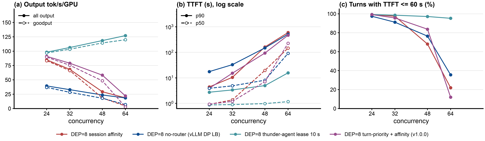
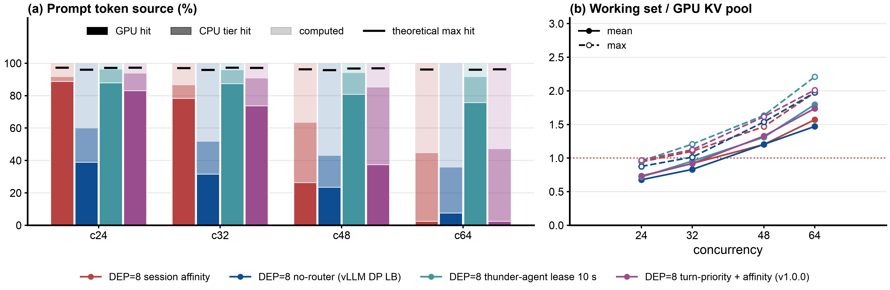
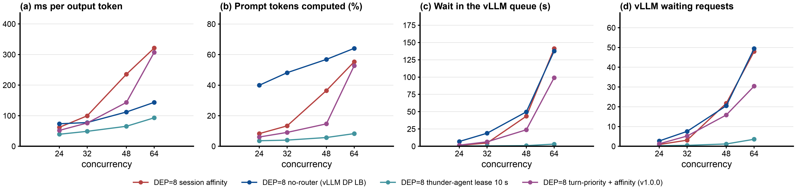

# Step 29: llm-d-router v1.0.0 turn-priority on GLM-5.2-NVFP4, vLLM DEP=8 + 8 x 102.5 GiB CPU offload, 8x B200

Status: done (2026-10-20). All four points valid, no retries, no client errors.

## Takeaways

Steady state (requests started after minute 5), one replicate per point, against step 27's `dep8-affinity` (same servers, same reset method, 2026-10-15):

- At c = 48, turn-priority on top of session affinity gives 1.99x the output throughput of session affinity alone (58.2 against 29.3 tok/s/GPU), a hit rate of 85.3% against 63.5%, TTFT p50 7.1 s against 19.6 s and E2E p99 539 s against 753 s. This is the one concurrency where the router's flow control was active part of the time (pool saturated in 24% of the 10 s samples, router queue wait mean 1.3 s, p99 27.8 s) and the pinned working set still fit about 1.4x the rank's pool.
- At c = 64 it is a tie on throughput (22.0 against 18.6 tok/s/GPU, 1.18x) and on hit rate (47.3% against 44.7%), with a worse TTFT median (226 s against 146 s) and a better p90 (465 s against 592 s). The router held requests most of the time (saturated in 67% of samples, queue wait mean 98 s, 35% of waits above the 60 s histogram bucket), but turn-priority does not cap active sessions: the working set peaked at 2.0x the pool in both arms, and ordering cannot fix that.
- At c = 24 and 32 the router never queued (pool saturation mean 0.35 and 0.51, queue wait 0.2 ms), so the 1.07x and 1.16x output throughput over session affinity cannot be attributed to turn-priority; they are within what one replicate of a different EPP build (v1.0.0 against main `907c5fe8`) and a different day can produce. The GPU hit rate was 5 points lower than session affinity's at both, the CPU tier hit 8 to 9 points higher, the overall hit 2 to 4 points higher.
- llm-d-thunder-agent-simplified lease 10 s (step 27) stays ahead at every c: 1.08x (c=24), 1.35x (c=32), 2.04x (c=48) and 5.78x (c=64) the output throughput of turn-priority, with a sub-second TTFT median throughout. On DEP=8, unlike TP=8 (step 28), turn-priority does something, but admission control on the per-rank working set does much more.

## Question

Step 28 ran llm-d-router v1.0.0's `turn-priority` fairness strategy in front of GLM-5.2 on TP=8 and found it a tie with no router: with one engine and an 820 GiB CPU tier, no-router already hits 96 to 97%, and turn-priority only moved the wait from vLLM's queue to the router's. Step 27 showed DEP=8 (attention data parallel 8, expert parallel 8) holds 4.2x more distinct tokens in GPU KV than TP=8, but splits it into 8 pools of 818k tokens, one per rank, so where a session lands matters: `dep8-affinity` (a session pinned to one rank, new sessions to the least loaded rank) is the natural baseline, and `dep8-thunder-l10` (the gate on top of pinning) the upper bound.

Does turn-priority help on DEP=8, where the same pinning is in place and each rank's pool is small enough that ordering which session's turn goes first could change what stays resident? The arm is step 27's `dep8-affinity` scheduling profile with step 28's flow-control layer added, so the difference from `dep8-affinity` is only the flow-control layer.

## Setup

- **Servers:** step 27's `glm52-dep8-b` and `glm52-dep8-c` on cluster a4-pr (nodes `13z6` and `0x6t`), up since step 27 (no restart for this step): vLLM v0.31.0, `--data-parallel-size 8 --enable-expert-parallel --data-parallel-size-local 8 --data-parallel-multi-port-external-lb` (one API server per rank, ports 8000 to 8007), MTP 3, `--kv-offloading-size 102.5` per rank (820 GiB in total), `--max-num-seqs 32` and `--max-num-batched-tokens 8192` per rank, `--max-model-len 783872`, 818,175 KV tokens per rank (6.55M in total). Unchanged from step 27.
- **Router:** llm-d-router v1.0.0, image `ghcr.io/llm-d/llm-d-router-endpoint-picker:v1.0.0` (amd64 digest `sha256:8c6b2430...`, tag commit `b9393d1a`), chart from the v1.0.0 tag (`b200/render-epp.sh`), one EPP and envoy per server (releases `agentx-epp-pb`, `agentx-epp-pc`), the 8 rank endpoints from a file as in step 27. Plugin config [`b200/dep8-turn-priority-plugins.yaml`](b200/dep8-turn-priority-plugins.yaml):
  - flow control as step 28: `agent-identity` reads `X-Session-ID` (one session is one fairness flow), `program-aware-fairness` with `strategy: turn-priority` and its defaults (score = turns already dispatched + 0.05 x head wait in seconds; a session idle for 120 s counts as turn one), `defaultRequestTTL: 0s`, envoy ext_proc timeout 2400 s;
  - saturation: the utilization detector with step 28's thresholds (waiting queue 5, KV usage 0.8), pool saturation = the average over the 8 ranks of max(waiting / 5, KV / 0.8);
  - scheduling as step 27's `dep8-affinity`: `session-affinity-scorer` (`session_id` from `x-session-id`, weight 1, binding TTL 300 s) plus `token-load-scorer` (weight 0.1) for new sessions, `inflight-load-producer`;
  - `headroom: 100` on the detector. With flow control on, v1.0.0 also injects the detector as a filter into the scheduling profile; at the default headroom 0 it drops every rank above the thresholds from the candidates before the scorers run, which would move sessions off their rank most of the time (KV usage sits above 0.8 with offload). headroom 100 lifts the filter limits to queue 505 and KV 1.0 (capped) and leaves the saturation signal unchanged. This is not an out-of-the-box config; see the Caveats.
- **Client and method:** as steps 27 and 28: AgentX harness `agentx-v1.0.6`, dataset `semianalysis_cc_traces_weka_062126`, 60 min per point, `RESET=1` (both KV tiers emptied on all 8 rank ports and the EPP restarted before every point, no server restart), client 4 CPU and 48 GiB limit (step 27's 32 GiB limit OOM-killed three c=64 clients during the export).
- **Grid:** c = 24, 32, 48, 64, one point per server, two at a time: b ran c=64 then c=32, c ran c=48 then c=24 (00:52 to 03:46 UTC). Compared with step 27's `dep8-direct`, `dep8-affinity` (`-r2` at c=32, `-retry` at c=64) and `dep8-thunder-l10` at the same c (same servers, same `max-num-seqs`, same reset method).
- **Smoke test first:** c = 4 for 2 minutes through `agentx-epp-pb`, then `verify-point.sh`, the EPP log for errors, and the EPP's `flow_control_stale_endpoints` gauge (must be 0: a stale rank is dropped by the filter regardless of headroom).
- **Runner:** [`b200/run-dep8-turn-priority.sh`](b200/run-dep8-turn-priority.sh), log `b200/results/run-dep8-turn-priority.log`. The EPPs were deleted at the end; the servers stay up.

## Expectations (written before the run)

1. With 8 ranks at `max-num-seqs` 32 each and KV usage above 0.8 on most ranks, the pool reads saturated most of the time from c = 32 on, and most requests pass through the router's queue; vLLM's waiting queue per rank stays well below `dep8-affinity`'s.
2. Turn-priority does not cap active sessions and does not move them between ranks (same pinning as `dep8-affinity`), so the working set per rank is the same as `dep8-affinity`'s: GPU hit rate and total throughput within about 5% of `dep8-affinity` at c = 24 and 32. At c = 48 and 64, where a rank's working set (6 to 8 sessions of up to 783k tokens) outgrows its 818k pool, dispatching the deepest session first keeps its prefix resident a little longer: GPU hit rate 1 to 3 points above `dep8-affinity`, output throughput 0 to 5% above, still below `dep8-thunder-l10`.
3. The median TTFT is at or below `dep8-affinity`'s at every c (deep sessions go first), the TTFT p90 above it (shallow and new sessions wait at the router), E2E p99 within 20% (waits age at 0.05 turns per second; no forced-admission burst).
4. Falsified if every throughput and hit metric is within about 5% of `dep8-affinity` at all four points (the policy then rarely reorders anything that matters, as on TP=8), or if the GPU hit rate falls below `dep8-affinity`'s by more than 2 points at any c (the flow-control layer is then disturbing the pinning, for example through session rebinding after the 300 s TTL while a request waits at the router).

## Results

Steady state (requests started after minute 5), 8 B200, `max-num-seqs` 32 per rank, offload on. Report: [`b200/results/compare-step27/report/summary.md`](b200/results/compare-step27/report/summary.md), ratios [`ratios.md`](b200/results/compare-step27/report/ratios.md); runs under `b200/results/dep8-turn-priority/c<N>/`, log `b200/results/run-dep8-turn-priority.log`. The three reference arms are step 27's points, analyzed again with the same `analyze.py`.

### Load: throughput and latency against concurrency

| c | arm | output tok/s/GPU | goodput tok/s | TTFT p50 s | TTFT p90 s | E2E p99 s | turn SLO share | completed (ss) |
|---|---|---|---|---|---|---|---|---|
| 24 | no-router (vLLM DP LB) | 39.4 | 295 | 3.89 | 17.5 | 605 | 97.4% | 1122 |
| 24 | session affinity | 84.9 | 667 | 0.92 | 4.4 | 197 | 99.3% | 2202 |
| 24 | turn-priority + affinity | 91.0 | 717 | 0.94 | 3.9 | 167 | 99.2% | 2385 |
| 24 | thunder-agent lease 10 s | 98.2 | 775 | 0.87 | 2.7 | 132 | 99.3% | 2578 |
| 32 | no-router (vLLM DP LB) | 32.9 | 227 | 4.86 | 32.8 | 905 | 91.1% | 997 |
| 32 | session affinity | 68.3 | 529 | 1.37 | 10.4 | 378 | 97.4% | 1811 |
| 32 | turn-priority + affinity | 79.0 | 603 | 1.20 | 15.2 | 333 | 95.6% | 2059 |
| 32 | thunder-agent lease 10 s | 106 | 827 | 0.90 | 3.4 | 173 | 98.5% | 2848 |
| 48 | no-router (vLLM DP LB) | 23.6 | 143 | 8.08 | 149 | 1201 | 76.4% | 909 |
| 48 | session affinity | 29.3 | 147 | 19.6 | 162 | 753 | 68.1% | 1089 |
| 48 | turn-priority + affinity | 58.2 | 387 | 7.08 | 93 | 539 | 83.8% | 1731 |
| 48 | thunder-agent lease 10 s | 119 | 915 | 0.98 | 5.0 | 241 | 97.2% | 3279 |
| 64 | no-router (vLLM DP LB) | 18.4 | 55 | 90.6 | 513 | 1742 | 35.6% | 627 |
| 64 | session affinity | 18.6 | 35 | 146 | 592 | 1409 | 22.0% | 578 |
| 64 | turn-priority + affinity | 22.0 | 21 | 226 | 465 | 1441 | 12.0% | 642 |
| 64 | thunder-agent lease 10 s | 127 | 959 | 1.17 | 15.7 | 521 | 95.3% | 3415 |

Turn SLO share is the share of turns with TTFT at or below 60 s; goodput counts only the output of those turns. Panel (a) shows turn-priority's throughput between session affinity and thunder-agent at c = 32 and 48, and back on the session-affinity line at c = 64. Panel (b) shows the price at c = 64: the TTFT median is the highest of the four arms, because the router now holds a request for 98 s on average (next table) before vLLM's own queue adds its share.

### Why: cache reuse, working set, engine queue

| c | arm | GPU hit / CPU hit / computed (%) | theoretical hit | working set / pool (peak) | vLLM waiting avg (8 ranks) | vLLM queue wait avg s | router queue wait mean / p99 s | pool saturated (share of samples) |
|---|---|---|---|---|---|---|---|---|
| 24 | session affinity | 88.7 / 3.0 / 8.3 | 97.2% | 0.97x | 0.9 | 1.3 | | |
| 24 | turn-priority + affinity | 83.1 / 10.9 / 6.1 | 97.2% | 0.96x | 1.3 | 1.7 | 0.0002 / 0.0005 | 0% (mean 0.35) |
| 24 | thunder-agent lease 10 s | 87.9 / 8.5 / 3.6 | 97.2% | 1.0x | 0.3 | 0.4 | | |
| 32 | session affinity | 78.4 / 8.3 / 13.4 | 96.9% | 1.10x | 3.1 | 4.8 | | |
| 32 | turn-priority + affinity | 73.7 / 17.2 / 9.1 | 97.1% | 1.12x | 5.2 | 6.4 | 0.0002 / 0.0005 | 0% (mean 0.51) |
| 32 | thunder-agent lease 10 s | 87.4 / 8.5 / 4.1 | 97.3% | 1.21x | 0.5 | 0.6 | | |
| 48 | session affinity | 26.3 / 37.3 / 36.5 | 96.2% | 1.47x | 21.8 | 43.5 | | |
| 48 | turn-priority + affinity | 37.4 / 47.9 / 14.7 | 96.9% | 1.62x | 15.9 | 23.9 | 1.26 / 27.8 | 24% (mean 0.71) |
| 48 | thunder-agent lease 10 s | 80.8 / 13.5 / 5.7 | 96.7% | 1.63x | 1.2 | 1.0 | | |
| 64 | session affinity | 2.5 / 42.2 / 55.3 | 96.2% | 1.97x | 48.0 | 141 | | |
| 64 | turn-priority + affinity | 2.4 / 44.8 / 52.8 | 96.3% | 2.01x | 30.4 | 99 | 97.7 / above 60 s bucket (35% of waits) | 67% (mean 0.78) |
| 64 | thunder-agent lease 10 s | 75.7 / 16.1 / 8.3 | 96.0% | 2.21x | 3.6 | 3.1 | | |

Pool saturation is the EPP's `flow_control_pool_saturation` gauge, scraped every 10 s over the whole run (468 to 538 samples per point); the router queues requests only while it reads 1.0 or more. The router queue wait is the EPP's flow-control queue duration histogram (whole window; its top finite bucket is 60 s, so the c=64 p99 is unknown).

The mechanism at c = 48: the router held requests for part of the hour, vLLM's queue on the 8 ranks went from 21.8 to 15.9 waiting requests on average and the engine queue wait from 43.5 to 23.9 s, and the share of prompt tokens computed from scratch fell from 36.5% to 14.7%. Both GPU and CPU-tier hits rose. At c = 64 the pool was saturated two thirds of the time and the router queue wait averaged 98 s, but the per-rank working set was 2.0x the pool in both arms and the GPU hit stayed at 2.4%; the CPU tier served 45% of the tokens either way.

### Against session affinity (ratios.md)

| arm | c | output tok/s/GPU | total tok/s/GPU | goodput | TTFT p50 | TTFT p90 | hit rate | completed |
|---|---|---|---|---|---|---|---|---|
| turn-priority + affinity | 24 | 1.07 | 1.08 | 1.08 | 1.02 | 0.88 | 1.02 | 1.08 |
| turn-priority + affinity | 32 | 1.16 | 1.14 | 1.14 | 0.88 | 1.46 | 1.05 | 1.14 |
| turn-priority + affinity | 48 | 1.99 | 1.79 | 2.63 | 0.36 | 0.58 | 1.34 | 1.59 |
| turn-priority + affinity | 64 | 1.18 | 1.21 | 0.60 | 1.55 | 0.79 | 1.06 | 1.11 |
| thunder-agent lease 10 s | 24 | 1.16 | 1.15 | 1.16 | 0.95 | 0.62 | 1.05 | 1.17 |
| thunder-agent lease 10 s | 32 | 1.56 | 1.60 | 1.56 | 0.66 | 0.32 | 1.11 | 1.57 |
| thunder-agent lease 10 s | 48 | 4.05 | 3.17 | 6.23 | 0.05 | 0.03 | 1.48 | 3.01 |
| thunder-agent lease 10 s | 64 | 6.83 | 5.31 | 27.2 | 0.008 | 0.03 | 2.05 | 5.91 |

thunder-agent against turn-priority (output tok/s/GPU): 1.08x at c=24, 1.35x at c=32, 2.04x at c=48, 5.78x at c=64.

### Expectations: what held

1. Did not hold at c = 32: the pool never read saturated (mean 0.51) and the router queued nothing. Held in part at c = 48 (saturated 24% of the time) and at c = 64 (67%). vLLM's waiting queue was below session affinity's at c = 48 and 64 (15.9 against 21.8, 30.4 against 48.0) and slightly above it at c = 24 and 32 (1.3 against 0.9, 5.2 against 3.1).
2. Did not hold in either direction. At c = 24 and 32 the output throughput was 7% and 16% above session affinity's, not within 5%, with the router inactive (see Caveats). At c = 48 the gain was 1.99x in output throughput and 22 points of hit rate, far above the 0 to 5% and 1 to 3 points expected. At c = 64 it was 1.18x and 2.6 points, a tie on throughput by the 5% rule of the dashboard but not in the predicted "small gain" band either; the working set at 2.0x the pool left nothing for ordering to keep.
3. Held in part. TTFT median at or below session affinity's at c = 24 (tie, 0.94 against 0.92 s), 32 (1.20 against 1.37 s) and 48 (7.1 against 19.6 s), but 1.55x higher at c = 64 (226 against 146 s). The TTFT p90 was lower than session affinity's at c = 24, 48 and 64 and higher only at c = 32 (15.2 against 10.4 s), the opposite of the prediction. E2E p99 was within 20% at c = 24, 32 and 64 and 28% lower at c = 48.
4. Not falsified by the first clause (the c = 48 differences are far beyond 5%). The second clause triggered: the GPU hit rate was 5.6 and 4.7 points below session affinity's at c = 24 and 32. But the CPU-tier hit rose by 7.9 and 9.0 points and the overall hit by 2.2 and 4.3 points, which is not the signature of sessions moving between ranks (a moved session misses both tiers of its new rank, since each rank has its own CPU tier). The shift from GPU to CPU hits at low c is unexplained; a per-rank request count from the EPP would settle it and is listed under Next steps.

## Validity

Every point's line from `summary.md` ("Validity checks"):

- `dep8-turn-priority c=24`: 5 requests cancelled when the grace period ended (not in the exports). Valid.
- `dep8-turn-priority c=32`: 13 requests cancelled when the grace period ended, 5 of them without a first token (counted as SLO misses); working set peaked at 1.12x the KV pool (expect evictions). Valid.
- `dep8-turn-priority c=48`: 42 requests cancelled when the grace period ended, 17 of them without a first token; server hit 85.8% is 11.0 points below theoretical 96.9%; in-flight working set peaked at 1.39x the KV pool; working set peaked at 1.62x. Valid.
- `dep8-turn-priority c=64`: 64 requests cancelled when the grace period ended, 43 of them without a first token; server hit 54.8% is 41.4 points below theoretical 96.3%; in-flight working set peaked at 1.98x the KV pool; working set peaked at 2.01x. Valid.

All four: job succeeded, pods unchanged (same uid and restart count before and after), 100% of profiling requests completed, 0 client errors, `verify-point.sh` passed. The cancelled counts are in the same range as step 27's reference points at the same c (0 to 1 at c=24, 1 to 19 at c=32, 44 to 60 at c=48, 32 to 74 at c=64). The EPP's `flow_control_stale_endpoints` gauge was non-zero in 1 to 2 of 468 to 538 samples per point, so the detector's staleness filter did not move sessions in any measurable way. Every EPP logged `parsing response: invalid character '#'` for most responses (1 error line per response); as in steps 25 and 28 the error only drops usage metrics, the request completes. The step 27 reference points carry their own notes (`dep8-direct c=64`: client OOM-killed during the export, analyzed from the records and the parquet; the affinity points `-r2` and `-retry` are the reruns step 27 used).

## Caveats

- `headroom: 100` is a deliberate change from v1.0.0's defaults; the out-of-the-box config (headroom 0, filter active) is a different arm, not run here. On TP=8 (step 28) the filter had one endpoint and its fail-open fallback made it a no-op, so step 28 is the out-of-the-box result for that topology.
- The c = 24 and 32 gains over session affinity (1.07x, 1.16x) come with an inactive router (queue wait 0.2 ms, saturation never 1.0), so the flow-control layer cannot be the cause. What differs besides the day: the EPP build (v1.0.0, 2026-10-15, against main `907c5fe8`, 2026-10-13) and the client memory limit (48 against 32 GiB, which does not touch the server). One replicate each; the repo's earlier replicate runs put cell-to-cell variance at 2% to 6%, and the c=32 difference is above that. A replicate of `dep8-affinity` on v1.0.0 (same image, flow control off) would separate the build from the policy.
- The session binding TTL of the affinity scorer is 300 s (step 27 used the same); at c = 64 a request waits 98 s at the router on average and some wait above 60 s in 35% of cases, so a few sessions may have been rebound to another rank after an idle gap. The hit rates at c = 64 (2.4 against 2.5% GPU) do not show it.
- Closed loop: turn-priority completed 1.59x the requests of session affinity at c = 48 and saw a correspondingly different request mix.
- Single replicate per point, same day; step 27's reference points ran on 2026-10-15 on the same servers and nodes.

## Next steps

- `dep8-affinity` on the v1.0.0 image with flow control off, c = 32 and 48, to measure the build difference and to put the c = 48 2x on a same-build baseline.
- The out-of-the-box v1.0.0 config (headroom 0) on DEP=8 at c = 48, to measure what the injected filter costs with 8 ranks.
- Per-rank request counts from the EPP (an endpoint-labeled counter, or `emit-endpoint-scores`) to settle whether sessions ever leave their rank with flow control on, and why GPU hits shift to the CPU tier at c = 24 and 32.
- Turn-priority with a `defaultRequestTTL` or a usage limit on the band at c = 64, where ordering alone does not help: the policy needs something that bounds the per-rank working set, which is what the thunder-agent gate does.

## Reproduce

- Run: `cd b200 && setsid nohup ./run-dep8-turn-priority.sh > results/run-dep8-turn-priority.log 2>&1 < /dev/null &` (needs `/tmp/a4-pr.kubeconfig`: `KUBECONFIG=/tmp/a4-pr.kubeconfig gcloud container clusters get-credentials a4-pr --region europe-west4 --project supercomputer-testing`; `setsid` so the runner outlives the shell that started it).
- Analyze with step 27's points: the last `analyze.py` call in the runner, output `b200/results/compare-step27/report/`.
- Figures: `uv run ../../.claude/skills/agentic-benchmark/scripts/make_figures.py --out results/compare-step27/report --baseline dep8-affinity --replicate-suffix='-(r\d+|retry)$' --name dep8-direct="DEP=8 no-router (vLLM DP LB)" --name dep8-affinity="DEP=8 session affinity" --name dep8-turn-priority="DEP=8 turn-priority + affinity (v1.0.0)" --name dep8-thunder-l10="DEP=8 thunder-agent lease 10 s" results/compare-step27/report/summary.csv`
- Dashboard: `export_bundle.py` into `dashboard/data/step29-glm52-dep8-turn-priority.json` (arm `dep8-turn-priority`, `--kv-bytes-per-token 48408`), merged into `dashboard/data/glm52-nvfp4-8xb200.json` with `merge_bundle.py --cpu-tier-tokens 18173440`.
- Raw per-request files (`profile_export.jsonl`) and the vLLM metrics parquet are in each point folder; the EPP scrape (`epp/raw-epp-metrics.txt.gz`) is git-ignored and kept on this machine.
