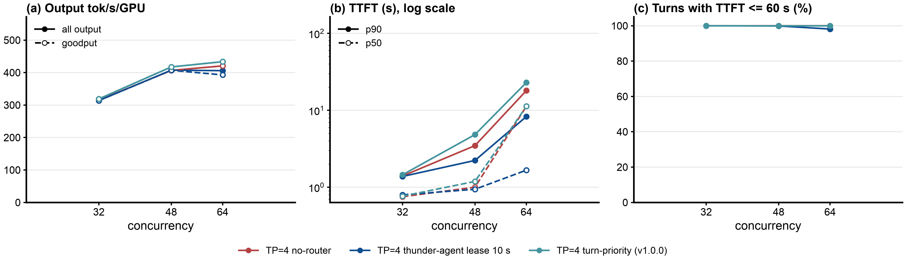
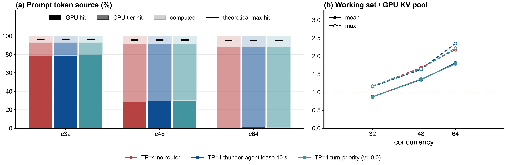
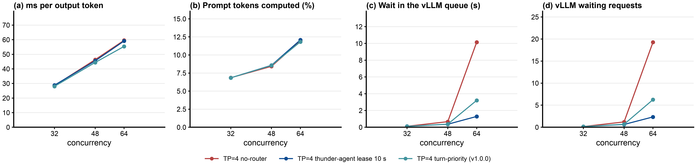

# Step 30: llm-d-router v1.0.0 turn-priority on Qwen3.5-397B-A17B-FP8, vLLM TP=4 + 387 GiB CPU offload, 4x B200

Status: done (2026-10-20). All three points valid, no retries, no client errors.

## Takeaways

Steady state (requests started after minute 5), one replicate per point, against step 26's `qwen35-direct` (no router; same servers and `MAX_NUM_SEQS`, same reset method, 2026-10-14):

- Turn-priority is a tie with no router at every concurrency: output throughput 1.01x, 1.03x, 1.03x at c = 32, 48, 64 (319 against 315, 417 against 407, 434 against 421 tok/s/GPU), hit rate identical (93.2%, 91.5%, 88.2%), E2E p99 within 7%. The same result as on GLM-5.2 TP=8 (step 28).
- The router was active at c=64 (pool saturated in 80% of the 10 s samples, mean 1.68; requests waited 6.2 s at the router on average, p99 29 s) and part of the time at c=48 (30% of samples, mean 0.56 s wait), yet the TTFT median did not move: 11.27 s against no-router's 11.29 s at c=64, 1.19 against 1.00 s at c=48. The wait moved from vLLM's queue (waiting requests 19.3 to 6.3 at c=64) to the router's; the deepest-session-first order did not shorten it. The TTFT p90 is longer than no-router's at c=48 and 64 (4.8 against 3.5 s, 23 against 18 s).
- llm-d-thunder-agent-simplified lease 10 s (step 26) is the other trade at c=64: 0.97x the output throughput of no-router (0.94x turn-priority's) with a TTFT median of 1.7 s (6.8x below both), at the cost of E2E p99 213 s against 153 to 159 s and 32 cancelled requests.
- With one engine whose GPU pool (4.7M to 4.8M tokens) plus CPU tier already serves 88% to 93% of prompt tokens without a router, ordering admissions has no leverage; the DEP=8 result of step 29 (2x at c=48) needed 8 small per-rank pools and a working set that overflowed them.

## Question

Steps 28 and 29 measured llm-d-router v1.0.0's `turn-priority` fairness strategy on GLM-5.2: a tie with no router on TP=8 (one engine, 1.57M-token GPU KV, 97% hit through the CPU tier), a 2x gain over session affinity at c=48 on DEP=8 (8 small per-rank pools) and nothing at c=64. Step 26 ran Qwen3.5-397B-A17B-FP8 on TP=4 with 4 B200 for the same workload (256k-capped traces, as InferenceX) and found llm-d-thunder-agent-simplified a tie with no router there: the hybrid model's KV is small (4.7M to 4.8M tokens on 4 GPUs), no-router already hits 88% to 93%, and vLLM only starts queuing at c=64 (TTFT p50 11 s).

This step fills the remaining cell: turn-priority, out of the box (step 28's config, unchanged), on the TP=4 Qwen3.5 server at the same c = 32, 48, 64 as step 26, against step 26's no-router and thunder-agent points.

## Setup

- **Servers:** step 26's `qwen35-tp4-b`, `-d`, `-f` (`MAX_NUM_SEQS` 64, 96, 128, that is 2x the concurrency of their point, as step 26): vLLM v0.31.0, TP=4 on 4 B200 (DRA claim, two servers per `a4-highgpu-8g` node), `--kv-offloading-size 387`, `--max-num-batched-tokens 16384`, `--gpu-memory-utilization 0.8`, `VLLM_HTTP_TIMEOUT_KEEP_ALIVE=1800`. Unchanged from step 26 except the node: step 26's nodes (`5qjv`, `13z6`, `0x6t`) hold step 27's DEP=8 servers, so b and d ran on `000v` and f on `14rm` (same machine type; the first start downloaded the checkpoint there, 20 min). Scaled from 0 to 1 for this step and back to 0 after it.
- **Router:** llm-d-router v1.0.0, image `ghcr.io/llm-d/llm-d-router-endpoint-picker:v1.0.0` (amd64 digest `sha256:8c6b2430...`, tag commit `b9393d1a`), chart from the v1.0.0 tag (`b200/render-epp.sh`), one EPP and envoy per server (releases `agentx-epp-u{b,d,f}`), the server's Service ClusterIP as the one endpoint from a file as in step 26. Plugin config [`b200/turn-priority-plugins.yaml`](b200/turn-priority-plugins.yaml), identical to step 28's: `agent-identity` on `X-Session-ID`, `program-aware-fairness` with `strategy: turn-priority` and its defaults, the default utilization detector (saturated at vLLM waiting 5 or KV usage 0.8; with one endpoint its injected filter is a no-op through fail-open), `defaultRequestTTL: 0s`, envoy ext_proc timeout 2400 s.
- **Client and method:** as step 26: AgentX harness `agentx-v1.0.6`, dataset `semianalysis_cc_traces_weka_062126_256k`, 60 min per point, `RESET=1` (both KV tiers emptied and the EPP restarted before every point, no server restart), client 3 CPU, 12 GiB request, 32 GiB limit.
- **Grid:** c = 32 (b), 48 (d), 64 (f), all three at once (07:55 to 09:11 UTC). Compared with step 26's `qwen35-direct` and `qwen35-thunder-gpu-l10` at the same c (same servers and `MAX_NUM_SEQS`, same reset method, other nodes).
- **Smoke test first:** c = 4 for 2 minutes through `agentx-epp-ub`, then `verify-point.sh` and the EPP log (passed; 184 `parsing response` error lines, see Validity).
- **Runner:** [`b200/run-turn-priority.sh`](b200/run-turn-priority.sh), log `b200/results/run-turn-priority.log`.

## Expectations (written before the run)

1. At c = 32 and 48 the pool never reads saturated (step 26's no-router points had vLLM waiting averages well below 5 and KV usage under 0.8 at these c), the router queues nothing, and every metric is within 5% of no-router: a tie, as thunder-agent was in step 26.
2. At c = 64 vLLM queues (step 26 no-router: TTFT p50 11.3 s, thunder-agent 1.7 s), so the pool reads saturated part of the time and requests wait at the router. Output throughput and hit rate within 5% of no-router (the working set fits the pool; nothing to keep resident by ordering); TTFT p50 below no-router's 11.3 s (deep sessions first) but above thunder-agent's 1.7 s; TTFT p90 and E2E p99 above no-router's (shallow sessions wait at the router with no TTL).
3. Falsified in the interesting direction if turn-priority's output throughput or hit rate at c=64 is more than 5% above no-router's; in the other direction if its TTFT p50 at c=64 is above no-router's.

## Results

Steady state (requests started after minute 5), 4 B200, offload on. Report: [`b200/results/compare-step26/report/summary.md`](b200/results/compare-step26/report/summary.md), ratios [`ratios.md`](b200/results/compare-step26/report/ratios.md); runs under `b200/results/qwen35-turn-priority/c<N>/`, log `b200/results/run-turn-priority.log`. The two reference arms are step 26's points, analyzed again with the same `analyze.py`.

### Load: throughput and latency against concurrency

| c | arm | output tok/s/GPU | goodput tok/s | TTFT p50 s | TTFT p90 s | E2E p99 s | P90 interactivity | completed (ss) |
|---|---|---|---|---|---|---|---|---|
| 32 | no-router | 314.9 | 1260 | 0.75 | 1.40 | 86 | 34.6 | 4301 |
| 32 | turn-priority | 318.9 | 1275 | 0.77 | 1.45 | 86 | 34.3 | 4361 |
| 32 | thunder-agent lease 10 s | 313.7 | 1255 | 0.80 | 1.38 | 86 | 34.1 | 4288 |
| 48 | no-router | 406.7 | 1627 | 1.00 | 3.48 | 114 | 23.2 | 5834 |
| 48 | turn-priority | 417.4 | 1669 | 1.19 | 4.84 | 107 | 21.8 | 5941 |
| 48 | thunder-agent lease 10 s | 407.5 | 1628 | 0.94 | 2.23 | 115 | 26.1 | 5822 |
| 64 | no-router | 420.6 | 1682 | 11.3 | 18.1 | 159 | 6.9 | 6030 |
| 64 | turn-priority | 433.6 | 1734 | 11.3 | 23.0 | 153 | 6.3 | 6189 |
| 64 | thunder-agent lease 10 s | 405.9 | 1571 | 1.67 | 8.3 | 213 | 15.4 | 5817 |

Every turn met the 60 s TTFT SLO in all nine points except thunder-agent at c=64 (98.2%), so goodput equals output throughput. Panel (a): the three arms lie on one line; panel (b): at c=64 turn-priority's TTFT median sits on no-router's and its p90 above it, while thunder-agent's median is an order of magnitude lower.

### Why: cache reuse, working set, engine queue

| c | arm | GPU hit / CPU hit / computed (%) | theoretical hit | working set / pool (peak) | vLLM waiting avg | vLLM queue wait avg s | router queue wait mean / p90 / p99 s | pool saturated (share of samples, mean) |
|---|---|---|---|---|---|---|---|---|
| 32 | no-router | 78.4 / 14.8 / 6.8 | 96.5% | 1.16x | 0.15 | 0.11 | | |
| 32 | turn-priority | 79.5 / 13.7 / 6.8 | 96.5% | 1.17x | 0.15 | 0.10 | 0.03 / 0.0005 / 0.95 | 6%, 0.48 |
| 32 | thunder-agent lease 10 s | 78.7 / 14.5 / 6.8 | 96.5% | 1.15x | 0.16 | 0.11 | | |
| 48 | no-router | 28.3 / 63.2 / 8.4 | 95.7% | 1.67x | 1.21 | 0.67 | | |
| 48 | turn-priority | 29.9 / 61.6 / 8.5 | 95.6% | 1.65x | 0.67 | 0.37 | 0.56 / 2.3 / 7.4 | 30%, 0.90 |
| 48 | thunder-agent lease 10 s | 29.5 / 62.0 / 8.6 | 95.6% | 1.63x | 0.63 | 0.36 | | |
| 64 | no-router | 0.3 / 87.7 / 11.9 | 95.2% | 2.18x | 19.3 | 10.1 | | |
| 64 | turn-priority | 0.4 / 87.8 / 11.8 | 95.3% | 2.22x | 6.3 | 3.2 | 6.2 / 21.7 / 29.2 | 80%, 1.68 |
| 64 | thunder-agent lease 10 s | 1.4 / 86.5 / 12.1 | 95.3% | 2.35x | 2.3 | 1.3 | | |

Pool saturation is the EPP's `flow_control_pool_saturation` gauge, scraped every 10 s over the whole run (411 to 434 samples per point); the router queues requests only while it reads 1.0 or more. The router queue wait is the EPP's flow-control queue duration histogram (whole window).

The token sources are the same in all three arms at every c: the GPU hit falls from 78% to 0.3% between c=32 and c=64 as the working set grows from 1.2x to 2.2x the pool, and the CPU tier picks it up (88% at c=64), so the share computed from scratch stays at 7% to 12%. Nothing is left for an admission order to keep resident. At c=64 turn-priority took two thirds of the queue out of vLLM (waiting 19.3 to 6.3, engine queue wait 10.1 to 3.2 s) and held it at the router (6.2 s mean), with the same TTFT median.

### Against no-router (ratios.md)

| arm | c | output tok/s/GPU | total tok/s/GPU | goodput | P90 interactivity | TTFT p50 | TTFT p90 | hit rate | completed |
|---|---|---|---|---|---|---|---|---|---|
| turn-priority | 32 | 1.01 | 1.01 | 1.01 | 1.02 | 1.02 | 1.04 | 1.00 | 1.01 |
| turn-priority | 48 | 1.03 | 1.02 | 1.03 | 1.10 | 1.19 | 1.39 | 1.00 | 1.02 |
| turn-priority | 64 | 1.03 | 1.03 | 1.03 | 0.95 | 1.00 | 1.27 | 1.00 | 1.03 |
| thunder-agent lease 10 s | 32 | 1.00 | 1.00 | 1.00 | 0.97 | 1.06 | 0.99 | 1.00 | 1.00 |
| thunder-agent lease 10 s | 48 | 1.00 | 1.00 | 1.00 | 1.02 | 0.94 | 0.64 | 1.00 | 1.00 |
| thunder-agent lease 10 s | 64 | 0.97 | 0.96 | 0.93 | 0.97 | 0.15 | 0.46 | 1.00 | 0.97 |

### Expectations: what held

1. Held on the outcome, not on the mechanism: every metric at c = 32 and 48 is within 5% of no-router except the TTFT tail at c=48 (p50 1.19x, p90 1.39x). But the pool did read saturated at c=48 in 30% of the samples (KV usage near 0.8 on this server, vLLM waiting up to a few requests) and the router queued requests for 0.56 s on average; even at c=32 it read saturated in 6% of samples.
2. Held in part. Output throughput and hit rate at c=64 within 5% of no-router (1.03x, 1.00x). TTFT p50 not below no-router's: 11.27 against 11.29 s, a tie, not the predicted reduction. TTFT p90 above no-router's (23.0 against 18.1 s) as predicted; E2E p99 not above it (153 against 159 s).
3. Not falsified in either direction: throughput and hit rate within 5%, TTFT p50 equal to no-router's, not above.

## Validity

Every point's line from `summary.md` ("Validity checks"):

- `qwen35-turn-priority c=32`: working set peaked at 1.17x the KV pool (expect evictions). Valid, 0 cancelled.
- `qwen35-turn-priority c=48`: 1 request cancelled when the grace period ended (not in the exports); in-flight working set peaked at 1.20x the KV pool; working set peaked at 1.65x. Valid.
- `qwen35-turn-priority c=64`: 5 requests cancelled when the grace period ended; in-flight working set peaked at 1.61x the KV pool; working set peaked at 2.22x. Valid.

All three: job succeeded, pods unchanged, 100% of profiling requests completed, 0 client errors, `verify-point.sh` passed. The cancelled counts match step 26's no-router points (0, 6, 8). The EPP's `flow_control_stale_endpoints` gauge was 0 in every sample. Every EPP logged `parsing response: invalid character '#'` for most responses, as in steps 25, 28 and 29 (the error only drops the EPP's usage metrics; the request completes). The step 26 reference points carry their own notes (`qwen35-direct c=32`: 2 request errors from the 5 s keep-alive, fixed in the template before the other points).

## Caveats

- Other nodes than step 26 (same machine type, same node sharing: two servers per node). One replicate per point; the reference points ran on 2026-10-14.
- Closed loop: turn-priority completed 1% to 3% more requests than no-router and saw a correspondingly different request mix.
- The utilization detector's defaults (queue 5, KV 0.8) read this server as saturated at c=48 and c=64 because its KV usage sits near or above 0.8 with offload on; a higher `kvCacheUtilThreshold` would keep the router out of the way at c=48 and change nothing at c=64, where vLLM's own queue (19 waiting) is the signal.

## Next steps

- None for turn-priority on this topology. Across steps 28, 29 and 30 the pattern is: on one engine with a CPU tier (GLM TP=8, Qwen3.5 TP=4) the policy is a tie with no router; on DEP=8 it helps at the one concurrency where the per-rank working set just overflows the pool and the router is active part of the time (step 29, c=48), and not past that. The next lever for Qwen3.5 at c=64 is the thunder-agent's trade (TTFT median 1.7 s for 3% throughput), not ordering.
- If a higher-concurrency cell is wanted for Qwen3.5 (c = 96, 128, where no-router has not been measured either), run no-router and turn-priority together on two servers with `MAX_NUM_SEQS` 192 and 256.

## Reproduce

- Scale `qwen35-tp4-b`, `-d`, `-f` to 1 on free nodes (the runner waits for them), then `cd b200 && setsid nohup ./run-turn-priority.sh > results/run-turn-priority.log 2>&1 < /dev/null &` (needs `/tmp/a4-pr.kubeconfig`, see step 26).
- Analyze with step 26's points: the last `analyze.py` call in the runner, output `b200/results/compare-step26/report/`.
- Figures: `uv run ../../.claude/skills/agentic-benchmark/scripts/make_figures.py --out results/compare-step26/report --baseline qwen35-direct --name qwen35-direct="TP=4 no-router" --name qwen35-turn-priority="TP=4 turn-priority (v1.0.0)" --name qwen35-thunder-gpu-l10="TP=4 thunder-agent lease 10 s" results/compare-step26/report/summary.csv`
- Dashboard: `export_bundle.py` (arm `qwen35-turn-priority`, `--kv-bytes-per-token 32770`), merged into `dashboard/data/qwen35-397b-fp8-4xb200.json` with `merge_bundle.py --cpu-tier-tokens 12680442`.
- Raw per-request files and the vLLM metrics parquet are in each point folder; the EPP scrape (`epp/raw-epp-metrics.txt.gz`) is git-ignored and kept on this machine.
