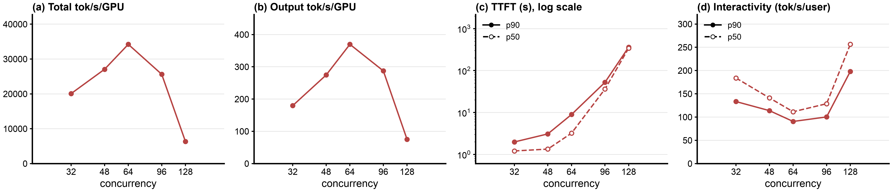

# Step 33: no-thunder 1P1D baseline sweep, Qwen3.5-397B-A17B-FP8, 8x B200

Status: done (2026-10-22). Baseline for a P/D thunder-agent arm.

## Question

How does a plain 1P1D deployment (1 prefill + 1 decode server, no router, no admission gate) behave on the AgentX workload as concurrency rises? This is the baseline that a P/D-aware llm-d-thunder-agent arm will be compared against.

## Setup

| | |
|---|---|
| Node | `5qjv` (`a4-highgpu-8g`, 8 B200, 8 RDMA NICs at 400 Gb/s) |
| Prefill | `qwen35-pd-prefill`: vLLM v0.31.0, TP=4 on GPUs 4-7 + their 4 NICs, `MAX_NUM_SEQS` 64 |
| Decode | `qwen35-pd-decode`: same flags, GPUs 0-3 + their 4 NICs, `MAX_NUM_SEQS` 256 (2x the top concurrency; step 31 used 128) |
| Model flags | step 31's ([`b200/vllm-qwen35-pd.yaml`](b200/vllm-qwen35-pd.yaml)): FP8 KV, MTP 3, `--max-num-batched-tokens 16384`, `--gpu-memory-utilization 0.8`, prefix caching, `VLLM_HTTP_TIMEOUT_KEEP_ALIVE=1800` |
| KV | `MultiConnector` = `NixlConnector` (`bidirectional_kv_xfer: false`) + `OffloadingConnector` (387 GiB CPU tier per server). KV moves P -> D by RDMA READ over the NICs (verified with host NIC counters in step 31) |
| vLLM fix | [vllm-project/vllm#62862](https://github.com/vllm-project/vllm/issues/62862) fix ([zetxqx/vllm#1](https://github.com/zetxqx/vllm/pull/1), ported onto v0.31.0, [`b200/pr62862/`](b200/pr62862/)) on both servers: decode reuses its local prefix and pulls only the missing suffix |
| Routing | no router: vLLM's NIXL toy proxy ([`b200/toy_proxy_server.py`](b200/toy_proxy_server.py), [`b200/pd-proxy.yaml`](b200/pd-proxy.yaml)). Every request goes P (`max_tokens=1`) then D, i.e. always-disagg. Changes from upstream: SSE content type, and uvicorn keep-alive 1800 s (default 5 s, which aborts AgentX runs as in step 26) |
| Client | AgentX `agentx-v1.0.6`, dataset `semianalysis_cc_traces_weka_062126_256k`, 60 min per point, `RESET=1` (both KV tiers on both servers emptied before every point, no restart), 3 CPU / 12 GiB request / 32 GiB limit; as step 26 |
| Grid | c = 32, 48, 64, 96, 128, one at a time (one 1P1D pair); a failed point retried once |
| Runner | [`b200/run-baseline.sh`](b200/run-baseline.sh), log `b200/results/run-baseline.log` |

Throughput per GPU divides by 8 GPUs (both servers). Step 26's aggregated `qwen35-direct` (one TP=4 server per 4 GPUs, c = 32/48/64 per server) is the reference for "same 8 GPUs, no disaggregation" at double the concurrency.

## Expectations (written before the run)

1. TTFT is P's prefill plus a short NIXL pull. P sees every request's prompt and hits its own cache for most of it (step 31: 73% at c=4, with an empty CPU tier at the start), so TTFT stays near step 31's ~1 s until P's prefill or D's decode saturates.
2. Decode does no prefill, so inter-token latency stays flat longer than an aggregated server at the same per-server load. The knee should come from P (one 4-GPU server prefilling for the whole pool) somewhere between c=64 and c=128.
3. Decode local hit rate stays high (76% at c=4 with the fix); NIXL bytes per request stay near the new-suffix size.

## Results

Status: done (2026-10-21 18:55 to 2026-10-22 01:48 UTC). All five points pass `verify-point.sh` (job succeeded, pods unchanged, every profiling request completed, 0 client errors). Report: [`b200/results/qwen35-1p1d-baseline/report/summary.md`](b200/results/qwen35-1p1d-baseline/report/summary.md), log `b200/results/run-baseline.log`.

Steady state (requests started after minute 5), per GPU over 8 GPUs:

| c | output tok/s/GPU (total) | TTFT p50 / p90 s | interactivity p50 / p90 tok/s | E2E p99 s | hit % | turns within 60 s TTFT | cancelled at grace end |
|---|---|---|---|---|---|---|---|
| 32 | 180 (1,438) | 1.21 / 1.98 | 184 / 133 | 42 | 96.5 | 100% | 0 |
| 48 | 275 (2,197) | 1.34 / 3.09 | 141 / 114 | 50 | 95.7 | 100% | 1 |
| **64** | **370 (2,957)** | 3.21 / 8.95 | 111 / 91 | 62 | 93.7 | 100% | 1 |
| 96 | 287 (2,299) | 36.1 / 52.3 | 129 / 100 | 155 | 89.6 | 96.7% | 38 |
| 128 | 75 (601) | 342 / 362 | 256 / 198 | 382 | 54.7 | 28.3% | 208 |

Per-server averages over the profiling window (server metrics parquet):

| c | P waiting / running | D waiting / running | D KV usage | working set / GPU pool (peak) |
|---|---|---|---|---|
| 32 | 0.12 / 0.5 | 0.08 / 7.1 | 21% | |
| 48 | 0.59 / 0.9 | 0.14 / 13.9 | 38% | |
| 64 | 6.0 / 1.8 | 0.40 / 23.0 | 57% | 1.10x |
| 96 | **81.7** / 2.2 | 0.28 / 16.4 | 40% | 1.66x |
| 128 | **215** / 1.4 | 0.05 / 4.1 | 8% | 2.18x |

- **The knee is c=64.** Throughput rises in proportion to load up to c=64 (370 tok/s/GPU) with TTFT p50 still 3.2 s. Above it the system collapses instead of plateauing: -22% at c=96 and -80% at c=128.
- **The bottleneck is the prefill server.** P runs about 2 prefills at a time (16k-token batches against ~85k-token prompts), and its queue goes 6 -> 82 -> 215 requests. D is never the limit: it is never queued and runs fewer sequences as load rises (23 -> 16 -> 4), because requests are stuck in front of P. Per-user decode speed therefore rises at high c, but over far fewer requests.
- **Cache thrashing feeds the collapse.** The working set grows past P's pool (peak 1.10x, 1.66x, 2.18x), so the hit rate falls (93.7% -> 89.6% -> 54.7%). At c=128 the server hit is 64.4% against a theoretical 93.4%. Each miss is more prefill for the server that is already the bottleneck, so the queue and the misses feed each other.
- **Expectations:** (1) confirmed up to c=48; (2) the knee came from P, at c=64, and past it the system collapses rather than plateauing; (3) decode stayed unqueued throughout.

### Against aggregated serving on the same 8 GPUs

Step 26's `qwen35-direct` (one TP=4 server per 4 GPUs, no router, same flags, offload, client, dataset and reset method; other nodes, 2026-10-14), read as two such servers each taking half the concurrency:

| total c on 8 GPUs | 1P1D output tok/s/GPU | 2x aggregated (step 26 at c/2) | 1P1D TTFT p50 | aggregated TTFT p50 | 1P1D interactivity p90 | aggregated interactivity p90 |
|---|---|---|---|---|---|---|
| 64 | 370 | 315 (c=32) | 3.2 s | 0.75 s | 91 | 34.6 |
| 96 | 287 | 407 (c=48) | 36 s | 1.00 s | 100 | 23.2 |
| 128 | 75 | 421 (c=64) | 342 s | 11.3 s | 198 | 6.9 |

1P1D trades TTFT for generation speed: per-user tokens/s are 3x to 4x higher, because decode never stalls behind a prefill. But a single prefill server for 8 GPUs of capacity limits it to c of about 64. Past that, two aggregated servers do better on every metric except interactivity. A 1P1D split is prefill-starved for this workload (long prompts, short outputs); a 2P1D layout would match it better, but that needs 12 GPUs.

### For the thunder comparison

- Compare at **c=64** (the knee, with real cache pressure, baseline still healthy) and **c=96** (collapse driven by the prefill queue and cache thrashing). Admission control could help most at c=96: holding new sessions would keep the working set inside P's pool and keep P's queue short. c=128 is deep in the collapse and mostly measures timeouts.
- Same servers, flags, fix, client settings and grid; the thunder arm needs the EPP + disagg sidecar in front instead of `pd-proxy`. Thunder has to gate on **P's** queue and cache, not D's: D is never the bottleneck here (step 31 next step 2: the v1.0.0 plugin also counts prefill pods in its ledger).
