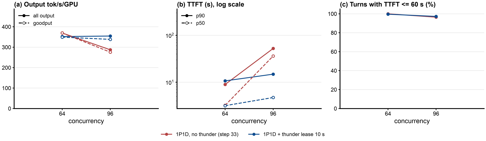

# Step 34: llm-d-thunder-agent-simplified on the 1P1D pair, Qwen3.5-397B-A17B-FP8, 8x B200

Status: done (2026-10-22). At c=96 thunder keeps the 1P1D pair at its knee: 1.23x output throughput, TTFT p50 36 s -> 4.7 s, at 1.43x E2E p99.

## Question

Step 33's no-thunder 1P1D baseline peaks at c=64 (370 output tok/s/GPU). Past that it collapses: at c=96 the single prefill server queues 82 requests, TTFT p50 is 36 s, and the working set peaks at 1.66x the GPU KV pool. Can thunder's session admission gate keep the 1P1D pair at its knee when the offered load is above it, and what does that cost the paused sessions?

## Setup

| | |
|---|---|
| Servers | step 33's pair, untouched: `qwen35-pd-prefill` (TP=4, GPUs 4-7) + `qwen35-pd-decode` (TP=4, GPUs 0-3, `MAX_NUM_SEQS` 256), vLLM v0.31.0 + the vllm-project/vllm#62862 fix, `MultiConnector` NIXL + 387 GiB CPU tier on each, KV P -> D by RDMA |
| Router | llm-d-router EPP built from [zetxqx/llm-d-router#15](https://github.com/zetxqx/llm-d-router/pull/15) (commit `8d1fbc87`: thunder-agent tracks only decode pods under P/D), image `bobinference/llm-d-router-endpoint-picker:thunder-pd-8d1fbc87`, chart from the same commit ([`b200/render-epp.sh`](b200/render-epp.sh)), release `agentx-epp-pdt` |
| Plugin config | [`b200/thunder-pd-plugins.yaml`](b200/thunder-pd-plugins.yaml): `disagg-profile-handler` + `always-disagg-pd-decider` (every request P then D, as step 33's proxy), the decode pod's llm-d disagg sidecar runs the prefill; thunder as flow-control saturation detector + fairness policy and as the only scorer of the decode profile |
| Thunder | step 26's `thunder-gpu-l10`: `utilThreshold` 1.0, `idleLeaseSeconds` 10, `headWaitStarvationMs` 1800000, `evictionTtlSeconds` 3600, `defaultRequestTTL` 0, envoy ext_proc timeout 2400 s. **`capacityTokens` 4,843,063 = the prefill server's GPU KV pool**: under always-disagg every turn is computed on P, so P's prefix cache is the one whose overflow costs recompute, and in 1P1D P's working set is the sum of all sessions, which is what the decode pod's ledger entry counts. `cacheInfoSpec` dropped (block_size x num_gpu_blocks overstates this hybrid model's pool by about 13%). Checked before the run: the ledger holds only `qwen35-pd-decode`, capacity 4.843063e+06 |
| Client | as step 33 (AgentX `agentx-v1.0.6`, `semianalysis_cc_traces_weka_062126_256k`, 60 min, `RESET=1`), `MODE=pool` (X-Session-ID sent, EPP restarted before each point, EPP metrics scraped) |
| Grid | smoke c=4 (120 s), then c = 64 and 96, one hour each |
| Runner | [`b200/run-thunder.sh`](b200/run-thunder.sh), log `b200/results/run-thunder.log` |

## Expectations (written before the run)

1. **c=64**: the baseline's working set averaged 0.89x P's pool (peak 1.10x), so the gate engages only at peaks. Throughput and TTFT within about 5% of the baseline (370 tok/s/GPU, TTFT p50 3.2 s), with a few pauses.
2. **c=96**: the baseline's working set averaged 1.40x the pool (peak 1.66x), so the gate holds about a third of the sessions and admitted concurrency falls to roughly 60 to 70, near the knee. Output throughput recovers toward c=64's 370 tok/s/GPU (baseline 287); TTFT p50 of admitted turns falls far below the baseline's 36 s; E2E p99 and the share of held time rise for paused sessions (step 26 at aggregated c=64: TTFT p50 1.7 s against 11.3 s, E2E p99 213 s against 159 s).
3. The gate counts KV, not P's compute queue. Falsified in the interesting direction if P still queues tens of requests at c=96 with the gate holding sessions; then `utilThreshold` 0.8 is the next arm.

## Results

Status: done (2026-10-22 08:18 to 11:09 UTC). Smoke and both points pass `verify-point.sh` (job succeeded, pods unchanged, every profiling request completed, EPP scrape present, no gate warning). Report: [`b200/results/compare/report/summary.md`](b200/results/compare/report/summary.md), ratios [`ratios.md`](b200/results/compare/report/ratios.md), log `b200/results/run-thunder.log`. The baseline is step 33's points, analyzed again with the thunder points.

Steady state (requests started after minute 5), per GPU over 8 GPUs:

| c | arm | output tok/s/GPU | TTFT p50 / p90 s | E2E-normalized interactivity p50 / p90 | E2E p90 / p99 s | hit % | P waiting (avg) | completed | cancelled at grace end (no first token) |
|---|---|---|---|---|---|---|---|---|---|
| 64 | no thunder | 370 | 3.21 / 8.95 | 60.5 / 19.3 | 23.5 / 62 | 93.7 | 6.0 | 10,774 | 1 (0) |
| 64 | thunder l10 | 352 (0.95x) | 3.16 / 10.66 | 59.9 / 18.5 | 25.6 / 73 | 93.4 | 6.7 | 10,356 | 2 (0) |
| 96 | no thunder | 287 | 36.1 / 52.3 | 11.5 / 2.8 | 61.5 / 155 | 89.6 | 81.7 | 8,957 | 38 (16) |
| **96** | **thunder l10** | **355 (1.23x)** | **4.71 / 14.8** | **52.3 / 13.8** | **30.4** / 222 | 92.1 | **10.3** | **10,748** | 37 (34) |

Gate and router (EPP scrape):

| c | pauses | delayed dispatches | forced admissions | router wait mean / p90 s | over 60 s | router queue (mean) | ledger working set / capacity (mean) |
|---|---|---|---|---|---|---|---|
| 64 | 3,377 | 865 | 0 | 1.2 / 0.5 | 0.2% | 3.7 | 0.99 |
| 96 | 3,891 | 1,574 | 26 | 9.8 / 2.4 | 1.8% | 34.1 | 1.00 |

- **c=96: thunder holds the pair at its knee.** Output throughput is 355 tok/s/GPU against 287 (1.23x), the same as thunder at c=64 (352) and 0.96x the baseline's peak (370 at c=64). The prefill queue falls from 82 to 10 waiting requests, TTFT p50 from 36 s to 4.7 s, and E2E-normalized interactivity p50 rises 4.6x (11.5 to 52.3). The hit rate recovers from 89.6% to 92.1%. 20% more requests complete in the same hour.
- **What it costs at c=96**: requests wait at the router instead of at P (mean 9.8 s, 34 in the router queue on average, 1.8% over the 60 s top bucket). The tail of held sessions grows: E2E p99 222 s against 155 s (1.43x), 26 forced admissions after the 1800 s backstop, and 34 turns cancelled at the grace end without a first token (16 in the baseline). E2E p90 halves (61 to 30 s): most sessions are much better off, a few wait much longer.
- **c=64: a small loss.** The gate is busy (3,377 pauses), but the baseline did not thrash at c=64 (hit 93.7%, P queue 6), so there was little to protect: throughput 0.95x, TTFT p90 and E2E p99 1.19x. Admitted sessions' turns always dispatch, so holding new and paused sessions adds router wait on top of the same P queue (6.7 against 6.0).
- **Why a KV gate fixes a compute collapse here**: the ledger counts idle sessions too and sat at 0.99x to 1.00x of P's pool at both points. Capping the resident working set at P's GPU pool also caps how many sessions send turns, so P's prefill load stays near what it can serve. The baseline's c=96 collapse was P's queue (82) fed by misses; the gate removes both.
- **Expectations**: (1) partly wrong: at c=64 the gate engaged throughout, not only at peaks, because the ledger counts idle and recently finished sessions, and it cost 5%; (2) confirmed: throughput recovered to 355 (expected toward 370), TTFT p50 4.7 s, E2E p99 1.43x; (3) not falsified: with the gate, P queues 10, not tens.

## Next steps

1. **Thunder at c=128**: the baseline collapsed to 75 tok/s/GPU (TTFT p50 342 s). If the gate keeps the pair at about 355 there too, the 1P1D curve becomes flat past the knee.
2. **Idle lease 30 s** (step 32's value) at c=64 and 96: fewer pauses of sessions about to return should cut the c=64 loss and the c=96 tail (E2E p99, forced admissions), possibly at some throughput.
3. **prefix-based-pd-decider + thunder**: admitted sessions keep their KV on D, so most turns could prefill on the idle decode pod (PR #15's README). Needs D to cache the Mamba state of NIXL-received KV (step 31's open issue) for the turn right after a remote prefill.
