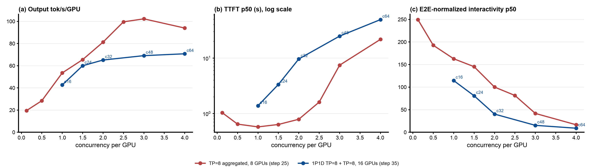

# Step 35: 1P1D GLM-5.2-NVFP4 across two 8x B200 nodes, no router (baseline)

Status: done (2026-10-23). Per GPU 1P1D is 0.68x to 0.92x TP=8 aggregated at equal load per GPU; it saturates at about 70 output tok/s/GPU from c=48 with the prefill server queueing (44 waiting at c=64).

## Question

Steps 33 and 34 ran Qwen3.5-397B (hybrid attention, small KV) as 1P1D on one node: the single prefill server was the bottleneck and decode sat half idle. GLM-5.2 is the opposite case. With MLA its KV is replicated on every GPU, a TP=8 server holds only 1.57M to 1.69M tokens, and step 25 found the aggregated server limited by KV capacity: it runs only 6 to 7 of the ~250k-token requests at a time. What does disaggregating it into one prefill and one decode TP=8 server do, per GPU and per user?

## Setup

| | |
|---|---|
| Nodes | prefill on `5qjv`, decode on `000v` (both `a4-highgpu-8g`, 8 B200 + 8 RDMA NICs at 400 Gb/s); `000v` downloaded the checkpoint on first start |
| Servers | `glm52-pd-prefill` and `glm52-pd-decode`, vLLM v0.31.0, `nvidia/GLM-5.2-NVFP4` rev `aec724e8`, TP=8 each, step 25's flags on both ([`b200/vllm-glm52-pd.yaml`](b200/vllm-glm52-pd.yaml)): FP8 KV, `--max-model-len 1048576`, `--max-num-batched-tokens 8192`, MTP 3, `--gpu-memory-utilization 0.8`, glm47 tool parser. `MAX_NUM_SEQS` 64 on P, 128 on D (2x the top concurrency) |
| GPU and NIC claim | [`b200/gpu-nic-claim.yaml`](b200/gpu-nic-claim.yaml): all 8 GPUs and all 8 RDMA NICs of the node per server |
| KV | `MultiConnector` = `NixlConnector` (P `kv_producer`, D `kv_consumer`, `bidirectional_kv_xfer: false`) + `OffloadingConnector` with 820 GiB per server (`cpu_bytes_to_use`, what step 25's `--kv-offloading-size 820` sets). KV moves P -> D over NIXL/UCX RoCE between the two nodes |
| vLLM fix | vllm-project/vllm#62862 (zetxqx/vllm#1, [`b200/pr62862/`](b200/pr62862/)) on both servers, as steps 33/34 |
| Routing | no router: vLLM's NIXL toy proxy ([`b200/toy_proxy_server.py`](b200/toy_proxy_server.py), step 33's copy with the SSE content type and 1800 s keep-alive), every request P (`max_tokens=1`) then D. The decode pod also runs the llm-d disagg sidecar on 8000 for a later EPP/thunder arm |
| Client | as steps 25/27: AgentX `agentx-v1.0.6`, dataset `semianalysis_cc_traces_weka_062126` (uncapped, 1M context), 60 min per point, `RESET=1` (both KV tiers on both servers emptied, no restart), 4 CPU / 16 GiB request / 64 GiB limit |
| Grid | smoke c=4 (120 s), then c = 16, 24, 32, 48, 64 |
| Runner | [`b200/run-baseline.sh`](b200/run-baseline.sh), log `b200/results/run-baseline.log` |

Per-GPU throughput divides by 16 GPUs. The reference is step 25's TP=8 aggregated no-router (one server, 8 GPUs, same flags, offload, client and reset method) at half the concurrency: 1P1D c=32, 48, 64 against TP=8 c=16 (81.3 output tok/s/GPU, TTFT p50 0.79 s), c=24 (102.3, 7.45 s), c=32 (94.0, 21.8 s).

## Expectations (written before the run)

1. **Decode is the bottleneck, not prefill** (the reverse of Qwen3.5). D's GPU pool is the same 1.57M to 1.69M tokens as one aggregated server, so it can hold only 6 to 7 of the ~250k-token requests at a time; P frees each request's KV after the transfer.
2. Per GPU, 1P1D delivers **less** output throughput than TP=8 aggregated at equal concurrency per GPU, roughly 0.5x to 0.7x: twice the GPUs, about the same number of requests decoding at once. Decode without prefill interruptions makes per-user decode speed higher than aggregated, and TTFT adds P's prefill plus a cross-node transfer of up to about 12 GB per request (250k tokens x 48.4 KB).
3. Cross-node NIXL over 8 NICs should move a full prompt in well under a second, so the transfer is not the limit.

## Results

Status: done (2026-10-22 21:16 to 2026-10-23 04:33 UTC). Smoke and all five points pass `verify-point.sh` (job succeeded, pods unchanged, every profiling request completed, 0 client errors). Report: [`b200/results/glm52-1p1d-baseline/report/summary.md`](b200/results/glm52-1p1d-baseline/report/summary.md), log `b200/results/run-baseline.log`. Servers up in 25 minutes (`000v` downloaded the checkpoint quickly); the NIXL compatibility check passed on all 8 decode ranks and the first request moved its KV across the nodes (8 transfers, 0.8 ms each).

Step 35 (blue, 16 GPUs) against step 25's TP=8 aggregated no-router (red, 8 GPUs) at equal concurrency per GPU; [`b200/plot_vs_tp8.py`](b200/plot_vs_tp8.py).

Steady state (requests started after minute 5), per GPU over 16 GPUs:

| c | output tok/s/GPU (total) | TTFT p50 / p90 s | interactivity p50 / p90 | E2E-normalized interactivity p50 / p90 | E2E p99 s | hit % | turns within 60 s TTFT | cancelled at grace end |
|---|---|---|---|---|---|---|---|---|
| 16 | 42.7 (683) | 1.38 / 6.35 | 227 / 172 | 114.5 / 34.4 | 41 | 98.7 | 100% | 0 |
| 24 | 60.0 (960) | 3.35 / 10.8 | 200 / 151 | 80.8 / 17.6 | 48 | 98.8 | 100% | 0 |
| 32 | 65.1 (1,042) | 9.65 / 22.6 | 194 / 148 | 40.2 / 7.6 | 56 | 98.8 | 100% | 0 |
| 48 | 69.1 (1,105) | 24.9 / 41.9 | 184 / 142 | 15.3 / 3.5 | 75 | 98.6 | 98.6% | 4 |
| 64 | 70.8 (1,132) | 49.5 / 73.2 | 177 / 136 | 9.0 / 2.0 | 153 | 98.1 | 77.6% | 35 |

Per server (averages over the profiling window) and NIXL (decode pod, `vllm:nixl_bytes_transferred`):

| c | P waiting / running / KV | D waiting / running / KV | NIXL bytes in the hour | per transfer (one of 8 ranks) |
|---|---|---|---|---|
| 16 | 0.27 / 0.22 / 15% | 0.34 / 2.7 / 38% | 62.7 TB | 3.2 GB (~66k tokens) |
| 24 | 1.11 / 0.37 / 37% | 1.28 / 4.4 / 61% | 154.7 TB | 5.7 GB (~117k tokens) |
| 32 | 4.84 / 0.57 / 67% | 2.84 / 5.0 / 73% | 204.0 TB | 6.9 GB (~142k tokens) |
| 48 | **19.6** / 0.77 / 78% | 3.21 / 5.7 / 74% | 210.9 TB | 6.7 GB |
| 64 | **44.2** / 0.85 / 75% | 3.48 / 6.1 / 74% | 192.3 TB | 6.1 GB |

Against step 25's TP=8 aggregated no-router:

| 1P1D c | per GPU, against TP=8 at c/2 (equal load per GPU) | total, against one TP=8 server at the same c |
|---|---|---|
| 16 | 0.80x (42.7 vs 53.5) | 1.05x (683 vs 650), TTFT p50 1.38 vs 0.79 s |
| 24 | 0.92x (60.0 vs 65.5) | 1.17x (960 vs 818), TTFT p50 3.35 vs 7.45 s |
| 32 | 0.80x (65.1 vs 81.3) | 1.39x (1,042 vs 752), TTFT p50 9.65 vs 21.8 s |
| 48 | 0.68x (69.1 vs 102.3) | 1.44x (1,105 vs 767), TTFT p50 24.9 vs 45.5 s |
| 64 | 0.75x (70.8 vs 94.0) | 1.45x (1,132 vs 780), TTFT p50 49.5 vs 79.4 s |

- **Per GPU, 1P1D never beats TP=8 aggregated**: 0.68x to 0.92x at equal concurrency per GPU, and TTFT p50 is 2x to 12x higher (every turn adds P's prefill and a cross-node transfer). On the per-GPU Pareto view (panel c) the 1P1D line lies below the aggregated line everywhere.
- **What 16 GPUs as 1P1D buy over one 8-GPU server at the same load**: 1.05x to 1.45x the total throughput, half the TTFT from c=24 on, 2x to 2.4x the E2E-normalized interactivity at c=24 to 48, and 1.3x to 2.4x the per-user decode speed (p90 interactivity 136 to 172 tok/s against 62 to 88). Two aggregated servers would give about 2x.
- **Saturation at about 70 tok/s/GPU from c=48.** Decode is KV-capacity-bound as expected: it holds 5 to 6 of the ~250k-token requests at a time (KV about 74%) and never queues more than 3.5. But from c=32 on the prefill server queues more (4.8, 19.6, 44 waiting), processing under one request at a time: each turn's whole prompt is prefilled on P, mostly loaded from P's CPU tier (98% hit overall, GPU-only hit under 10%), and a running prefill needs the whole prompt's KV on P's GPUs (P KV 67% to 78%).
- **Cross-node NIXL is not the limit, but MLA makes it 8x redundant.** With TP=8 on both sides every decode rank pulls the whole (replicated) MLA block from its prefill peer, so each request moves 8 copies: 63 to 211 TB per hour (17 to 59 GB/s aggregate over 8 NICs of 50 GB/s each). D reuses its local prefix (the #62862 fix), so a transfer averages 66k to 142k tokens rather than the whole prompt.
- **Expectations**: (1) half right: decode is KV-bound at 5 to 6 requests, but the prefill server is what queues past c=32; (2) per GPU 0.68x to 0.92x, less bad than the predicted 0.5x to 0.7x; (3) confirmed: the transfer is not the limit.

## Next steps

1. **Thunder on this pair** (PR #15 image, capacity = P's GPU KV pool 1,572,864): the c=48/64 collapse is P's queue fed by long prompts, the regime where step 34 kept Qwen3.5's pair at its knee.
2. **MLA-aware transfer**: pull each block once per node and share it over NVLink instead of 8 RDMA reads, an upstream NIXL/vLLM change.
3. **More prefill per decode** (2P1D, 24 GPUs): this workload is prefill-heavy here too.
