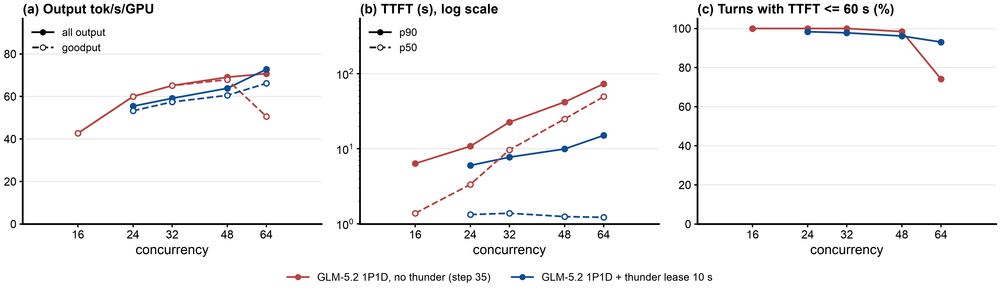
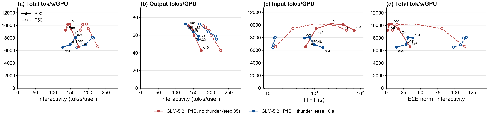

# Step 36: llm-d-thunder-agent-simplified on the GLM-5.2 1P1D pair (two 8x B200 nodes)

Status: done (2026-10-23). At c = 24 to 64 thunder holds TTFT p50 at 1.2 to 1.4 s (no thunder: 3.4 to 49 s) for 0.91x to 1.03x the output throughput; the cost grows with the load: completed requests 12% to 32% shorter (smaller sessions served first) and E2E p99 2.3x to 7.5x the baseline.

## Question

Step 35's no-router GLM-5.2 1P1D pair saturates at about 70 output tok/s/GPU from c=48, with the prefill server queueing 19.6 (c=48) and 44 (c=64) requests and TTFT p50 25 s and 49 s. Step 34 showed thunder keeping an overloaded Qwen3.5 1P1D pair at its knee. Does the same gate help GLM-5.2, whose sessions are much larger relative to the KV pool (a ~250k-token session is about a sixth of P's 1.57M-token pool)?

## Setup

| | |
|---|---|
| Servers | step 35's pair, untouched: `glm52-pd-prefill` (TP=8, `5qjv`) + `glm52-pd-decode` (TP=8, `000v`), KV over cross-node NIXL/RDMA, 820 GiB CPU tier each, vllm#62862 fix |
| Router | step 34's EPP image (`thunder-pd-8d1fbc87`, zetxqx/llm-d-router#15) and plugin config ([`b200/thunder-pd-plugins.yaml`](b200/thunder-pd-plugins.yaml)): always-disagg through the decode pod's llm-d disagg sidecar, thunder as flow-control saturation detector, fairness policy and decode-profile scorer; release `agentx-epp-gpdt` |
| Thunder | `utilThreshold` 1.0, `idleLeaseSeconds` 10, `headWaitStarvationMs` 1800000, `evictionTtlSeconds` 3600, `defaultRequestTTL` 0, envoy ext_proc timeout 2400 s. **`capacityTokens` 1,572,864 = the prefill server's GPU KV pool** (D's is 1,505,088). Checked before the run: the ledger holds only `glm52-pd-decode` at 1.572864e+06 |
| Client | as step 35 (AgentX `agentx-v1.0.6`, uncapped `semianalysis_cc_traces_weka_062126`, 60 min, `RESET=1`), `MODE=pool` (X-Session-ID sent, EPP restarted per point) |
| Grid | smoke c=4 (120 s), then c = 48 and 64, one hour each; c = 24 and 32 added after (same EPP and servers, 2026-10-23 16:22 to 19:12 UTC, `SMOKE=0 CONCS="24 32" COMPARE_CONCS="24 32 48 64"`, log `b200/results/run-thunder-c24-c32.log`) |
| Runner | [`b200/run-thunder.sh`](b200/run-thunder.sh), log `b200/results/run-thunder.log` |

## Expectations (written before the run)

1. The ledger fits only about 6 average sessions in P's GPU pool, far below 48 or 64, so the gate holds most sessions and admitted concurrency stays small. Prefill's queue and TTFT p50 of admitted turns fall far below step 35's (19.6 and 44 waiting; 25 s and 49 s).
2. Unlike Qwen3.5, throughput may fall below the baseline's ~70 tok/s/GPU: the baseline served most misses from the 820 GiB CPU tier (98% overall hit with under 10% on GPU), which a GPU-capacity gate does not count, so it may hold more than it needs to.
3. Long router waits and forced admissions (1800 s backstop) for held sessions, as in step 25's TP=8 thunder runs.

## Results

Status: done (2026-10-23 05:06 to 08:32 UTC; c=24 and 32 16:22 to 19:12 UTC). Smoke and all four points pass `verify-point.sh` (job succeeded, pods unchanged, every profiling request completed, EPP scrape present, no gate warning). Report: [`b200/results/compare/report/summary.md`](b200/results/compare/report/summary.md), ratios [`ratios.md`](b200/results/compare/report/ratios.md); all-points figures with step 35's five baseline points: [`fig2-load-all-points.png`](b200/results/compare/report/fig2-load-all-points.png), [`fig1-pareto-all-points.png`](b200/results/compare/report/fig1-pareto-all-points.png).

Steady state (requests started after minute 5), per GPU over 16 GPUs:

| c | arm | output tok/s/GPU | input tok/s/GPU | TTFT p50 / p90 s | E2E-normalized interactivity p50 / p90 | E2E p90 / p99 s | P waiting | completed | mean ISL of completed | turns within 60 s TTFT | cancelled (no first token) |
|---|---|---|---|---|---|---|---|---|---|---|---|
| 24 | no thunder | 60.0 | 9,415 | 3.35 / 10.8 | 80.8 / 17.6 | 20.2 / 48 | 1.11 | 3,413 | 157k | 100% | 0 |
| 24 | thunder l10 | 55.4 (0.92x) | 7,937 (0.84x) | **1.33 / 6.0** | **112 / 38.5** | 18.8 / 124 | **0.21** | 3,318 | 139k | 98.5% | 1 (0) |
| 32 | no thunder | 65.1 | 10,158 | 9.65 / 22.6 | 40.2 / 7.6 | 31.1 / 56 | 4.84 | 3,706 | 159k | 100% | 0 |
| 32 | thunder l10 | 59.1 (0.91x) | 8,027 (0.79x) | **1.38 / 7.7** | **117 / 31.3** | **18.6** / 128 | **0.26** | 3,608 | 134k | 97.9% | 9 (8) |
| 48 | no thunder | 69.1 | 10,083 | 24.9 / 41.9 | 15.3 / 3.5 | 49.9 / 75 | 19.6 | 3,939 | 153k | 98.6% | 4 (2) |
| 48 | thunder l10 | 63.8 (0.92x) | 6,870 (0.68x) | **1.25 / 9.9** | **108 / 28.7** | **22.6** / 563 | **2.2** | 3,750 | 120k | 96.2% | 18 (15) |
| 64 | no thunder | 70.8 | 9,153 | 49.5 / 73.2 | 9.0 / 2.0 | 82.0 / 153 | 44.2 | 3,948 | 145k | 77.6% | 35 (19) |
| 64 | thunder l10 | 72.8 (1.03x) | 6,440 (0.70x) | **1.22 / 15.0** | **98.0 / 14.5** | **29.6** / 1,109 | **5.9** | **4,543** | 99k | **93.7%** | 46 (44) |

Gate, router and transfer:

| c | pauses | delayed dispatches | forced admissions | router wait mean / p90 s | over 60 s | router queue (mean) | ledger / capacity (mean) | NIXL in the hour, thunder vs no thunder |
|---|---|---|---|---|---|---|---|---|
| 24 | 519 | 314 | 1 | 4.7 / 0.0 | 1.2% | 4.5 | 0.95 | 36 TB vs 155 TB |
| 32 | 703 | 419 | 4 | 6.6 / 1.7 | 1.4% | 9.5 | 1.03 | 40 TB vs 204 TB |
| 48 | 933 | 466 | 14 | 13.6 / 2.7 | 2.4% | 22.3 | 1.35 | 44 TB vs 211 TB |
| 64 | 1,422 | 765 | 32 | 26.6 / 4.5 | 3.9% | 49.4 | 2.01 | 45 TB vs 192 TB |

Thunder against no thunder, by load:

| c | output tok/s/GPU | TTFT p50 | E2E-normalized interactivity p50 | E2E p99 | mean ISL of completed | forced admissions |
|---|---|---|---|---|---|---|
| 24 | 0.92x | 2.5x lower (3.35 -> 1.33 s) | 1.4x | 2.6x (48 -> 124 s) | -12% | 1 |
| 32 | 0.91x | 7x lower (9.65 -> 1.38 s) | 2.9x | 2.3x (56 -> 128 s) | -16% | 4 |
| 48 | 0.92x | 20x lower (24.9 -> 1.25 s) | 7.1x | 7.5x (75 -> 563 s) | -22% | 14 |
| 64 | 1.03x | 40x lower (49.5 -> 1.22 s) | 10.9x | 7.2x (153 -> 1,109 s) | -32% | 32 |

- **With thunder, TTFT p50 stays at 1.2 to 1.4 s at every load** (panel b of the load figure: the blue dashed line is flat) while the baseline's grows from 3.4 to 49 s. Below the collapse (c=24, 32) thunder costs about 8% to 9% of output throughput, because it admits only about 4 sessions at a time and D runs about 4 requests; at c=64, where the baseline collapses, it matches it.
- **The cost scales with the overload**: at c=24 and 32 the tail is about 2.5x the baseline's (124 to 128 s) with 1 and 4 forced admissions and requests 12% to 16% shorter; at c=48 and 64 it is 7x (563 to 1,109 s) with 14 and 32 forced admissions and requests 22% to 32% shorter.
- **At c=48 and 64 the prefill queue disappears and TTFT p50 drops 20x to 40x.** Admitted concurrency stays at about 5 to 8 sessions (the ledger fits few ~250k-token sessions into P's 1.57M-token pool), so P queues 2 to 6 instead of 20 to 44, TTFT p50 is 1.2 s at both points, E2E-normalized interactivity p50 is 7x to 11x higher, and E2E p90 is 2x to 3x lower. At c=64, 93.7% of turns get their first token within 60 s against 77.6%.
- **Output throughput holds: 0.92x at c=48, 1.03x at c=64.** NIXL traffic falls 4x to 5x: admitted sessions keep their KV on D, so a turn pulls about 30k tokens instead of about 140k.
- **But thunder serves smaller sessions first.** The completed requests' mean input length falls from 153k to 120k tokens (c=48) and from 145k to 99k (c=64), and input tok/s/GPU is 0.68x to 0.70x. The gate admits whatever fits, and "a session that fits no pod does not block the others", so large sessions wait: E2E p99 is 563 s and 1,109 s against 75 and 153 s, 14 and 32 sessions hit the 1800 s forced admission, and 15 and 44 turns end the hour without a first token. Part of the TTFT and interactivity gain is this mix shift, not only shorter queues; output tok/s compares fairly, total tok/s does not (panel d above, where the thunder points sit lower).
- **Against Qwen3.5 (step 34)** thunder again prevents the overload collapse, but on GLM-5.2 the per-session footprint is a sixth of the pool, so the gate admits only a handful of sessions, biases strongly toward small ones and costs a much longer tail.
- **Expectations**: (1) confirmed: 5 to 8 admitted sessions, P queue and TTFT far down; (2) throughput did not fall (0.92x, 1.03x), though input throughput did, through the mix shift; (3) confirmed and larger than expected: E2E p99 7x the baseline, 14 and 32 forced admissions.

## Next steps

1. **A fairness check**: compare per-session completion (`session_progress`) and the turn distribution by session size, to separate the queueing gain from the small-session bias.
2. **Capacity counting the CPU tier** (step 25's `cap3m`/`cap6m` style, for example 2x or 4x P's GPU pool): more admitted sessions, less bias toward small ones, at some TTFT.
3. **Idle lease 30 s** to pause fewer sessions about to return.
