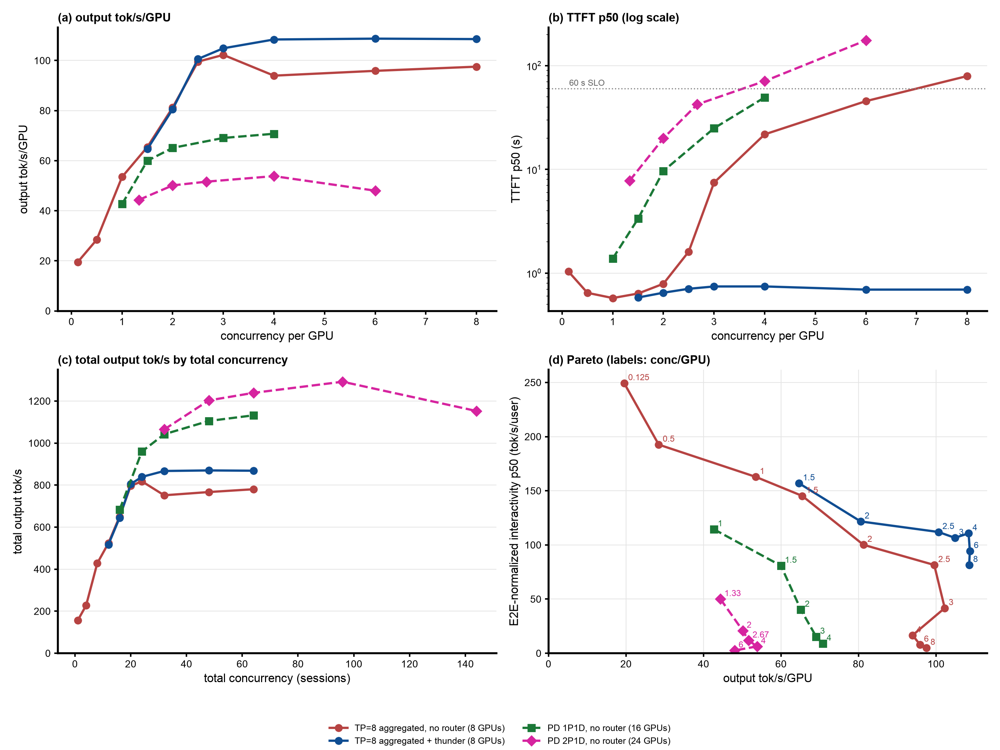

# Step 37: 2P1D GLM-5.2-NVFP4 across three 8x B200 nodes, no router (baseline)

Status: done (servers started 2026-10-24 04:41 UTC, last point finished 12:54 UTC).

## Question

Step 35's 1P1D pair (16 GPUs) saturated at about 70 output tok/s/GPU from c=48 with the single prefill server queueing (19.6 waiting at c=48, 44 at c=64) while decode, KV-bound at 5 to 6 of the ~250k-token requests, queued at most 3.5. Does a second prefill server (2P1D, 24 GPUs) remove the prefill bottleneck, and what does it do per GPU and per user?

## Setup

| | |
|---|---|
| Nodes | prefill A on `gw0s`, prefill B on `t3gv`, decode on `p3mf` (`a4-highgpu-8g`, 8 B200 + 8 RDMA NICs each); freed on 2026-10-24 from namespaces `llm-d-pd-disaggregation` (SGLang GLM-5.2 P/D LWS scaled to 0) and `bz-wideep` (wide-EP `DisaggregatedSet` roles scaled to 0); each node downloads the checkpoint on first start |
| Servers | `glm52-2p1d-prefill-a`, `glm52-2p1d-prefill-b`, `glm52-2p1d-decode`, step 35's flags and KV config on all three ([`b200/vllm-glm52-2p1d.yaml`](b200/vllm-glm52-2p1d.yaml)): TP=8, FP8 KV, 1M context, MTP 3, `MultiConnector` NIXL + 820 GiB CPU tier each, vllm#62862 fix; `MAX_NUM_SEQS` 64 per prefill, 128 on decode |
| Routing | no router: step 35's vLLM NIXL toy proxy ([`b200/toy_proxy_server.py`](b200/toy_proxy_server.py)) with one change: with two prefill servers, a session's turns go to the same one (CRC32 of `X-Session-ID` modulo 2), so each session's history stays in one prefill server's prefix cache and CPU tier; every request P (`max_tokens=1`) then D |
| Client | as step 35 (AgentX `agentx-v1.0.6`, uncapped `semianalysis_cc_traces_weka_062126`, 60 min, `RESET=1`), `MODE=direct` with `SESSION_ID_HEADER=true` so the proxy sees the session |
| Grid | smoke c=4 (120 s), then **c = 96 first** (4 per GPU over 24 GPUs: the highest load with references on both sides, TP=8 aggregated c=32 and 1P1D c=64), run as `CONCS=96 ./run-baseline.sh`; then, on request, c = 144, 64, 48, 32 on the same servers ([`b200/run-more.sh`](b200/run-more.sh)), one hour each |
| Runner | [`b200/run-baseline.sh`](b200/run-baseline.sh), log `b200/results/run-baseline.log` |

## Expectations (written before the run)

1. The prefill queue shrinks: each prefill server sees half the sessions, so at c=64 each carries about step 35's c=32 load (P queue 4.8).
2. Decode becomes the limit: one D still holds only 5 to 6 long requests at a time, and in step 35 it already ran about 6 at c=64. Total throughput rises little over 1P1D (about 1,130 output tok/s), so per GPU (24 GPUs) it falls, perhaps to 50 to 55 tok/s/GPU, below step 35's 1P1D and far below TP=8 aggregated (94 to 108).
3. TTFT falls against 1P1D at c=48 to 64 (shorter prefill queue), so E2E-normalized interactivity improves at equal total concurrency.

## Results

Status: done (c=96 05:29 to 07:01 UTC; c = 144, 64, 48, 32 07:02 to 12:54 UTC on 2026-10-24, same servers, no restarts). Smoke and all five points pass `verify-point.sh` (job succeeded, pods unchanged, every profiling request completed, 0 client errors). Report: [`b200/results/glm52-2p1d-baseline/report/summary.md`](b200/results/glm52-2p1d-baseline/report/summary.md), logs `b200/results/run-baseline.log` (smoke, c=96) and `b200/results/run-more.log` (the rest, run by [`b200/run-more.sh`](b200/run-more.sh)).

2P1D (magenta, 24 GPUs) against step 25's TP=8 aggregated server without router (red) and with thunder-l10 (blue), 8 GPUs, and step 35's 1P1D (green, 16 GPUs); [`make_figure.py`](make_figure.py) (references from the GLM dashboard bundle).

Steady state (requests started after minute 5), per GPU over 24 GPUs:

| c (per GPU) | output tok/s/GPU (total) | TTFT p50 / p90 s | interactivity p50 / p90 | E2E-normalized interactivity p50 / p90 | E2E p90 s | hit % | turns within 60 s TTFT | cancelled at grace end (no first token) |
|---|---|---|---|---|---|---|---|---|
| 32 (1.33) | 44.4 (1,065) | 7.8 / 20.6 | 189 / 147 | 50.0 / 9.2 | 30 | 98.7 | 100% | 1 (0) |
| 48 (2) | 50.1 (1,203) | 20.0 / 43.4 | 177 / 137 | 20.9 / 3.9 | 51 | 98.5 | 98% | 2 (0) |
| 64 (2.67) | 51.6 (1,239) | 42.3 / 75.0 | 171 / 132 | 11.8 / 2.3 | 82 | 98.4 | 74% | 45 (38) |
| 96 (4) | **53.8 (1,292)** | 71.0 / 139 | 159 / 123 | 6.3 / 1.3 | 145 | 97.8 | 34% | 92 (76) |
| 144 (6) | 48.0 (1,153) | 175 / 240 | 133 / 95 | 2.6 / 0.6 | 249 | 97.3 | 1% | 164 (151) |

Per server (steady-state averages), the session-hash split between the two prefill servers, NIXL (decode pod, `vllm:nixl_bytes_transferred`) and mean ISL of the profiling requests:

| c | P-a waiting / running / KV | P-b waiting / running / KV | requests P-a : P-b | D waiting / running / KV | NIXL in the hour | mean ISL |
|---|---|---|---|---|---|---|
| 32 | 0.8 / 0.2 / 53% | 0.6 / 0.2 / 43% | 57 : 43 | **6.5** / 5.4 / 82% | 207 TB | 157k |
| 48 | 8.7 / 0.3 / 84% | 2.3 / 0.3 / 69% | 49 : 51 | **11.6** / 6.4 / 87% | 219 TB | 146k |
| 64 | 26.1 / 0.4 / 88% | 7.9 / 0.3 / 84% | 50 : 50 | 14.0 / 6.8 / 88% | 211 TB | 137k |
| 96 | 27.5 / 0.4 / 89% | 54.2 / 0.4 / 87% | 54 : 46 | 16.3 / 7.7 / 89% | 204 TB | 121k |
| 144 | 101.8 / 0.4 / 85% | 92.3 / 0.4 / 89% | 46 : 54 | 19.9 / 8.1 / 89% | 165 TB | 103k |

Against the references at equal concurrency per GPU (`~` = interpolated between the two neighbouring measured points):

| c/GPU | 2P1D | 1P1D (step 35) | TP=8 no router (step 25) | TP=8 + thunder-l10 (step 25) |
|---|---|---|---|---|
| 1.33 | 44.4 | ~54 | ~61 | n/a |
| 2 | 50.1 | 65.1 | 81.3 | 80.6 |
| 2.67 | 51.6 | ~68 | ~100 | ~102 |
| 4 | 53.8 | 70.8 | 94.0 | 108.4 |
| 6 | 48.0 | n/a | 95.9 | 108.7 |

Against 1P1D at the same total concurrency (16 vs 24 GPUs): total output 1.02x / 1.09x / 1.09x at c = 32 / 48 / 64 (1,065 vs 1,042; 1,203 vs 1,105; 1,239 vs 1,132), TTFT p50 7.8 vs 9.7, 20.0 vs 24.9, 42.3 vs 49.5 s, E2E-normalized interactivity p50 50.0 vs 40.2, 20.9 vs 15.3, 11.8 vs 9.0.

- **2P1D is the worst of the four per GPU**: 44 to 54 output tok/s/GPU, 0.5x to 0.6x TP=8 aggregated and 0.45x to 0.5x TP=8 + thunder at equal load per GPU, and 0.75x to 0.8x 1P1D. On the Pareto view (panel d) its line lies below every other one. With the same 24 GPUs as three TP=8 servers, c=96 would be about 2,260 output tok/s without a router (3 x 752) and about 2,600 with thunder, against 1,292.
- **The second prefill server removes the prefill queue only at low load, and the decode server becomes the limit.** At c=32 both P servers are nearly idle (under 1 waiting, KV 43% to 53%; step 35's single P had 4.8 waiting) while D queues 6.5 and runs 5.4 requests at 82% KV. TTFT at c=32 (7.8 s) is therefore mostly D's queue. D stays KV-bound at 5 to 8 of these long requests (KV 82% to 89%) and its queue grows with the load (6.5 to 20). From c=48 the P servers queue as well, since each still prefills under one ~140k-token request at a time.
- **So the extra 8 GPUs add only 2% to 9% total throughput over 1P1D.** Output comes only from D, and D produces 1,065 to 1,292 tok/s, a little more than step 35's D (1,042 to 1,132) because its queue is never empty (5.4 to 8 running at 130 to 190 tok/s per user). P servers produce no output tokens, so each one added lowers output per GPU. Peak total is at c=96; at c=144 it drops 11% (1,153), with 164 requests cancelled at the end of the grace period.
- **Per-user decode speed is still PD's advantage** (interactivity p90 95 to 147 tok/s; TP=8 aggregated 62 to 88 in step 35's comparison), but TTFT dominates the turn: E2E-normalized interactivity p50 is 50 at c=32 and under 21 from c=48, where TP=8 + thunder holds 80 to 122.
- **The session hash splits requests evenly but not load.** Request shares are 43% to 57%, yet the waiting queues differ by 3x to 4x at c=48 and c=64 (P-a 8.7 vs 2.3, 26.1 vs 7.9) and by 2x the other way at c=96 (27.5 vs 54.2): a few long sessions land on one server and stay there. A least-loaded choice among prefills (with the session's prefix in the CPU tier of the other server lost) would even this out, but would not lift the D limit.
- **The completed mix shifts to shorter prompts as load rises** (mean ISL 157k at c=32, 103k at c=144): long turns wait longest and are the ones cancelled at the grace end, so the high-load points flatter 2P1D's throughput slightly.
- **NIXL**: 165 to 219 TB per hour (46 to 61 GB/s over the decode node's 8 NICs), the same as step 35; not a limit.
- **Expectations**: (1) half right: the prefill queue shrinks at c=32 (0.6 to 0.8 vs 4.8) and at c=48 (2 to 9 vs 19.6), but not at c=64 and above, and the split is uneven; (2) confirmed: decode is the limit and per GPU lands at 44 to 54 tok/s/GPU, inside the predicted 50 to 55 range at c>=48; (3) confirmed but small: TTFT 15% to 20% lower and E2E-normalized interactivity 1.25x to 1.35x 1P1D at the same total concurrency.

## Next steps

1. **Release the 24 GPUs** (three nodes) unless a follow-up is wanted; the manifests stay in `b200/`.
2. If PD on GLM is pursued further, the limit is D's KV capacity at ~250k-token sessions, so more decode (2P2D or 1P2D) rather than more prefill, or thunder on 2P1D with capacity set to D's KV pool.
3. Least-loaded prefill selection with session affinity as a tie-breaker, to even out P-a and P-b.
