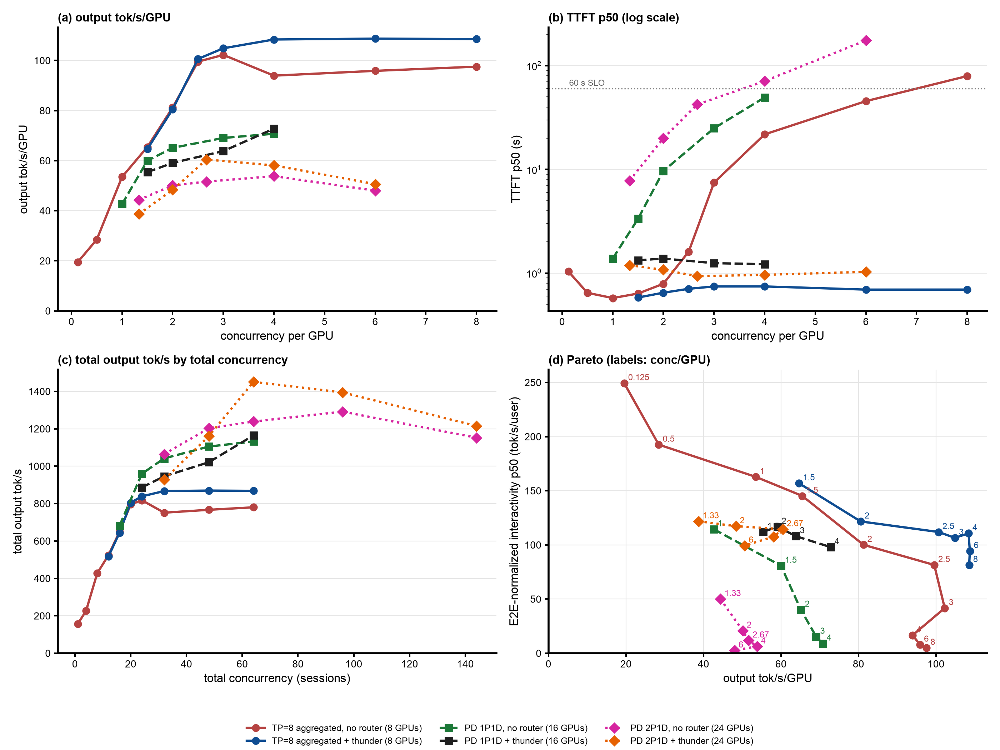

# Step 38: llm-d-thunder-agent-simplified on the GLM-5.2 2P1D servers (three 8x B200 nodes)

Status: done (2026-10-24 19:30 to 2026-10-25 03:44 UTC). TTFT p50 stays at about 1 s at every load (no router: 7.8 to 175 s) for 0.87x to 1.17x the output throughput (1.17x at c=64, 1,451 tok/s, the highest GLM-5.2 P/D total); the cost grows with the load: completed requests 18% to 39% shorter and E2E p99 2.9x to 7.4x the baseline, 4 to 123 forced admissions.

## Question

Step 37's no-router 2P1D (two prefill + one decode TP=8 server, 24 GPUs) is decode-bound: the decode server holds 5 to 8 of the ~150k-token requests (KV 82% to 89%) and queues 6.5 to 20, TTFT p50 is 7.8 s at c=32 and up to 175 s at c=144, and output peaks at 1,292 tok/s (53.8 tok/s/GPU). Step 36 showed thunder holding a GLM-5.2 1P1D pair at TTFT ~1.2 s for 0.91x to 1.03x its throughput. What does the same gate do on 2P1D, with its capacity set to the decode server's KV pool?

## Setup

| | |
|---|---|
| Servers | step 37's three servers, untouched: `glm52-2p1d-prefill-a` (`gw0s`), `glm52-2p1d-prefill-b` (`t3gv`), `glm52-2p1d-decode` (`p3mf`), TP=8 each, KV over cross-node NIXL/RDMA, 820 GiB CPU tier each, vllm#62862 fix |
| Router | step 36's EPP image `thunder-pd-8d1fbc87`: [zetxqx/llm-d-router#15](https://github.com/zetxqx/llm-d-router/pull/15) head commit `8d1fbc87` (one commit on upstream `main` `26200ef8`, which already has the thunder-agent plugin from #2968, #3052, #3076; #15 makes only decode pods enter the ledger). Plugin config [`b200/thunder-pd-plugins.yaml`](b200/thunder-pd-plugins.yaml): always-disagg through the decode pod's llm-d disagg sidecar, thunder as flow-control saturation detector, fairness policy and decode-profile scorer; release `agentx-epp-g2pt` ([`b200/render-epp.sh`](b200/render-epp.sh), endpoints in [`b200/epp-values-pd-thunder.yaml`](b200/epp-values-pd-thunder.yaml)) |
| Thunder | as step 36 (`utilThreshold` 1.0, `idleLeaseSeconds` 10, `headWaitStarvationMs` 1800000, `evictionTtlSeconds` 3600, `defaultRequestTTL` 0, envoy ext_proc timeout 2400 s) except **`capacityTokens` 1,505,088 = the decode server's GPU KV pool** (64 x 23,517; each prefill server has 1,572,864). In the code at `8d1fbc87` only pods with a decode role enter the ledger (`saturation.go`, `bylabel.RunsDecode`), so the ledger has one entry, the decode pod; its capacity is `capacityTokens` because the metrics extractor has no `cacheInfoSpec` (`accounting.go` `endpointCapacity`); a pod's room is capacity x `utilThreshold` minus its working set (`fairness.go` `roomLocked`). Prefill servers carry no capacity: the number caps the summed footprint of every admitted session |
| Prefill choice | new against step 36: `session-affinity-scorer` (upstream plugin, `session_id` strategy on `x-session-id`, `profileName: prefill`) in the prefill profile, picked by `weighted-random-picker`, so a session's turns stay on one prefill server and its prefix in that server's GPU cache and CPU tier. A bound session scores 1.0 on its server and 0.0 on the other, and the picker excludes zero-score pods; a new session scores 0.0 on both, and the picker shuffles uniformly. First turn random, later turns sticky: the same split as step 37's CRC32 hash. Checked before the sweep through the gateway: 40 new sessions split 23 : 17, and the same 40 sessions again doubled both counts exactly (46 : 34) |
| First attempt (discarded) | the prefill profile first used `max-score-picker`. It breaks ties by rotating with a counter shared by every picker (`picker.PickerRand.NextCounter`), and each request draws it twice (decode profile, then prefill profile), so an unbound session's prefill pick saw the same parity almost every time: the c=96 point (2026-10-24 17:05 to 18:56) sent 87% of requests to prefill-b (10 waiting) and 13% to prefill-a (idle). Kept in `b200/results/maxscore-skewed/`, not used; the sweep restarted at 19:31 |
| Client | as step 37 (AgentX `agentx-v1.0.6`, uncapped `semianalysis_cc_traces_weka_062126`, 60 min, `RESET=1`: all three servers' KV tiers emptied before each point), `MODE=pool` (X-Session-ID sent, EPP restarted per point so the ledger starts empty) |
| Grid | smoke c=4 (120 s), then c = 96, 48, 64, 32, 144, one hour each: step 37's five concurrencies |
| Runner | [`b200/run-thunder.sh`](b200/run-thunder.sh), log `b200/results/run-thunder.log`; analysis against step 37's points at the same concurrencies in `b200/results/compare/report` |

## Expectations (written before the run)

1. The ledger holds only `glm52-2p1d-decode` at 1.505088e6, and admitted concurrency stays at about 5 to 8 sessions at every load, as in step 36 (capacity 4% smaller). The decode queue and both prefill queues stay under about 2; TTFT p50 stays at about 1 to 1.5 s at every load (step 37: 7.8 to 175 s), so E2E-normalized interactivity p50 is far higher than step 37's (50 down to 2.6).
2. Output throughput lands near step 36's total (890 to 1,165 tok/s), because the gate, not the second prefill server, sets the admitted load: 37 to 49 tok/s/GPU over 24 GPUs, 0.85x to 1.0x step 37 at c=32 to 96 and above it at c=144, where the baseline falls. Per GPU it stays below 1P1D + thunder (step 36: 55 to 73) and far below TP=8 + thunder (81 to 109). The second prefill server mostly idles.
3. The costs seen in step 36 grow with the load: smaller sessions served first (completed requests 15% to 35% shorter than step 37's), E2E p99 several times step 37's, forced admissions (1800 s) from c=64 and many at c=144.
4. NIXL traffic falls 4x to 5x against step 37 (admitted sessions keep their KV on D, so a turn pulls only the new tokens).

## Results

Status: done (sweep 2026-10-24 19:30 to 2026-10-25 03:44 UTC, same servers as step 37, no restarts). Smoke and all five points pass `verify-point.sh` (job succeeded, pods unchanged, every profiling request completed, EPP scrape present, no gate warning). Report: [`b200/results/compare/report/summary.md`](b200/results/compare/report/summary.md), ratios [`ratios.md`](b200/results/compare/report/ratios.md), gate figure [`fig5-gate.png`](b200/results/compare/report/fig5-gate.png). The ledger held only `bobzetian-llmd/glm52-2p1d-decode` at 1.505088e6 (smoke EPP scrape), and the two prefill servers split requests 47 : 53 to 53 : 47 at every point.

All six GLM-5.2 deployments, steady state: TP=8 aggregated with and without thunder (8 GPUs, step 25), 1P1D with and without thunder (16 GPUs, steps 35 and 36), 2P1D with and without thunder (24 GPUs, steps 37 and 38); [`make_figure.py`](make_figure.py).

Steady state (requests started after minute 5), per GPU over 24 GPUs, thunder against step 37's no-router 2P1D at the same concurrency:

| c | arm | output tok/s/GPU (total) | input tok/s/GPU | TTFT p50 / p90 s | E2E-normalized interactivity p50 / p90 | E2E p90 / p99 s | turns within 60 s TTFT | completed | mean ISL | cancelled (no first token) |
|---|---|---|---|---|---|---|---|---|---|---|
| 32 | no router | 44.4 (1,065) | 7,005 | 7.8 / 20.6 | 50.0 / 9.2 | 30 / 58 | 100% | 3,788 | 157k | 1 (0) |
| 32 | thunder | 38.7 (929) 0.87x | 5,201 | **1.19 / 6.5** | **122 / 37.9** | 18 / 167 | 98% | 3,538 | 128k | 11 (8) |
| 48 | no router | 50.1 (1,203) | 7,118 | 20.0 / 43.4 | 20.9 / 3.9 | 51 / 82 | 98% | 4,147 | 146k | 2 (0) |
| 48 | thunder | 48.4 (1,161) 0.97x | 5,211 | **1.08 / 9.2** | **117 / 31.4** | 21 / 360 | 97% | 4,247 | 106k | 10 (10) |
| 64 | no router | 51.6 (1,239) | 6,835 | 42.3 / 75.0 | 11.8 / 2.3 | 82 / 132 | 74% | 4,269 | 137k | 45 (38) |
| 64 | thunder | **60.5 (1,451) 1.17x** | 5,262 | **0.93 / 8.4** | **115 / 27.3** | 21 / 552 | 96% | 5,525 | 83k | 32 (31) |
| 96 | no router | 53.8 (1,292) | 6,628 | 71.0 / 139 | 6.3 / 1.3 | 145 / 183 | 34% | 4,852 | 121k | 92 (76) |
| 96 | thunder | 58.1 (1,395) 1.08x | 5,192 | **0.96 / 11.7** | **108 / 23.3** | 24 / 1,347 | 93% | 6,121 | 77k | 70 (70) |
| 144 | no router | 48.0 (1,153) | 5,375 | 175 / 240 | 2.6 / 0.6 | 249 / 446 | 1% | 4,778 | 103k | 164 (151) |
| 144 | thunder | 50.6 (1,215) 1.05x | 4,793 | **1.03 / 32.9** | **99 / 11.0** | 46 / 2,081 | 90% | 5,458 | 79k | 121 (116) |

Gate, router, servers (steady-state averages) and transfer:

| c | pauses | delayed dispatches | forced admissions | router wait mean / p90 s | router queue mean (max) | D waiting / running / KV | P-a / P-b waiting | NIXL in the hour, thunder vs no router |
|---|---|---|---|---|---|---|---|---|
| 32 | 675 | 394 | 4 | 7.5 / 1.6 | 10.2 (24) | 0.1 / 4.2 / 46% | 0.1 / 0.0 | 33 TB vs 207 TB |
| 48 | 1,166 | 557 | 13 | 14.6 / 3.6 | 20.9 (54) | 0.4 / 5.6 / 50% | 0.1 / 0.1 | 45 TB vs 219 TB |
| 64 | 1,784 | 875 | 29 | 19.6 / 3.7 | 40.2 (80) | 0.6 / 7.7 / 54% | 0.2 / 0.3 | 45 TB vs 211 TB |
| 96 | 2,257 | 1,191 | 72 | 40.3 / 5.8 | 85.2 (163) | 0.3 / 8.3 / 49% | 0.5 / 3.6 | 52 TB vs 204 TB |
| 144 | 1,891 | 1,139 | 123 | 54.6 / 6.8 | 125.3 (181) | 1.1 / 7.1 / 49% | 6.4 / 12.4 | 61 TB vs 165 TB |

Against the other thunder arms at equal concurrency per GPU (output tok/s/GPU; `~` interpolated):

| c/GPU | 2P1D + thunder | 1P1D + thunder (step 36) | TP=8 + thunder (step 25) |
|---|---|---|---|
| 1.33 | 38.7 | n/a | n/a |
| 2 | 48.4 | 59.1 | 80.6 |
| 2.67 | 60.5 | ~62 | ~102 |
| 4 | 58.1 | 72.8 | 108.4 |
| 6 | 50.6 | n/a | 108.7 |

- **TTFT p50 stays at 0.93 to 1.19 s at every load** (no router: 7.8 to 175 s) and E2E-normalized interactivity p50 at 99 to 122 (no router: 50 down to 2.6); 90% to 98% of turns get their first token within 60 s (no router: 100% down to 1%). As in step 36, admitted sessions keep their KV on D, so NIXL traffic falls 3x to 6x.
- **Output throughput: 0.87x and 0.97x at c=32 and 48, 1.17x, 1.08x and 1.05x from c=64.** The 1,451 tok/s at c=64 is the highest total of any GLM-5.2 P/D run. Below c=64 the gate costs throughput (it admits about 4 to 6 sessions, D runs 4.2 to 5.6); from c=64 D runs 7.1 to 8.3 requests with no queue (0.3 to 1.1 waiting against 14 to 20 without the gate), because the admitted requests are shorter and every one reaches D's batch.
- **D's GPU KV stays at 46% to 54%.** The ledger counts idle sessions inside their 10 s lease and the summed footprint of every admitted session, so it fills at about half of D's real KV use; the prefill servers idle (under 0.5 waiting, KV 4% to 10%) up to c=64. The gate, not the decode server and not the prefill servers, sets the admitted load; a capacity above D's pool could fill D further.
- **Per GPU it is still the weaker PD arm**: 0.80x to 0.98x 1P1D + thunder and 0.47x to 0.60x TP=8 + thunder at equal load per GPU. With thunder on both, 2P1D's extra prefill server adds total throughput from c=48: 0.98x 1P1D + thunder's total at c=32 (929 vs 945), 1.14x at c=48 (1,161 vs 1,021), 1.25x at c=64 (1,451 vs 1,165).
- **The costs grow with the load, as in step 36.** Completed requests are 18% to 39% shorter (mean ISL 128k to 77k against 157k to 103k) and input tok/s/GPU is 0.73x to 0.89x, so the output and TTFT gains are partly a mix shift. E2E p99 is 2.9x to 7.4x the baseline (167 to 2,081 s), with 4 to 123 forced admissions (1800 s) and a mean router wait of 7.5 to 55 s. At c=144 the prefill queues return (6.4 and 12.4): forced-admitted sessions are large and need a full prefill.
- **Expectations**: (1) confirmed: one ledger entry at 1.505088e6, TTFT p50 about 1 s, D and P queues under about 1 up to c=96 (P-b 3.6 at c=96, both P 6 to 12 at c=144); (2) wrong on throughput: predicted 37 to 49 tok/s/GPU and 0.85x to 1.0x the baseline, measured 38.7 to 60.5 and 0.87x to 1.17x; right that it stays below 1P1D + thunder and far below TP=8 + thunder; (3) confirmed: requests 18% to 39% shorter, E2E p99 up to 7.4x, forced admissions from c=32 (4) to c=144 (123); (4) confirmed: NIXL 3x to 6x lower.

## Next steps

1. **Release the 24 GPUs** (three nodes) and the `agentx-epp-g2pt` EPP unless a follow-up is wanted; manifests stay in steps 37 and 38.
2. **Capacity above D's pool** (for example 2x, 3,010,176): D's KV stays at about 50%, so the gate could admit more before D queues; it would also show how much of the TTFT gain survives.
3. **Upstream**: `max-score-picker`'s shared tie-break counter (`picker.PickerRand.NextCounter`) makes the second profile's pick depend on the first profile's draw; any P/D config with two or more prefill pods and tied prefill scores sends unbound requests to one pod.
