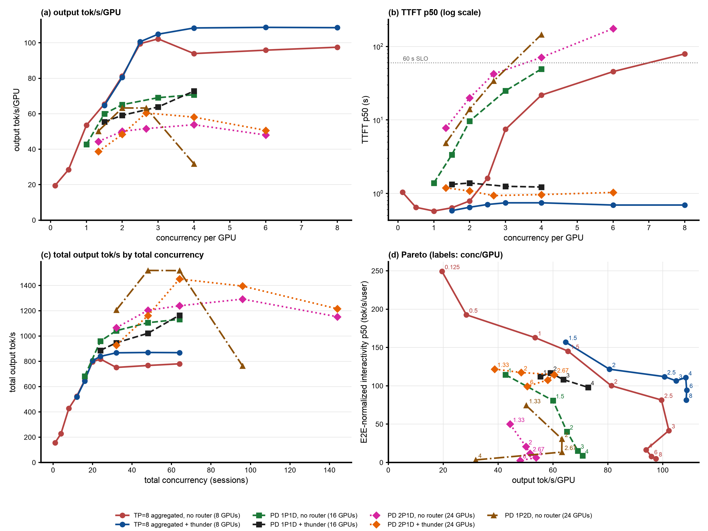

# Step 39: 1P2D GLM-5.2-NVFP4 across three 8x B200 nodes, no router (baseline)

Status: done (2026-10-25; c = 32, 48, 64, 96; c=144 not measured, see Results). Up to c=64, 1P2D gives 1.13x to 1.26x 2P1D's output on the same 24 GPUs (peak 1,519 tok/s at c=48, the highest GLM-5.2 P/D total) with lower TTFT and the highest per-user decode speed; its single prefill server is the limit and collapses at c=96 (763 tok/s, TTFT p50 145 s). Per GPU still 0.6x to 0.8x TP=8 aggregated.

## Question

Step 37's 2P1D was decode-bound (D KV 82% to 89%, 6.5 to 20 waiting) with its prefill servers nearly idle at c=32; step 35's 1P1D was prefill-bound from c=32 (P waiting 4.8 to 44, D under 3.5 waiting). Per GPU, a P/D deployment can match TP=8 aggregated only if decode GPUs are at least about 60% of the total (D output per D GPU 141 to 181 tok/s against 94 to 108 tok/s/GPU aggregated). Does 1P2D (two decode servers per prefill server, 24 GPUs), without a router or gate, get there, or does the single prefill server cap it?

## Setup

| | |
|---|---|
| Nodes | step 37's: prefill on `gw0s`, decode A on `p3mf`, decode B on `t3gv` |
| Servers | step 37's `glm52-2p1d-prefill-a` and `glm52-2p1d-decode` keep running untouched (same pods); step 37's `glm52-2p1d-prefill-b` is scaled to 0 and `glm52-1p2d-decode-b` ([`b200/vllm-glm52-1p2d-decode-b.yaml`](b200/vllm-glm52-1p2d-decode-b.yaml)), a copy of the decode server, takes `t3gv`. All three: TP=8, FP8 KV, 1M context, MTP 3, `MultiConnector` NIXL + 820 GiB CPU tier, vllm#62862 fix; `MAX_NUM_SEQS` 64 on the prefill server, 128 per decode server. Step 38's EPP `agentx-epp-g2pt` scaled to 0 |
| Routing | no router: step 37's vLLM NIXL toy proxy ([`b200/toy_proxy_server.py`](b200/toy_proxy_server.py), [`b200/pd-proxy.yaml`](b200/pd-proxy.yaml)) with one prefill server and two decode servers; a session's turns go to the same decode server (CRC32 of `X-Session-ID` modulo 2), so its history stays in that server's GPU cache and CPU tier and only the new tokens cross NIXL; every request P (`max_tokens=1`) then D |
| Client | as step 37 (AgentX `agentx-v1.0.6`, uncapped `semianalysis_cc_traces_weka_062126`, 60 min, `RESET=1`), `MODE=direct` with `SESSION_ID_HEADER=true` |
| Grid | smoke c=4 (120 s), then c = 64, 96, 32, 48, 144, one hour each (step 37's five concurrencies) |
| Runner | [`b200/run-baseline.sh`](b200/run-baseline.sh), log `b200/results/run-baseline.log`; analysis with step 37's points in `b200/results/compare/report` |

## Expectations (written before the run)

1. The single prefill server is the limit from c=32 on, as in step 35: its queue grows with the load (step 35's single P: 4.8, 19.6, 44 waiting at c = 32, 48, 64), and each decode server, with half the sessions, stays under its KV limit (KV under about 75%, few waiting).
2. Total output stays near step 35's 1P1D (1,040 to 1,130 tok/s) and below step 37's 2P1D (1,065 to 1,292): about 43 to 48 tok/s/GPU over 24 GPUs, well below TP=8 aggregated (94 to 102). The second decode server mostly idles, as the second prefill server did in step 37.
3. TTFT is higher than step 37's at the same concurrency (the prefill queue, not the decode queue, now sets it); per-user decode speed is the highest of the P/D runs (interactivity p50 above 190 tok/s), since each decode server runs fewer requests.

## Results

Status: done for c = 32, 48, 64, 96 (2026-10-25 09:21 to 16:13 UTC, same servers throughout, no restarts); **c=144 not measured**: its warmup reached 1,036 of 1,598 requests after 10,714 s (about 0.08 requests/s, the single prefill server saturated), so warmup + 60 min + grace would pass the client job's 6 h deadline, and the retry would do the same; stopped by hand at 19:15. The first runner launch stopped at the patch check (step 37's 28-hour-old pods had rotated the start-up log line; the check now compares the installed files with the ConfigMap, `b200/results/run-baseline-attempt1.log`). Smoke and all four points pass `verify-point.sh`. Report with step 37's points: [`b200/results/compare/report/summary.md`](b200/results/compare/report/summary.md). Routing check before the smoke: 8 sessions x 2 turns, 16 requests on the prefill server, 8 on each decode server.

All seven GLM-5.2 deployments, steady state; [`make_figure.py`](make_figure.py).

Steady state (requests started after minute 5), per GPU over 24 GPUs, against step 37's 2P1D at the same concurrency:

| c | arm | output tok/s/GPU (total) | TTFT p50 / p90 s | interactivity p50 / p90 | E2E-normalized interactivity p50 / p90 | E2E p90 / p99 s | turns within 60 s TTFT | completed | cancelled (no first token) |
|---|---|---|---|---|---|---|---|---|---|
| 32 | 2P1D | 44.4 (1,065) | 7.8 / 20.6 | 189 / 147 | 50.0 / 9.2 | 30 / 58 | 100% | 3,788 | 1 (0) |
| 32 | **1P2D** | **50.2 (1,205)** | **4.8 / 12.5** | **236 / 179** | **74.4 / 14.9** | 21 / 45 | 100% | 4,151 | 1 (0) |
| 48 | 2P1D | 50.1 (1,203) | 20.0 / 43.4 | 177 / 137 | 20.9 / 3.9 | 51 / 82 | 98% | 4,147 | 2 (0) |
| 48 | **1P2D** | **63.3 (1,519)** | **14.0 / 23.5** | **216 / 166** | **30.5 / 6.6** | 31 / 59 | 100% | 5,132 | 1 (0) |
| 64 | 2P1D | 51.6 (1,239) | 42.3 / 75.0 | 171 / 132 | 11.8 / 2.3 | 82 / 132 | 74% | 4,269 | 45 (38) |
| 64 | **1P2D** | **63.2 (1,517)** | **33.9 / 50.9** | **211 / 162** | **13.6 / 3.1** | 58 / 134 | 95% | 5,154 | 32 (27) |
| 96 | 2P1D | 53.8 (1,292) | 71.0 / 139 | 159 / 123 | 6.3 / 1.3 | 145 / 183 | 34% | 4,852 | 92 (76) |
| 96 | 1P2D | 31.8 (763) | 145 / 263 | 225 / 169 | 3.4 / 0.7 | 266 / 478 | 3% | 2,982 | 81 (72) |
| 144 | 2P1D | 48.0 (1,153) | 175 / 240 | 133 / 95 | 2.6 / 0.6 | 249 / 446 | 1% | 4,778 | 164 (151) |
| 144 | 1P2D | not measured (warmup too slow, see above) | | | | | | | |

Per server (steady-state averages), the session-hash split between the decode servers, NIXL into each decode server, the prefill server's prompt tokens in the hour, and cache behaviour (all servers):

| c | P waiting / running / KV | D-a waiting / running / KV | D-b waiting / running / KV | requests D-a : D-b | NIXL D-a + D-b | P prompt tokens | recompute % | prefill compute per output token |
|---|---|---|---|---|---|---|---|---|
| 32 | 3.3 / 0.7 / 52% | 0.2 / 2.2 / 34% | 0.5 / 2.8 / 44% | 46 : 54 | 63 + 79 TB | 648M | 1.2 | 4.1 |
| 48 | **14.5** / 1.2 / 79% | 0.4 / 3.2 / 40% | 1.0 / 3.5 / 54% | 46 : 54 | 103 + 154 TB | 718M | 1.4 | 4.1 |
| 64 | **44.8** / 1.3 / 77% | 0.9 / 3.4 / 47% | 0.6 / 3.5 / 41% | 46 : 54 | 116 + 129 TB | 647M | 1.9 | 5.0 |
| 96 | **111** / 1.3 / 51% | 0.1 / 1.6 / 18% | 0.3 / 1.7 / 22% | 50 : 50 | 52 + 64 TB | **304M** | **6.6** | **13.8** |

Against the other no-router arms at equal concurrency per GPU (output tok/s/GPU; `~` interpolated):

| c/GPU | 1P2D | 2P1D (step 37) | 1P1D (step 35) | TP=8 aggregated (step 25) |
|---|---|---|---|---|
| 1.33 | 50.2 | 44.4 | ~54 | ~61 |
| 2 | 63.3 | 50.1 | 65.1 | 81.3 |
| 2.67 | 63.2 | 51.6 | ~68 | ~100 |
| 4 | 31.8 | 53.8 | 70.8 | 94.0 |

- **Up to c=64, 1P2D is the best no-router P/D deployment**: 1.13x to 1.26x 2P1D's output on the same 24 GPUs with lower TTFT (4.8 to 34 s against 7.8 to 42 s), the highest per-user decode speed of any run (interactivity p50 211 to 236 tok/s) and 1.15x to 1.5x 2P1D's E2E-normalized interactivity. Its peak total, 1,519 tok/s at c=48, is the highest of any GLM-5.2 P/D run, thunder included (2P1D + thunder: 1,451). Against 1P1D at the same total concurrency it gives 1.16x to 1.37x the total output (1,205 vs 1,042, 1,519 vs 1,105, 1,517 vs 1,132) with lower TTFT (4.8 vs 9.7, 14.0 vs 24.9, 33.9 vs 49.5 s).
- **The single prefill server is the limit, and it does more work than step 35's**: it queues 3.3, 14.5, 44.8 at c = 32, 48, 64 while both decode servers stay far from their KV limit (KV 34% to 54%, under 1 waiting, 2 to 3.5 running). At c=64 it took about 30% more prompt tokens than step 35's prefill server (client input 193k against 146k tok/s), probably because two lightly loaded decode servers pull each request's KV at once, so the prefill server frees its blocks sooner (step 35's decode server was KV-bound at 5 to 6 requests). Not measured directly.
- **At c=96 the prefill server collapses**: it queues 111, processes half the prompt tokens of c=64 (304M against 647M), recompute rises to 6.6% (1.2% to 1.9% below) and prefill compute per output token to 13.8 (4 to 5 below); output drops to 763 tok/s (31.8 tok/s/GPU), TTFT p50 to 145 s, and the decode servers idle (KV about 20%). Every session's history has to stay in the one prefill server's caches (GPU pool plus 820 GiB CPU tier); at 96 sessions they no longer fit and turns re-prefill, which 2P1D (two prefill servers, half the sessions each) avoided. c=144 could not even finish its warmup in time.
- **Per GPU it still does not reach TP=8 aggregated**: 50 to 63 tok/s/GPU against 61 to 100 at equal load per GPU, about 0.6x to 0.8x, and 0.9x to 0.97x step 35's 1P1D. More decode GPUs raise P/D's output only while the prefill side keeps up.
- **Expectations**: (1) confirmed: the prefill server is the limit (from c=48) and the decode servers stay under their KV limit; (2) wrong: total output is 1,205 to 1,519 tok/s at c=32 to 64, above both 1P1D and 2P1D, not near 1P1D; only c=96 falls (763); (3) half right: per-user decode speed is the highest of the P/D runs (211 to 236), but TTFT is lower than 2P1D's up to c=64 and higher only at c=96.

## Next steps

1. **Release the 24 GPUs** unless a follow-up is wanted; manifests stay in steps 37 and 39.
2. **1P2D + thunder** (two ledger entries at 1,505,088 each; the decode profile's `max-score-picker` tie-break needs the same check as step 38's prefill profile): the gate would cap the prefill server's queue and keep the session count below the c=96 cliff.
3. **Selective P/D** (`prefix-based-pd-decider`): keep small uncached suffixes on the decode servers so only cold or long prefills reach the prefill server, the limit here.
