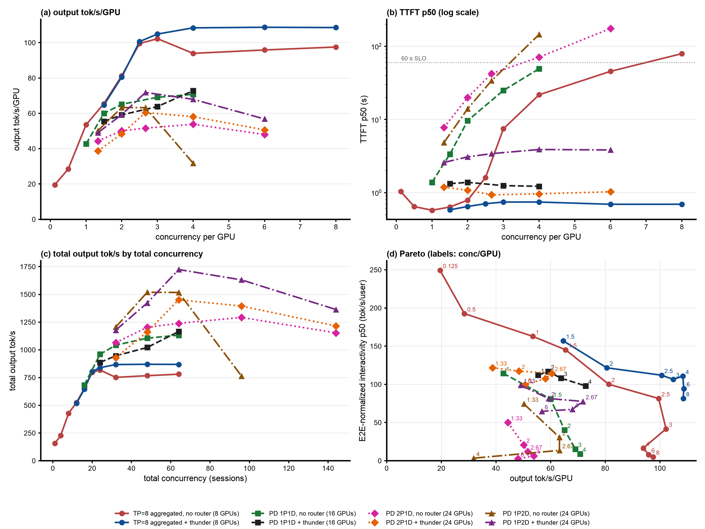

# Step 40: llm-d-thunder-agent-simplified on the GLM-5.2 1P2D servers (three 8x B200 nodes)

Status: done (2026-10-25 19:43 to 2026-10-26 05:24 UTC). The gate removes step 39's collapse (c=96: 1,630 against 763 tok/s, TTFT p50 3.9 s against 145 s; c=144 completes) and gives the best P/D result so far, 71.8 tok/s/GPU and 1,724 tok/s at c=64 (1.14x step 39, 1.12x to 1.27x 2P1D + thunder); TTFT p50 2.6 to 3.9 s, the single prefill server still the limit. Per GPU 0.52x to 0.74x TP=8 + thunder.

## Question

Step 39's no-router 1P2D was the best no-router P/D deployment up to c=64 (peak 1,519 tok/s, 63 tok/s/GPU) with both decode servers at 34% to 54% KV, but its single prefill server was the limit (44.8 waiting at c=64) and collapsed at c=96: every session's history has to stay in that one server's caches, and at about 20M tokens of working set it no longer fit (recompute 6.6%, 763 tok/s). Step 38 showed thunder holding 2P1D at TTFT ~1 s and above its baseline's throughput from c=64. Does thunder on 1P2D, with each decode server's KV pool as its capacity, cap the prefill server's queue and the session count below that cliff, and how close does it get to TP=8 aggregated per GPU?

## Setup

| | |
|---|---|
| Servers | step 39's three servers, untouched: `glm52-2p1d-prefill-a` (`gw0s`), `glm52-2p1d-decode` (`p3mf`), `glm52-1p2d-decode-b` (`t3gv`), TP=8 each, KV over cross-node NIXL/RDMA, 820 GiB CPU tier each, vllm#62862 fix |
| Router | step 38's EPP image `thunder-pd-8d1fbc87` ([zetxqx/llm-d-router#15](https://github.com/zetxqx/llm-d-router/pull/15), commit `8d1fbc87`); plugin config [`b200/thunder-pd-plugins.yaml`](b200/thunder-pd-plugins.yaml): always-disagg through the picked decode pod's llm-d disagg sidecar, thunder as flow-control saturation detector, fairness policy and decode-profile scorer; release `agentx-epp-g1p2t` ([`b200/render-epp.sh`](b200/render-epp.sh), endpoints in [`b200/epp-values-pd-thunder.yaml`](b200/epp-values-pd-thunder.yaml)) |
| Thunder | as step 38 (`capacityTokens` 1,505,088, `utilThreshold` 1.0, `idleLeaseSeconds` 10, `headWaitStarvationMs` 1800000, `evictionTtlSeconds` 3600, `defaultRequestTTL` 0). With two decode pods the ledger has two entries at 1,505,088 each (both decode servers report a 1,505,088-token GPU pool), so the gate admits about twice step 38's footprint |
| Decode placement | the gate binds a new session to a decode pod with room when it admits it, and the thunder scorer then gives that pod 1.0 for all its turns. A force-admitted session that fits no pod is left to the picker, which is `weighted-random-picker` (uniform when all scores are 0), not `max-score-picker` (step 38: its tie-break counter is shared across profiles and biased the second pick). One prefill server, so the prefill profile has no affinity scorer. Checked before the sweep through the gateway: 40 new sessions split 20 : 20 between the decode servers, and the same 40 sessions again doubled both counts exactly (40 : 40) |
| Before the sweep | step 39's no-router proxy `pd-proxy` scaled to 0: after step 39's c=144 was stopped by hand, it kept 38 orphaned prefill requests queued on the prefill server; closing its connections dropped them (prefill queue 0 at 19:43) |
| Client | as step 39 (AgentX `agentx-v1.0.6`, uncapped `semianalysis_cc_traces_weka_062126`, 60 min, `RESET=1`), `MODE=pool` (X-Session-ID sent, EPP restarted per point) |
| Grid | smoke c=4 (120 s), then c = 64, 96, 144, 32, 48, one hour each |
| Runner | [`b200/run-thunder.sh`](b200/run-thunder.sh), log `b200/results/run-thunder.log`; analysis with step 39's points in `b200/results/compare/report` |

## Expectations (written before the run)

1. The ledger has two entries (`glm52-2p1d-decode`, `glm52-1p2d-decode-b`) at 1.505088e6, and decode requests split about evenly between them. Admitted sessions stay at about 8 to 16 (twice step 38's), so the prefill server's working set stays well under the ~20M tokens where step 39 collapsed; c=96 and c=144 complete, with no collapse.
2. TTFT p50 is a few seconds or less at every load, but higher than step 38's ~1 s: the single prefill server now prefills for twice the admitted sessions and will queue at times (P waiting a few, against 14 to 111 without the gate from c=48).
3. Output throughput: about step 39's at c=32 to 64 (1,200 to 1,500 tok/s; the gate costs a little at low load as in step 38) and far above it at c=96 (763), roughly 55 to 65 tok/s/GPU flat from c=48: the best P/D per-GPU result so far, still below TP=8 + thunder (81 to 109).
4. The step 36/38 costs again: completed requests 15% to 40% shorter than step 39's, E2E p99 several times the baseline, forced admissions growing with the load.

## Results

Status: done (sweep 2026-10-25 19:43 to 2026-10-26 05:24 UTC, same servers as step 39, no restarts). Smoke and all five points pass `verify-point.sh` (job succeeded, pods unchanged, every profiling request completed, EPP scrape present, no gate warning). The ledger held exactly two entries, `bobzetian-llmd/glm52-2p1d-decode` and `bobzetian-llmd/glm52-1p2d-decode-b`, at 1.505088e6 each (smoke EPP scrape). Report with step 39's points: [`b200/results/compare/report/summary.md`](b200/results/compare/report/summary.md), ratios [`ratios.md`](b200/results/compare/report/ratios.md), gate figure [`fig5-gate.png`](b200/results/compare/report/fig5-gate.png).

All eight GLM-5.2 deployments, steady state; [`make_figure.py`](make_figure.py).

Steady state (requests started after minute 5), per GPU over 24 GPUs, against step 39's no-router 1P2D at the same concurrency:

| c | arm | output tok/s/GPU (total) | input tok/s/GPU | TTFT p50 / p90 s | E2E-normalized interactivity p50 / p90 | E2E p90 / p99 s | turns within 60 s TTFT | completed | mean ISL | cancelled (no first token) |
|---|---|---|---|---|---|---|---|---|---|---|
| 32 | no router | 50.2 (1,205) | 8,064 | 4.8 / 12.5 | 74.4 / 14.9 | 21 / 45 | 100% | 4,151 | 165k | 1 (0) |
| 32 | thunder | 49.1 (1,177) 0.98x | 7,587 | **2.6 / 9.1** | **98.8 / 24.0** | 19 / 70 | 99% | 4,143 | 155k | 4 (2) |
| 48 | no router | 63.3 (1,519) | 8,948 | 14.0 / 23.5 | 30.5 / 6.6 | 31 / 59 | 100% | 5,132 | 147k | 1 (0) |
| 48 | thunder | 59.3 (1,422) 0.94x | 7,485 | **3.1 / 16.5** | **81.5 / 15.2** | 25 / 234 | 96% | 5,105 | 124k | 9 (8) |
| 64 | no router | 63.2 (1,517) | 8,023 | 33.9 / 50.9 | 13.6 / 3.1 | 58 / 134 | 95% | 5,154 | 133k | 32 (27) |
| 64 | thunder | **71.8 (1,724) 1.14x** | 6,760 | **3.4 / 17.9** | **77.7 / 12.7** | 29 / 548 | 96% | 6,198 | 94k | 20 (18) |
| 96 | no router | 31.8 (763) | 3,763 | 145 / 263 | 3.4 / 0.7 | 266 / 478 | 3% | 2,982 | 120k | 81 (72) |
| 96 | thunder | **67.9 (1,630) 2.13x** | 5,731 | **3.9 / 22.6** | **67.2 / 10.2** | 33 / 1,307 | 94% | 6,480 | 78k | 70 (68) |
| 144 | no router | not measured (step 39: warmup too slow) | | | | | | | | |
| 144 | thunder | 56.8 (1,363) | 4,735 | 3.8 / 18.1 | 64.7 / 12.2 | 27 / 1,453 | 93% | 6,000 | 70k | 163 (162) |

Gate, router, servers (steady-state averages) and transfer:

| c | pauses | delayed dispatches | forced admissions | router wait mean / p90 s | router queue mean (max) | P waiting / running / KV | P prompt tokens | D-a / D-b running, KV | requests D-a : D-b | NIXL D-a + D-b | recompute % |
|---|---|---|---|---|---|---|---|---|---|---|---|
| 32 | 765 | 306 | 0 | 2.2 / 0.0 | 3.0 (9) | 1.3 / 0.5 / 29% | 607M | 2.7 / 2.0, 30% to 35% | 56 : 44 | 24 + 23 TB | 1.2 |
| 48 | 1,295 | 545 | 4 | 6.8 / 1.3 | 12.6 (32) | 3.9 / 0.9 / 34% | 600M | 3.7 / 2.4, 26% to 35% | 50 : 50 | 27 + 23 TB | 2.0 |
| 64 | 1,929 | 828 | 12 | 14.3 / 3.8 | 30.7 (92) | 8.2 / 1.2 / 32% | 541M | 4.2 / 3.9, 32% | 50 : 50 | 25 + 28 TB | 3.2 |
| 96 | 2,499 | 1,051 | 44 | 28.7 / 4.4 | 71.1 (137) | 18.3 / 1.4 / 35% | 459M | 4.3 / 4.1, 26% to 27% | 50 : 50 | 30 + 27 TB | 4.8 |
| 144 | 2,190 | 1,014 | 98 | 27.5 / 3.7 | 92.8 (133) | 41.0 / 1.4 / 29% | 385M | 3.5 / 3.7, 20% to 21% | 49 : 51 | 19 + 19 TB | 6.0 |

Without the gate (step 39) the prefill server queued 3.3, 14.5, 44.8, 111 at c = 32, 48, 64, 96, the decode servers ran 2 to 3.5 requests at 34% to 54% KV, and NIXL moved 142 to 257 TB per hour.

Against the other P/D thunder arms and TP=8 + thunder at equal concurrency per GPU (output tok/s/GPU; `~` interpolated):

| c/GPU | 1P2D + thunder | 2P1D + thunder (step 38) | 1P1D + thunder (step 36) | TP=8 + thunder (step 25) |
|---|---|---|---|---|
| 1.33 | 49.1 | 38.7 | n/a | n/a |
| 2 | 59.3 | 48.4 | 59.1 | 80.6 |
| 2.67 | **71.8** | 60.5 | ~62 | ~102 |
| 4 | 67.9 | 58.1 | 72.8 | 108.4 |
| 6 | 56.8 | 50.6 | n/a | 108.7 |

- **The gate removes step 39's collapse.** At c=96 output is 2.13x step 39's (1,630 against 763 tok/s), TTFT p50 3.9 s against 145 s, and 94% of turns get their first token within 60 s against 3%; c=144, which step 39 could not even warm up, completes with 1,363 tok/s and TTFT p50 3.8 s. The prefill queue stays at 1.3 to 18 up to c=96 (step 39: up to 111).
- **The best P/D result so far**: 71.8 tok/s/GPU and 1,724 tok/s total at c=64, the highest total of any GLM-5.2 P/D run and 1.14x step 39 at the same load. Against the other thunder P/D arms it gives 1.12x to 1.27x 2P1D + thunder at every concurrency on the same 24 GPUs, and about 1P1D + thunder's per-GPU output (1.0x at 2 per GPU, 0.93x at 4) with 1.5x its total.
- **TTFT p50 2.6 to 3.9 s, higher than 2P1D + thunder's ~1 s**: the single prefill server still queues (1.3 at c=32 rising to 41 at c=144) while the decode servers idle (2 to 4 requests each, KV 20% to 35%). The ledger counts only decode pods, so the gate does not see the prefill side; and it fills at about a third of the decode servers' real KV use (idle sessions inside their lease count fully).
- **Throughput still falls past c=64** (1,724, 1,630, 1,363 tok/s at c = 64, 96, 144): the prefill server's prompt tokens per hour drop (541M, 459M, 385M) and recompute rises (3.2%, 4.8%, 6.0%) as more sessions' histories compete for its caches. The gate slows the decline but does not stop it, because it admits by decode capacity.
- **Per GPU it is still 0.52x to 0.74x TP=8 + thunder** at equal load per GPU (59.3 against 80.6 at 2 per GPU, 71.8 against ~102 at 2.67, 56.8 against 108.7 at 6).
- **Costs as in steps 36 and 38, smaller at low load**: completed requests 6% to 35% shorter (mean ISL 155k to 70k against 165k to 120k), input tok/s/GPU 0.84x to 0.94x at c=32 to 64 (1.52x at c=96, where the baseline collapsed), E2E p99 1.6x to 4.1x the baseline (70 to 1,453 s), forced admissions 0 to 98.
- **Expectations**: (1) confirmed: two ledger entries at 1.505088e6, decode split 44 : 56 to 51 : 49, c=96 and c=144 complete without collapse; but throughput still falls past c=64 (recompute up to 6.0%), so the prefill server's caches are under pressure even with the gate; (2) confirmed: TTFT p50 2.6 to 3.9 s, higher than step 38's ~1 s; the prefill queue is a few up to c=64 but 18 and 41 at c=96 and 144; (3) mostly confirmed: about step 39's at c=32 to 48 (0.98x, 0.94x), above it from c=64 (1.14x, 2.13x), the best P/D per-GPU result (71.8 at c=64, above the predicted 55 to 65), still below TP=8 + thunder; (4) confirmed: requests 6% to 35% shorter, E2E p99 up to 4.1x, forced admissions growing with the load.

## Next steps

1. **Release the 24 GPUs** (three nodes) and the `agentx-epp-g1p2t` EPP unless a follow-up is wanted; manifests stay in steps 37 to 40.
2. **A prefill-aware gate or capacity**: the limit is the prefill server, which the ledger does not track. Either a capacity that reflects the prefill server (e.g. lower `capacityTokens` per decode pod so the summed admitted footprint stays under the prefill server's cache) or selective P/D (`prefix-based-pd-decider`) so admitted sessions' small suffixes prefill on the idle decode servers.
3. **Upstream**: the `max-score-picker` shared tie-break counter (step 38) and decode-only capacity under P/D are both worth issues on llm-d-router.
