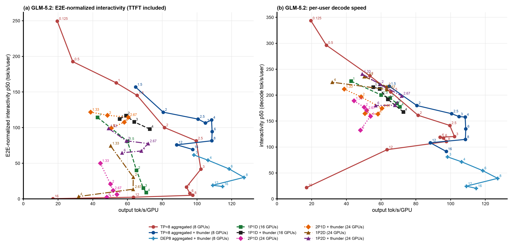
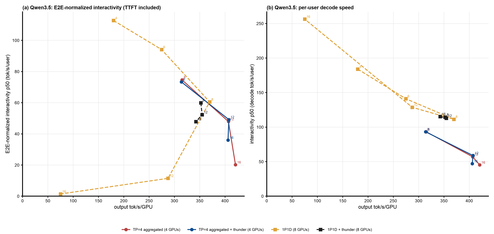
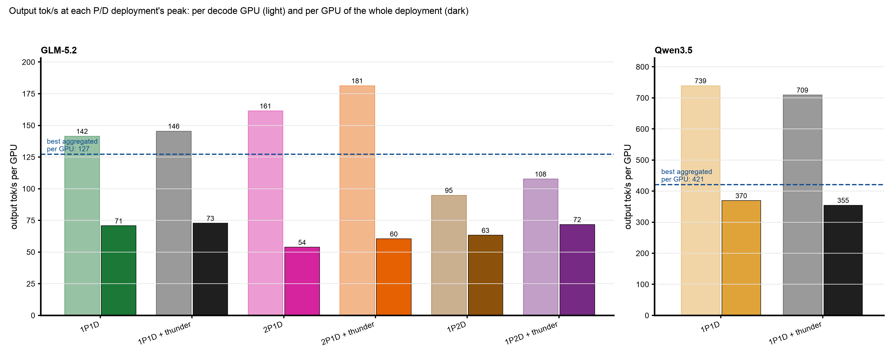

# P/D Disaggregation Against Aggregated Serving: What It Buys on This Workload

Written on 2026-10-26, covering every prefill/decode (P/D) and aggregated deployment measured in this repository: GLM-5.2-NVFP4 in steps 25, 27 and 35 to 40, Qwen3.5-397B-A17B-FP8 in steps 26, 33 and 34. All numbers are steady state (requests started after minute 5 of a 60-minute point), one point per configuration and concurrency. Figures are generated by [`make_pd_report_figures.py`](make_pd_report_figures.py) from the dashboard bundles and the step 38 and 40 summaries.

## 0. Takeaways

1. **On GLM-5.2, no P/D deployment is worth its GPUs.** The best P/D results are 72 to 73 output tok/s/GPU (1P2D + thunder, 1P1D + thunder), against 109 for TP=8 aggregated + thunder and 127 for DEP8 aggregated + thunder: 0.57x to 0.67x. Compared at equal output per GPU, aggregated serving gives the same per-user decode speed and higher E2E-normalized interactivity; every P/D point lies on or under the aggregated curves (Figure 1). P/D's faster decode is only visible when deployments are compared at equal concurrency per GPU, which is not equal cost.
2. **On Qwen3.5, P/D is competitive.** Its peak is 0.88x aggregated (370 against 421 tok/s/GPU), but at about 370 tok/s/GPU it gives 1.55x the per-user decode speed (111 against about 72 tok/s) at equal E2E-normalized interactivity (60.5 against about 59), and it reaches a high-interactivity region (E2E-normalized 94 to 113 at 180 to 275 tok/s/GPU) where no aggregated point was measured (Figure 2).
3. **Decode isolation itself works on both models.** A decode GPU produces 1.3x to 1.7x what an aggregated GPU produces on GLM-5.2 (142 to 181 against 109 tok/s) and 1.76x on Qwen3.5 (739 against 421). P/D loses or wins on whether the prefill GPUs pay for themselves: output per GPU is decode-GPU output times the decode share of the GPUs. The break-even decode share is about 60% to 77% on GLM-5.2 (against TP=8 + thunder) and 57% on Qwen3.5; the tested GLM-5.2 deployments had 33% (2P1D), 50% (1P1D) and 67% (1P2D) (Figure 3).
4. **Raising the decode share moves the limit to the prefill server, which holds every session's history.** 1P2D without a gate is the best no-router P/D deployment up to c=64 (63 tok/s/GPU) and collapses at c=96: its prefill server's working set reached about 20M tokens, more than its GPU pool and 820 GiB CPU tier hold, recompute rose to 6.6% and output fell to 763 tok/s (31.8 tok/s/GPU).
5. **The admission gate matters more than the topology.** On every topology, llm-d-thunder holds TTFT p50 at 1 to 4 s (no gate: up to 175 s) and adds throughput wherever the baseline overloads (2P1D: 1.05x to 1.17x from c=64; 1P2D: 1.14x at c=64, 2.13x at c=96). It costs the long tail: completed requests 6% to 39% shorter, E2E p99 1.6x to 7.5x, and forced admissions that grow with the load. Its ledger counts only decode pods, so it cannot see a saturated prefill server.
6. **Why GLM-5.2 loses** (Section 5): with TP=8 its MLA KV is replicated on every rank, so a decode server holds only 1.5M tokens, 5 to 8 of these 100k to 250k-token requests; always-disaggregated serving re-prefills the whole prompt on the prefill server every turn and that server must keep every session's history; each request's KV crosses NIXL eight times (165 to 219 TB per hour, not a limit); and each role takes a whole 8-GPU node, so the P:D ratio cannot be tuned finely.
7. **Recommendation.** For GLM-5.2 on this workload, serve aggregated with thunder: TP=8 at 2.5 to 4 sessions per GPU (100 to 108 tok/s/GPU, TTFT p50 0.7 s, decode 158 to 164 tok/s per user), or DEP8 when throughput matters more than per-user speed (118 to 127 tok/s/GPU at 40 to 55 tok/s per user). For Qwen3.5, P/D is worth it when per-user decode speed above about 100 tok/s is required at high load; otherwise aggregated serving gives more per GPU.

## 1. Testbed

| | |
|---|---|
| Hardware | GKE `a4-highgpu-8g` nodes (8x B200, 8 RDMA NICs each), cluster `a4-pr` |
| GLM-5.2 | `nvidia/GLM-5.2-NVFP4`, vLLM v0.31.0, FP8 KV, 1M context, MTP 3; 820 GiB CPU KV tier per server (`OffloadingConnector`); P/D through `MultiConnector` (NIXL over RDMA + the CPU tier), vllm#62862 fix; GPU KV pool 1,505,088 tokens (decode) and 1,572,864 (prefill) per TP=8 server |
| Qwen3.5 | `Qwen3.5-397B-A17B-FP8`, TP=4 servers; P/D as 1P1D of two TP=4 servers on one node |
| Workload | AgentX `agentx-v1.0.6` replaying uncapped `semianalysis_cc_traces_weka_062126` Claude Code sessions: mean input 100k to 160k tokens, median output 420 to 470 tokens, 93% to 99% prefix-cache hit (mostly from the CPU tier); 60 minutes per point, KV tiers emptied before each point |
| Metrics | output tok/s/GPU (all GPUs of the deployment); TTFT; interactivity = per-user decode speed (output tokens over decode time); E2E-normalized interactivity = output tokens over the whole request time, TTFT included |
| Gate | llm-d-thunder-agent-simplified (zetxqx/llm-d-router PR #15 for P/D): per-pod KV ledger, 10 s idle lease, 1800 s forced admission; under P/D only decode pods enter the ledger |

## 2. Deployments

| Model | Deployment | GPUs | Decode GPUs | Router | Step |
|---|---|---|---|---|---|
| GLM-5.2 | TP=8 aggregated | 8 | – | none | 25 |
| GLM-5.2 | TP=8 aggregated + thunder | 8 | – | thunder EPP | 25 |
| GLM-5.2 | DEP8 aggregated + thunder (data-parallel attention, expert parallel) | 8 | – | thunder EPP | 27 |
| GLM-5.2 | 1P1D, with and without thunder | 16 | 8 | vLLM NIXL toy proxy / thunder EPP | 35, 36 |
| GLM-5.2 | 2P1D, with and without thunder | 24 | 8 | toy proxy, prefill pinned per session / thunder EPP | 37, 38 |
| GLM-5.2 | 1P2D, with and without thunder | 24 | 16 | toy proxy, decode pinned per session / thunder EPP | 39, 40 |
| Qwen3.5 | TP=4 aggregated, with and without thunder | 4 | – | none / thunder EPP | 26 |
| Qwen3.5 | 1P1D, with and without thunder | 8 | 4 | toy proxy / thunder EPP | 33, 34 |

Every P/D deployment is always-disaggregated: each turn is prefilled on a prefill server (`max_tokens=1`) and decoded on a decode server that pulls the KV over NIXL, reusing its own cached prefix (the #62862 fix).

## 3. Peak throughput

| Model | Deployment | Peak output tok/s/GPU (total) | at c | TTFT p50 at peak | Decode tok/s per user at peak | E2E-normalized at peak |
|---|---|---|---|---|---|---|
| GLM-5.2 | **DEP8 aggregated + thunder** | **127.1** (1,017) | 64 | 1.2 s | 40 | 30 |
| GLM-5.2 | **TP=8 aggregated + thunder** | **108.7** (870) | 48 | 0.7 s | 135 | 94 |
| GLM-5.2 | TP=8 aggregated | 102.3 (818) | 24 | 7.5 s | 120 | 42 |
| GLM-5.2 | 1P1D + thunder | 72.8 (1,165) | 64 | 1.2 s | 168 | 98 |
| GLM-5.2 | 1P2D + thunder | 71.8 (1,724) | 64 | 3.4 s | 199 | 78 |
| GLM-5.2 | 1P1D | 70.8 (1,132) | 64 | 49 s | 177 | 9 |
| GLM-5.2 | 1P2D | 63.3 (1,519) | 48 | 14 s | 216 | 31 |
| GLM-5.2 | 2P1D + thunder | 60.5 (1,451) | 64 | 0.9 s | 175 | 115 |
| GLM-5.2 | 2P1D | 53.8 (1,292) | 96 | 71 s | 159 | 6 |
| Qwen3.5 | **TP=4 aggregated** | **420.6** (1,682) | 64 | 11 s | 45 | 20 |
| Qwen3.5 | TP=4 aggregated + thunder | 407.5 (1,630) | 48 | 0.9 s | 59 | 49 |
| Qwen3.5 | 1P1D | 369.7 (2,957) | 64 | 3.2 s | 111 | 61 |
| Qwen3.5 | 1P1D + thunder | 354.7 (2,838) | 96 | 4.7 s | 113 | 52 |

The P/D deployments have the largest totals because they use 2x to 3x the GPUs; per GPU, every GLM-5.2 P/D deployment is below every aggregated one.

## 4. Interactivity at equal cost

Figure 1. GLM-5.2, every deployment and concurrency: (a) E2E-normalized interactivity and (b) per-user decode speed against output tok/s/GPU (up and right is better), labelled with concurrency per GPU. Aggregated solid, P/D dashed.

Figure 2. The same for Qwen3.5 (aggregated was measured only from 8 sessions per GPU, so its curve starts at 315 tok/s/GPU).

At matched output per GPU (`~` interpolated between the two neighbouring measured points):

| Model | Output tok/s/GPU | Aggregated: decode tok/s per user / E2E-normalized | P/D: decode tok/s per user / E2E-normalized |
|---|---|---|---|
| GLM-5.2 | ~50 | TP=8, 1 per GPU (53.5): 237 / 163 | 1P2D, 1.33 per GPU (50.2): 236 / 74 |
| GLM-5.2 | ~60 | TP=8 + thunder, 1.5 per GPU (64.6): 217 / 157 | 2P1D + thunder, 2.67 per GPU (60.5): 175 / 115; 1P1D, 1.5 per GPU (60.0): 200 / 81 |
| GLM-5.2 | ~72 | TP=8 + thunder: ~200 / ~141 | 1P2D + thunder (71.8): 199 / 78; 1P1D + thunder (72.8): 168 / 98 |
| GLM-5.2 | 100 to 127 | TP=8 + thunder (100.6 to 108.7): 164 to 135 / 112 to 94; DEP8 + thunder (118 to 127): 55 to 40 / 42 to 30 | not reachable |
| Qwen3.5 | ~355 | TP=4: ~77 / ~63 | 1P1D + thunder (354.7): 113 / 52 |
| Qwen3.5 | ~370 | TP=4: ~72 / ~59 | 1P1D (369.7): 111 / 60.5 |
| Qwen3.5 | 407 to 421 | TP=4 with or without thunder: 59 to 45 / 49 to 20 | not reachable |

- **GLM-5.2**: at every output level P/D reaches, an aggregated deployment running fewer sessions per GPU gives the same decode speed per user (236 against 237 at about 50 tok/s/GPU, 199 against about 200 at 72) and 1.4x to 2.2x the E2E-normalized interactivity, because it has no prefill queue or transfer in front of the first token. Above 73 tok/s/GPU only aggregated deployments exist.
- **Qwen3.5**: at 355 to 370 tok/s/GPU P/D gives 1.47x to 1.55x the per-user decode speed of aggregated serving at equal (60.5 against about 59) or lower (52 against about 63) E2E-normalized interactivity. Aggregated serving reaches 10% to 14% more output per GPU, at 45 to 59 tok/s per user.

## 5. Where the GPUs go

Figure 3. At each P/D deployment's peak: output per decode GPU (light) and per GPU of the whole deployment (dark), against the best aggregated output per GPU (dashed).

Output per GPU = output per decode GPU x decode share of the GPUs. On GLM-5.2 a decode GPU at its best produces 142 to 181 tok/s, 1.3x to 1.7x TP=8 + thunder's 109, but the decode share is 33% to 67%, so the deployment produces 54 to 73 per GPU. Breaking even with TP=8 + thunder needs a decode share of 109 / 181 = 60% at the best decode efficiency measured (2P1D + thunder), 77% at 1P1D's; against DEP8 + thunder (127) it needs 70% to 90%. On Qwen3.5 a decode GPU produces 739, 1.76x aggregated's 421, so the break-even share is 57% and 1P1D (50%) comes close (0.88x).

1P2D shows why the decode share cannot simply be raised: with one prefill server per two decode servers, the decode servers produced only 95 to 108 tok/s per GPU because the prefill server could not feed them.

### What limited each GLM-5.2 deployment

| Deployment | Limit | Evidence (steady-state averages) |
|---|---|---|
| 1P1D | prefill server | P waiting 4.8, 19.6, 44 at c = 32, 48, 64; decode KV-bound at 5 to 6 requests (KV 74%) but under 3.5 waiting |
| 2P1D | decode server | D waiting 6.5 to 20, running 5 to 8, KV 82% to 89%; both prefill servers nearly idle at c=32 |
| 1P2D | prefill server, then its caches | P waiting 3.3, 14.5, 44.8, 111 at c = 32 to 96; decode servers at 34% to 54% KV; at c=96 recompute 6.6% and half the prompt tokens of c=64 |
| 1P1D + thunder, 2P1D + thunder | the gate | TTFT p50 0.9 to 1.4 s, prefill queue 0.1 to 6 (12 at 2P1D c=144); in 2P1D + thunder the decode server waits under about 1 at 46% to 54% KV, because the ledger counts idle sessions inside their lease at full size |
| 1P2D + thunder | prefill server (outside the gate's view) | P waiting 1.3 to 41, decode servers 20% to 35% KV; output falls past c=64 as prefill recompute rises to 6% |

### Why GLM-5.2 is a hard case for P/D

- **Small decode batches.** TP=8 replicates MLA's KV on every rank, so a decode server's GPU pool is 1.5M tokens: 5 to 8 requests of this workload's length. Aggregated TP=8 has the same pool, so P/D does not enlarge the batch; DEP8 does (its KV is split across ranks), which is why DEP8 + thunder runs about 35 requests and leads per GPU.
- **Prefill work repeated every turn.** Always-disaggregated serving prefills each turn's whole prompt on the prefill server, mostly by loading it from that server's CPU tier, and that server must hold every session's history; an aggregated server keeps each session's prefix next to its decode.
- **Redundant transfer.** Every decode rank pulls the whole replicated MLA block, so each request's KV crosses NIXL eight times: 165 to 219 TB per hour without a gate (3x to 6x less with thunder, since admitted sessions keep their KV on the decode server). The links were never the limit.
- **Coarse P:D ratios.** Each role takes a whole 8-GPU node, so the only ratios tested were 1:1, 2:1 and 1:2.

## 6. The gate on P/D

| Deployment, c | Output tok/s/GPU, gate against none | TTFT p50, gate against none | Completed requests' input, gate against none | E2E p99, gate against none |
|---|---|---|---|---|
| 1P1D, c=64 | 72.8 vs 70.8 (1.03x) | 1.2 vs 49 s | 32% shorter | 1,109 vs 153 s |
| 2P1D, c=64 | 60.5 vs 51.6 (1.17x) | 0.9 vs 42 s | 39% shorter | 552 vs 132 s |
| 2P1D, c=144 | 50.6 vs 48.0 (1.05x) | 1.0 vs 175 s | 23% shorter | 2,081 vs 446 s |
| 1P2D, c=64 | 71.8 vs 63.2 (1.14x) | 3.4 vs 34 s | 29% shorter | 548 vs 134 s |
| 1P2D, c=96 | 67.9 vs 31.8 (2.13x) | 3.9 vs 145 s | 35% shorter | 1,307 vs 478 s |
| Qwen3.5 1P1D, c=96 | 355 vs 287 (1.23x) | 4.7 vs 36 s | – | 222 vs 155 s |

The gate turns an overloaded P/D deployment's queueing into a short TTFT for admitted sessions and a long wait for held ones; it serves smaller sessions first ("a session that fits no pod does not block the others"), so part of the TTFT and interactivity gain is a shift toward shorter requests. Output tok/s compares fairly; input tok/s and the interactivity metrics do not.

## 7. Caveats

- One point per configuration and concurrency; earlier replicates in this repository varied 2% to 6% between cells.
- Nominal concurrency understates request concurrency at high load (sub-agent requests): at c=144 the 2P1D baseline averaged 206 requests in flight, the thunder arms 80 to 124. Comparisons below about c=64 are not affected much.
- The no-router P/D arms use vLLM's toy proxy with a session hash; the thunder arms use the llm-d EPP and disagg sidecar. A first 2P1D + thunder attempt routed 87% of requests to one prefill server (a shared tie-break counter in `max-score-picker`) and was discarded.
- Qwen3.5 has fewer points, and its aggregated arms start at 8 sessions per GPU.
- Not tested: selective P/D (`prefix-based-pd-decider`, prefilling small uncached suffixes on the decode server), DEP/wide-EP decode servers, P:D ratios beyond 2:1 and 1:2, heterogeneous prefill parallelism, and multi-node scale where one prefill server feeds many decode servers.

## 8. Sources

| Step | README | Content |
|---|---|---|
| 25 | [`../25-glm52-tp8-offload/`](../25-glm52-tp8-offload/) | GLM-5.2 TP=8 aggregated, with and without thunder |
| 27 | [`../27-glm52-dep8/`](../27-glm52-dep8/) | GLM-5.2 DEP8 aggregated, with thunder |
| 35, 36 | [`../35-glm52-1p1d/README.md`](../35-glm52-1p1d/README.md), [`../36-glm52-1p1d-thunder/README.md`](../36-glm52-1p1d-thunder/README.md) | GLM-5.2 1P1D, with and without thunder |
| 37, 38 | [`../37-glm52-2p1d/README.md`](../37-glm52-2p1d/README.md), [`../38-glm52-2p1d-thunder/README.md`](../38-glm52-2p1d-thunder/README.md) | GLM-5.2 2P1D, with and without thunder |
| 39, 40 | [`../39-glm52-1p2d/README.md`](../39-glm52-1p2d/README.md), [`../40-glm52-1p2d-thunder/README.md`](../40-glm52-1p2d-thunder/README.md) | GLM-5.2 1P2D, with and without thunder |
| 26 | [`../26-qwen35-tp4-thunder/`](../26-qwen35-tp4-thunder/) | Qwen3.5 TP=4 aggregated, with and without thunder |
| 33, 34 | [`../33-qwen35-1p1d-baseline/`](../33-qwen35-1p1d-baseline/), [`../34-qwen35-1p1d-thunder/`](../34-qwen35-1p1d-thunder/) | Qwen3.5 1P1D, with and without thunder |
| – | [`pd-vs-nonpd.png`](figures/pd-vs-nonpd.png) | earlier 1P1D-only version of this comparison |

Figures: `uv run summary-report/make_pd_report_figures.py <glm bundle> <qwen bundle> 38-glm52-2p1d-thunder/b200/results/compare/report/summary.csv 40-glm52-1p2d-thunder/b200/results/compare/report/summary.csv summary-report/figures`, with the bundles exported from `main`'s `dashboard/data/` (`glm52-nvfp4-8xb200.json`, `qwen35-397b-fp8-4xb200.json`).
